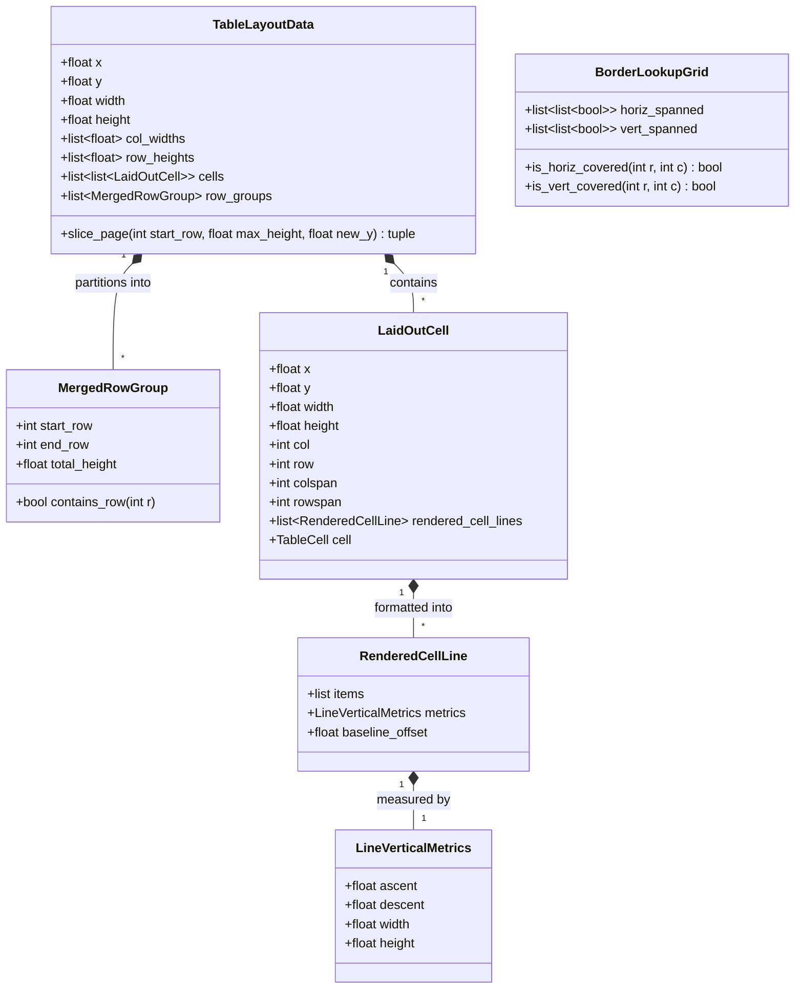

# Data Model: Table Layout, Line Metrics, and Import Fidelity

**Feature Branch**: `031-table-docx-layout-fidelity`
**Date**: 2026-10-11
**Spec**: [spec.md](spec.md)

## Overview

This document defines the data structures, geometry metrics, and entities supporting lossless table import, transitive pagination grouping, rich formula vertical metrics, and optimized border stroke generation.

---

## 1. Line Vertical Metrics (`LineVerticalMetrics`)

Represents exact typographic and stroke extents for a rendered line inside a table cell:

| Field | Type | Description |
|---|---|---|
| `ascent` | `float` | Maximum upward vertical extent from the baseline ($\max(0, -y)$). |
| `descent` | `float` | Maximum downward vertical extent below the baseline ($\max(0, y)$). |
| `width` | `float` | Total lateral width of all glyph and math strokes on the line. |
| `height` | `float` | Effective line height: $\max(\text{line\_height}, \text{ascent} + \text{descent} + \text{spacing})$. |

**Validation Rules**:
- `ascent >= 0.0`
- `descent >= 0.0`
- `width >= 0.0`
- `height >= (ascent + descent)`

---

## 2. Rendered Cell Line (`RenderedCellLine`)

Encapsulates formatted stroke elements and layout offsets for an individual line within a `TableCell`:

| Field | Type | Description |
|---|---|---|
| `items` | `list[tuple[float, list[Stroke], float]]` | Triplets of `(relative_x, strokes, advance_width)` for each token or math item. |
| `metrics` | `LineVerticalMetrics` | Vertical and lateral measurements for this line. |
| `baseline_y` | `float` | Absolute or relative Y position of the baseline within the cell. |

---

## 3. Merged Row Group (`MergedRowGroup`)

Represents the transitive closure of rows linked by one or more multi-row cells (`rowspan > 1`):

| Field | Type | Description |
|---|---|---|
| `start_row` | `int` | Lowest row index in the connected component (inclusive). |
| `end_row` | `int` | Highest row index in the connected component (inclusive). |
| `total_height` | `float` | Sum of `row_heights[start_row : end_row + 1]`. |

**Properties & Invariants**:
- All row groups in `TableLayoutData` form a contiguous partition of `0 .. num_rows - 1`.
- For any cell starting at row $r$ with span $rs$: $[r, r + rs - 1] \subseteq [\text{group.start\_row}, \text{group.end\_row}]$.
- A page slice MUST NOT split between $\text{start\_row}$ and $\text{end\_row}$ unless $\text{total\_height} > \text{max\_page\_height}$.

---

## 4. Border Lookup Grid (`BorderLookupGrid`)

An $O(1)$ query structure for generating border strokes without nested cell scans:

| Field | Type | Description |
|---|---|---|
| `num_rows` | `int` | Number of rows in table slice. |
| `num_cols` | `int` | Number of columns in table slice. |
| `horiz_spanned` | `list[list[bool]]` | `[num_rows - 1][num_cols]`: True if row boundary between $r$ and $r+1$ at column $c$ is spanned by a vertical cell merge. |
| `vert_spanned` | `list[list[bool]]` | `[num_rows][num_cols - 1]`: True if col boundary between $c$ and $c+1$ at row $r$ is spanned by a horizontal cell merge. |

---

## 5. DOCX Table Import Result

The contract returned by the import bridge:

| Field | Type | Description |
|---|---|---|
| `ok` | `bool` | True if file processed successfully. |
| `markdown_text` | `str` | Document Markdown containing preserved table pipe syntax. |
| `warnings` | `list[str]` | Human-readable warnings describing flattened merges or simplified attributes. |
| `unsupported` | `list[str]` | Specific unsupported features encountered (e.g. nested tables). |
