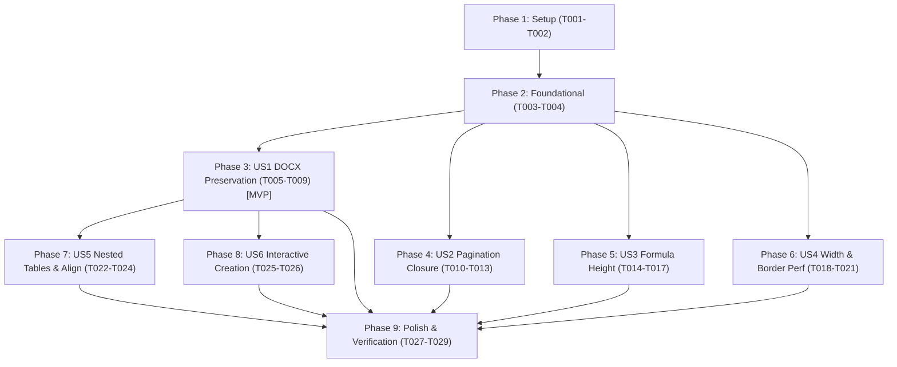

# Tasks: Table Layout and DOCX Import Fidelity

**Feature Branch**: `031-table-docx-layout-fidelity`  
**Date**: 2026-10-11  
**Spec**: [spec.md](spec.md) | **Plan**: [plan.md](plan.md)

## Phase 1: Setup (Shared Infrastructure & Test Fixtures)

**Purpose**: Test fixtures and baseline verification harnesses

- [X] T001 [P] Create DOCX test fixtures with tables, merged cells, and nested tables in `tests/fixtures/sample_table.docx` and `tests/fixtures/sample_nested_table.docx`
- [X] T002 [P] Create baseline unit test harness for table pagination and bounding box assertions in `tests/test_table_pagination_closure.py`

---

## Phase 2: Foundational (Core Metrics & Occupancy Mask Infrastructure)

**Purpose**: Core data structures and geometric lookup grids required across multiple user stories

- [X] T003 [P] Implement `LineVerticalMetrics` dataclass and metric measurement utilities in `chuviettay/layout/table_layout.py`
- [X] T004 [P] Implement `BorderLookupGrid` precomputed boolean masks for $O(1)$ border occupancy lookup in `chuviettay/layout/table_layout.py`

**Checkpoint**: Core data structures ready - user story implementations can proceed independently.

---

## Phase 3: User Story 1 - Lossless Table Preservation during Document Import and Web Editing (Priority: P1) 🎯 MVP

**Goal**: Prevent silent table omission during DOCX import in browser bridge, serialize Table blocks into clean Markdown pipe tables, and display warnings in web editor.

**Independent Test**: Import a DOCX file containing text and tables; verify all table contents appear in the editor with pipe syntax and render in live preview without dropping elements.

### Tests for User Story 1
- [X] T005 [P] [US1] Create automated regression tests reproducing table omission during DOCX import in `tests/test_docx_table_import.py`

### Implementation for User Story 1
- [X] T006 [US1] Implement `Table`-to-Markdown pipe table serialization with cell text sanitization and pipe escaping in `chuviettay/browser/bridge.py`
- [X] T007 [US1] Implement single-row table header/delimiter synthesis in `chuviettay/browser/bridge.py`
- [X] T008 [US1] Update `webapp/js/write.js` to extract and display `res.warnings` and `res.unsupported` in notification toast upon DOCX import
- [X] T009 [US1] Extend Playwright E2E test in `tests/e2e/docx-import.spec.ts` to assert table presence, headers, and cell content in editor and live SVG preview

**Checkpoint**: User Story 1 (MVP) is fully functional and independently testable. DOCX tables are never silently lost.

---

## Phase 4: User Story 2 - Safe Multi-Page Table Pagination with Merged Cells (Priority: P1)

**Goal**: Prevent bisecting multi-row merged cells (`rowspan`) across page breaks by computing transitive closure of row groups.

**Independent Test**: Paginate tables with transitive/interleaved row merges and oversized rows, verifying clean breaks at row group boundaries and closed border perimeters.

### Tests for User Story 2
- [X] T010 [P] [US2] Create automated unit tests for transitive row merge closures and oversized row pagination in `tests/test_table_pagination_closure.py`

### Implementation for User Story 2
- [X] T011 [US2] Implement transitive row group closure computation (interval union) in `TableLayoutData.slice_page()` in `chuviettay/layout/table_layout.py`
- [X] T012 [US2] Implement strict forward progression for oversized row groups when `curr_h == 0` in `TableLayoutData.slice_page()` in `chuviettay/layout/table_layout.py`
- [X] T013 [US2] Ensure outer border strokes close completely for each page slice in `generate_border_strokes()` in `chuviettay/layout/table_layout.py`

**Checkpoint**: User Story 2 complete. Tables with complex multi-row merges paginate safely across pages without severed cells or infinite loops.

---

## Phase 5: User Story 3 - Formula and Rich Inline Height Calculation in Table Cells (Priority: P1)

**Goal**: Accurately calculate formula line height (ascent + descent) in table cells using `_math_extent` and position baselines to prevent stroke collisions with cell borders.

**Independent Test**: Render table cells containing tall fractions, roots, and subscripts; verify row heights expand dynamically and strokes maintain $\ge 1\text{mm}$ clearance from borders.

### Tests for User Story 3
- [X] T014 [P] [US3] Create unit tests asserting formula stroke bounding boxes remain strictly inside cell bounds in `tests/test_table_rich_inlines.py`

### Implementation for User Story 3
- [X] T015 [US3] Update `cell_inlines_formatter` in `chuviettay/layout/engine.py` to calculate line ascent/descent from `self._math_extent` and compute effective line heights
- [X] T016 [US3] Update row height calculation in `TableLayoutEngine.layout_table()` in `chuviettay/layout/table_layout.py` to sum effective line heights plus cell padding
- [X] T017 [US3] Update cell content baseline rendering in `DocumentLayoutEngine.render()` in `chuviettay/layout/engine.py` to place baselines using line ascent and extra top padding

**Checkpoint**: User Story 3 complete. Math formulas inside cells are allocated full vertical space with zero border collision.

---

## Phase 6: User Story 4 - Robust Column Width Distribution and Token Containment (Priority: P2)

**Goal**: Safeguard column widths against unbroken wide tokens with character-level wrapping, and optimize border stroke generation to $O(R \cdot C)$.

**Independent Test**: Render narrow columns with continuous unbroken tokens (URLs, long strings) and benchmark border stroke generation on a 100x20 table.

### Tests for User Story 4
- [X] T018 [P] [US4] Create unit test for long unbroken token character-wrapping in `tests/test_table_layout.py`

### Implementation for User Story 4
- [X] T019 [US4] Implement character-level token fallback in `wrap_cell_text()` in `chuviettay/layout/table_layout.py`
- [X] T020 [US4] Enforce minimum readable column width constraints in `compute_column_widths()` in `chuviettay/layout/table_layout.py`
- [X] T021 [US4] Refactor `generate_border_strokes()` in `chuviettay/layout/table_layout.py` to query `BorderLookupGrid` in $O(1)$ per grid point

**Checkpoint**: User Story 4 complete. Unbroken tokens wrap inside cells without overflow, and border generation runs in under 10ms.

---

## Phase 7: User Story 5 - High-Fidelity Table Formatting and Structural Diagnostics (Priority: P2)

**Goal**: Preserve column alignments, extract nested table content safely, and record diagnostic warnings for unsupported structures.

**Independent Test**: Import DOCX tables with column alignments (left, center, right) and nested tables, verifying alignments in IR and warnings for nested tables.

### Tests for User Story 5
- [X] T022 [P] [US5] Create unit test for nested table extraction and column alignment preservation in `tests/test_docx_table_import.py`

### Implementation for User Story 5
- [X] T023 [US5] Implement recursive extraction of nested tables (`w:tbl`) with diagnostic warning in `chuviettay/importer/docx_importer.py`
- [X] T024 [US5] Preserve DOCX column alignments in `chuviettay/importer/docx_importer.py` and serialize them into Markdown pipe delimiter rows

**Checkpoint**: User Story 5 complete. Alignments and nested tables are preserved or cleanly surfaced to the user.

---

## Phase 8: User Story 6 - Interactive Table Creation and Grid Customization (Priority: P3)

**Goal**: Provide an interactive prompt/dialog in the web editor toolbar to insert custom tables with selectable row and column counts.

**Independent Test**: Click table button in web editor, enter custom rows and columns, verify template inserted at cursor and previewed.

### Implementation for User Story 6
- [X] T025 [P] [US6] Add table configuration modal/popover UI elements in `webapp/index.html`
- [X] T026 [US6] Implement dynamic table template generator and cursor insertion logic in `webapp/js/write.js`

**Checkpoint**: User Story 6 complete. Web users can easily insert tables of any dimensions.

---

## Phase 9: Polish & Cross-Cutting Concerns

**Purpose**: System-wide test suite verification and documentation validation

- [X] T027 [P] Run and verify complete test suite via `pytest tests/test_table_*.py tests/test_docx_*.py`
- [X] T028 Run and verify Playwright E2E suite via `npx playwright test tests/e2e/docx-import.spec.ts`
- [X] T029 Execute full quickstart validation scenarios documented in `specs/031-table-docx-layout-fidelity/quickstart.md`

---

## Dependencies & Execution Order

### Parallel Opportunities

- **Phase 1**: T001 and T002 can be run in parallel.
- **Phase 2**: T003 and T004 can be run in parallel.
- **User Stories**: Once Phase 2 is complete, US1, US2, US3, and US4 can be implemented in parallel across independent files:
  - US1 focuses on `chuviettay/browser/bridge.py` and `webapp/js/write.js`
  - US2 focuses on `chuviettay/layout/table_layout.py` (`slice_page`)
  - US3 focuses on `chuviettay/layout/engine.py` (`cell_inlines_formatter`)
  - US4 focuses on `chuviettay/layout/table_layout.py` (`wrap_cell_text`, `generate_border_strokes`)
