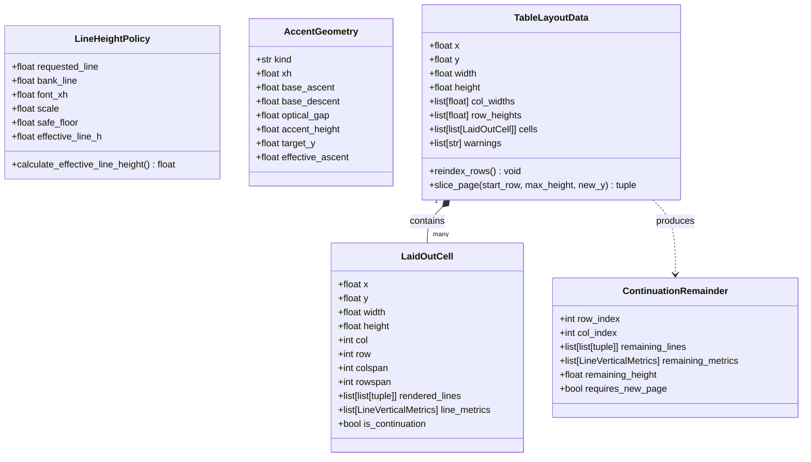

# Phase 1 Data Model: Table Pagination, Line Spacing, and Accent Hardening

**Feature**: `034-table-pagination-and-wrapping-hardening`  
**Date**: 2026-10-12  
**Status**: Completed

## 1. Entity Overview

---

## 2. Entity Specifications

### 2.1 LineHeightPolicy

Represents the physical rules and safe clamping thresholds governing baseline-to-baseline stepping in text paragraphs and table rows.

- **Attributes**:
  - `requested_line: float | None`: Raw user option from CLI / GUI / Web (`opts.line`).
  - `bank_line: float`: Default line height defined in the handwriting sample bank (`bank.d["line"]`, typically $20.0 - 24.0\text{pt}$).
  - `font_xh: float`: Effective $x$-height of current letter bank (`bank.xh`, typically $7.0 - 8.0\text{pt}$).
  - `scale: float`: Global scaling factor ($S$).
  - `safe_floor: float`: Minimum physical height required to render ascenders and descenders without overlap:
    $$\text{safe\_floor} = \max\left(1.4 \times \text{font\_xh} \times S,\; 0.65 \times \text{bank\_line} \times S\right)$$
  - `effective_line_h: float`: Final resolved baseline-to-baseline distance:
    $$\text{effective\_line\_h} = \begin{cases} 
      \text{safe\_floor} + \text{requested\_line} & \text{if } 0 < \text{requested\_line} < \text{safe\_floor} \\
      \text{requested\_line} & \text{if } \text{requested\_line} \ge \text{safe\_floor} \\
      \text{bank\_line} \times S & \text{if } \text{requested\_line is None}
    \end{cases}$$
- **Invariants**:
  - `effective_line_h > 0` and `effective_line_h >= safe_floor` for all positive user inputs.
  - Optical inter-line gap between consecutive lines is strictly greater than 0.

---

### 2.2 AccentGeometry

Represents the geometric placement parameters for mathematical accents placed on top of base symbols or expressions.

- **Attributes**:
  - `kind: str`: The accent command name (`"bar"`, `"hat"`, `"tilde"`, `"vec"`, `"dot"`, `"ddot"`).
  - `xh: float`: Effective $x$-height for math expressions (`self.xh * eff`).
  - `base_ascent: float`: Physical ascent of the base symbol (`base.size.ascent`).
  - `optical_gap: float`: Proportional clearance between the top of the base glyph and the accent stroke:
    - `"bar"`, `"overline"`: $0.08 \times xh$
    - `"hat"`, `"widehat"`: $0.06 \times xh$
    - `"tilde"`, `"widetilde"`: $0.06 \times xh$
    - `"vec"`: $0.10 \times xh$
    - `"dot"`, `"ddot"`: $0.08 \times xh$
  - `accent_height: float`: Bounding height of the accent vector polyline:
    - `"bar"`: $0.16 \times xh$ (polyline drawn at mid-height)
    - `"hat"`: $0.28 \times xh$
    - `"tilde"`: $0.24 \times xh$
    - `"vec"`: $0.35 \times xh$
  - `target_y: float`: Top coordinate for accent stroke positioning:
    $$y_0 = -(base\_ascent + optical\_gap + accent\_height)$$
  - `effective_ascent: float`: Bounded ascent metric reported to parent layout:
    $$\text{effective\_ascent} = base\_ascent + optical\_gap + accent\_height$$
- **Invariants**:
  - For single lowercase variable bases (e.g. $\bar{x}, \hat{x}$), $\text{effective\_ascent} \le 1.30 \times xh$.
  - Accent stroke points do not bleed into neighboring line baselines.

---

### 2.3 TableLayoutData & LaidOutCell Updates

- **`TableLayoutData.reindex_rows()`**:
  - Synchronizes all cells in `self.cells` such that for every cell at grid position `[r][c]`, `cell.row == r`.
  - Re-evaluates active spans across continuation rows to maintain accurate `BorderLookupGrid` coordinates.
- **`LaidOutCell`**:
  - `rendered_lines: list[list[tuple[float, list[Stroke], float]]]`: Bundles of strokes per text line within the cell.
  - `line_metrics: list[LineVerticalMetrics]`: Ascent, descent, and line height metrics.
  - `is_continuation: bool`: Flag indicating whether this cell represents a continuation from a previous page.

---

### 2.4 ContinuationRemainder

Represents unrendered lines and metrics deferred when an individual row or cell is truncated by printable page margins.

- **Attributes**:
  - `row_index: int`: Index of the table row containing unrendered lines.
  - `col_index: int`: Column index of the overflowing cell.
  - `remaining_lines: list[list[tuple[float, list[Stroke], float]]]`: Lines not yet drawn.
  - `remaining_metrics: list[LineVerticalMetrics]`: Corresponding vertical metrics for deferred lines.
  - `remaining_height: float`: Calculated vertical height required for the deferred content.
- **Usage**:
  - When `render()` halts emission at `line_bottom_y > max_page_y`, remaining lines are bundled into `ContinuationRemainder` and passed to the next page's slice rather than dropped.
