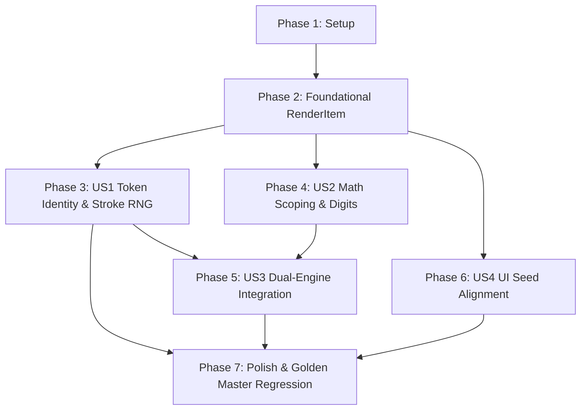

# Tasks: Ổn định Dòng kết xuất và Tính tái lập Hạt giống (Render Pipeline Seed Stability)

**Input**: Design documents from `specs/037-render-pipeline-seed-stability/` (`spec.md`, `plan.md`, `data-model.md`, `contracts/`, `research.md`, `quickstart.md`)  
**Status**: Ready for Implementation  
**Total Tasks**: 30 tasks across 7 phases  

---

## Phase 1: Setup (Baseline Check & Test Infrastructure)

**Purpose**: Xác minh môi trường thực thi hiện tại và chuẩn bị khung kiểm thử tích hợp trước khi thay đổi mã nguồn.

- [x] T001 Chạy kiểm thử đường chuẩn baseline qua lệnh `pytest tests/test_golden_master_real_path.py tests/test_seed_lifecycle.py tests/test_stable_variants.py`
- [x] T002 [P] Chuẩn bị hàm trợ giúp trích xuất nét vẽ XML theo từng token từ tệp `.xopp` phục vụ kiểm thử tích hợp trong `tests/test_stable_variants.py`

---

## Phase 2: Foundational (RenderItem Definition & Compatibility)

**Purpose**: Xây dựng cấu trúc dữ liệu nền tảng `RenderItem` - điều kiện tiên quyết cho toàn bộ pipeline dòng và bảng.

**⚠️ CRITICAL**: Các user story liên quan đến pipeline kết xuất phụ thuộc trực tiếp vào lớp `RenderItem`.

- [x] T003 [P] Cài đặt lớp `RenderItem` với `slots=True`, `__iter__` (hỗ trợ unpacking) và `__getitem__` (tương thích chỉ số tuple) trong `chuviettay/layout/engine.py` theo hợp đồng `CTR-037-RENDER-ITEM-METADATA.md`
- [x] T004 [P] Viết bộ unit test kiểm chứng thuộc tính, giải nén tuple, và truy cập chỉ số của `RenderItem` trong `tests/test_render_item.py`

**Checkpoint**: Lớp `RenderItem` sẵn sàng - có thể bắt đầu triển khai các user story.

---

## Phase 3: User Story 1 - Bảo tồn định danh Token và Ngẫu nhiên hình học cục bộ trong Pipeline (Priority: P1) 🎯 MVP

**Goal**: Giữ nguyên danh tính token (`RenderItem`) qua các dòng văn bản và ô bảng; neo ngẫu nhiên hình học nét chữ (`geom_rng`) vào `(token, occurrence)` thay vì `it_idx`; triệt tiêu trôi dạt sóng dòng vĩ mô (`slope=0, amp=0, xo=start_x`) khi `stable_variants=True` theo hợp đồng `CTR-037-STABLE-STROKE-GEOMETRY.md`; giới hạn bộ đếm occurrence theo khối văn bản để chống xáo trộn liên đoạn.

**Independent Test**: Kết xuất văn bản có `stable_variants=True` và `jitter=1.0`; chèn thêm từ vào đầu câu; xác minh 100% nét vẽ của các từ cũ giữ nguyên tọa độ tương đối và góc xoay (delta = 0).

### Tests for User Story 1
> **NOTE: Viết test trước để tái hiện lỗi, bảo đảm test ĐỎ trên mã nguồn hiện tại**

- [x] T005 [P] [US1] Viết bài kiểm thử tích hợp qua `write_text` với `jitter=1.0` chứng minh lỗi chèn từ làm đổi nét cũ (test ĐỎ) trong `tests/test_stable_variants.py`

### Implementation for User Story 1

- [x] T006 [US1] Cập nhật `_layout_inlines` trong `chuviettay/layout/engine.py`: sinh đối tượng `RenderItem` với bộ đếm `occurrence` và `token_id` có phạm vi theo từng khối
- [x] T007 [US1] Cập nhật `render_paragraph_inlines` trong `chuviettay/layout/engine.py`: lưu giữ `cur_line` là `list[RenderItem]` và truyền trực tiếp vào `_render_text_line`, loại bỏ hoàn toàn dòng mã nén `render_items = [(start, st, w) for ...]`
- [x] T008 [US1] Cập nhật `_render_text_line` trong `chuviettay/layout/engine.py`: khi `stable_variants=True`, neo `geom_rng` vào `(item.token, item.occurrence)` thay vì `it_idx`, đặt `slope=0.0, amp=0.0, xo=start_x`; giữ nguyên 100% luồng gọi `self.rnd` khi `stable_variants=False`
- [x] T009 [US1] Cập nhật `cell_inlines_formatter` và nhánh render ô bảng trong `chuviettay/layout/engine.py` và `chuviettay/layout/table_layout.py` sử dụng `RenderItem` và bảo toàn metadata qua các trang
- [x] T010 [US1] Chạy `pytest tests/test_stable_variants.py -k test_render_pipeline_prepend_invariance_with_jitter` và xác minh test chuyển từ ĐỎ sang XANH

**Checkpoint**: User Story 1 hoàn thành độc lập, giải quyết dứt điểm lỗi lớn nhất của `stable_variants` trên đường kết xuất thực tế.

---

## Phase 4: User Story 2 - Ngữ cảnh Hạt giống Độc lập cho Chữ số và Công thức Toán học (Priority: P1)

**Goal**: Cô lập ngữ cảnh hạt giống toán học trong `MathLayoutEngine`, thiết lập ngữ cảnh `_current_tok` và `_current_k` trong `Writer.number()`, và đồng bộ hóa tuyệt đối giữa bước đo thử `_scratch()` và bước kết xuất thực tế theo hợp đồng `CTR-037-MATH-RNG-SCOPING.md`.

**Independent Test**: Đặt cùng công thức toán `$x = 123.45$` sau hai đoạn văn khác nhau; xác minh hình thái chữ số và khoảng cách số hoàn toàn trùng khớp 100%.

### Tests for User Story 2

- [x] T011 [P] [US2] Viết test kiểm chứng tính độc lập của khoảng cách chữ số trong công thức toán học đối với từ văn bản đứng trước trong `tests/test_stable_variants.py`

### Implementation for User Story 2

- [x] T012 [US2] Cập nhật `Writer.number()` trong `chuviettay/model/writer.py`: khi `self.stable_variants=True`, tự động thiết lập `self._current_tok = s`, `self._current_k = k_idx`, `self._char_idx = 0`, `self.last = {}`
- [x] T013 [US2] Cập nhật `MathLayoutEngine._scratch()` trong `chuviettay/layout/math_layout.py`: đồng bộ cấu hình `Writer`, sao chép trạng thái bộ đếm token khi `stable_variants=True`
- [x] T014 [US2] Cập nhật `render_math_block` và `render_math_inline` trong `chuviettay/layout/engine.py`: cô lập seed và writer riêng cho từng công thức toán, không làm rò rỉ bộ đếm sang văn bản thường
- [x] T015 [US2] Chạy `pytest tests/test_stable_variants.py -k test_math_digits_context_independence` và xác minh test XANH

**Checkpoint**: User Story 2 hoàn thành độc lập, mọi công thức toán học đạt tính tất định và không bị rò rỉ trạng thái.

---

## Phase 5: User Story 3 - Kiểm thử Tích hợp Tính Tái lập Toàn diện trên Cả Hai Engine (Priority: P2)

**Goal**: Bổ sung kiểm thử tự động chứng minh tái lập XML byte-exact trên `FidelityLayoutEngine` với `seed_used`, đồng bộ hóa ngẫu nhiên hình học nét chữ của `FidelityLayoutEngine` với bộ đếm token, và kiểm tra tài liệu phức tạp hỗn hợp.

**Independent Test**: Kết xuất tệp Word (.docx) ở chế độ fidelity với `seed=None`; lấy `seed_used` kết xuất lại; so sánh mã băm SHA-256 trùng khớp 100%.

### Tests for User Story 3

- [x] T016 [P] [US3] Viết bài kiểm thử tự động tái lập bit-exact cho `FidelityLayoutEngine` qua `WriteResult.seed_used` trong `tests/test_seed_lifecycle.py`
- [x] T017 [P] [US3] Viết bài kiểm thử tích hợp đa trang chứa đồng thời văn bản thường, bảng biểu và công thức toán học với `stable_variants=True` trong `tests/test_stable_variants.py`

### Implementation for User Story 3

- [x] T018 [US3] Cập nhật `chuviettay/fidelity/engine.py`: theo dõi bộ đếm occurrence của token và sử dụng `ScopedRNG(self.effective_seed, "tok", w_tok, occ, "geom")` khi `stable_variants=True`
- [x] T019 [US3] Chạy `pytest tests/test_seed_lifecycle.py` và xác minh toàn bộ các test tái lập trên cả Semantic và Fidelity Engine đều XANH

**Checkpoint**: User Story 3 hoàn thành, tính tái lập bit-exact được chứng minh trên toàn bộ hệ thống engine.

---

## Phase 6: User Story 4 - Đồng bộ Hiển thị Seed và Phản hồi Giao diện Người dùng (Priority: P2)

**Goal**: Hiển thị tập trung `seed_used` trong `write_report_lines()`, dọn dẹp in lặp trên CLI, bổ sung checkbox `stable_variants` trong Desktop GUI (`write_tab.py`), và bổ sung nhãn báo lỗi trực quan phòng thủ `#opt-seed-error` trên Web Client theo hợp đồng `CTR-037-UI-SEED-ALIGNMENT.md`.

**Independent Test**: Kiểm tra báo cáo kết quả Desktop GUI và CLI hiển thị `Seed đã dùng: ...`; kiểm tra nhập seed sai trên Web hiển thị nhãn báo lỗi và xóa khi nhập đúng.

### Tests for User Story 4

- [x] T020 [P] [US4] Viết unit test cho hàm `write_report_lines()` khi `result.seed_used is not None` trong `tests/test_formatting.py`
- [x] T021 [P] [US4] Viết test kiểm tra checkbox `stable_variants` và truyền tham số vào `WriteOptions` trong Desktop GUI tại `tests/test_letter_gui_cli.py`

### Implementation for User Story 4

- [x] T022 [US4] Cập nhật `write_report_lines()` trong `chuviettay/formatting.py`: tự động bổ sung `"Seed đã dùng: %d (chạy lại với --seed %d để có đúng kết quả này)"` khi `result.seed_used is not None`
- [x] T023 [US4] Dọn dẹp `chuviettay/cli.py`: xóa đoạn mã `print(f"Seed đã dùng: ...")` riêng lẻ tại dòng 128-129 để tránh in lặp 2 lần trên terminal
- [x] T024 [US4] Cập nhật tab Viết trong `chuviettay/view/write_tab.py`: thêm biến `self.v_stable_variants` và checkbox "Kiểu chữ ổn định khi chỉnh sửa (stable_variants)", truyền vào `WriteOptions`
- [x] T025 [P] [US4] Cập nhật `webapp/index.html`: thêm phần tử `

` dưới ô `#opt-seed`
- [x] T026 [US4] Cập nhật `setupOptionsModal()` trong `webapp/js/write.js`: lắng nghe sự kiện nhập liệu với cơ chế phòng thủ DOM, hiển thị cảnh báo lỗi trực quan khi seed sai và ẩn khi hợp lệ
- [x] T027 [US4] Chạy `pytest tests/test_formatting.py` và `node --test tests/test_web_parse_seed.test.mjs`, xác minh XANH 100%

**Checkpoint**: User Story 4 hoàn thành, giao diện người dùng trên mọi nền tảng hoàn toàn đồng bộ và minh bạch.

---

## Phase 7: Polish, Documentation & Regression Verification

**Purpose**: Hoàn thiện tài liệu kỹ thuật, bảo đảm tuân thủ Hiến chương, và kiểm chứng chống thoái lui trên toàn bộ hệ thống.

- [x] T028 [P] Cập nhật docstring trong `chuviettay/model/rng.py`: phân định rõ cam kết 100% bit-exact trong cùng runtime CPython và cam kết tương đương phân phối thống kê giữa các nền tảng khác biệt
- [x] T029 Chạy `pytest tests/test_golden_master_real_path.py` xác minh 100% mã băm SHA-256 của chế độ mặc định (`stable_variants=False`) không bị thay đổi từng byte
- [x] T030 Chạy toàn bộ test suite dự án (`pytest`) xác minh mọi kiểm thử vượt qua thành công không có lỗi hoặc cảnh báo

---

## Dependencies & Execution Order

### Phase Dependencies

- **Setup (Phase 1)**: Không phụ thuộc - thực thi ngay lập tức.
- **Foundational (Phase 2)**: Phụ thuộc vào Phase 1 - **BLOCKS** toàn bộ User Story 1, 2, 3, 4.
- **User Story 1 (Phase 3 - P1)**: Phụ thuộc vào Phase 2 (`RenderItem`). Có thể tiến hành độc lập.
- **User Story 2 (Phase 4 - P1)**: Phụ thuộc vào Phase 2 (`RenderItem`). Có thể tiến hành song song với US1 hoặc nối tiếp.
- **User Story 3 (Phase 5 - P2)**: Phụ thuộc vào hoàn thành US1 và US2 (thừa hưởng logic pipeline hoàn chỉnh).
- **User Story 4 (Phase 6 - P2)**: Có thể tiến hành sau Phase 2 (giao diện và định dạng báo cáo).
- **Polish (Phase 7)**: Phụ thuộc vào hoàn thành toàn bộ các User Story.

### User Story Completion Graph

---

## Parallel Opportunities

- **Trong Phase 2**: `T003` (`RenderItem` implementation) và `T004` (unit test `test_render_item.py`) có thể viết song song theo phong cách TDD.
- **Giữa các User Story**: Sau khi hoàn thành Phase 2, `User Story 1` (Pipeline), `User Story 2` (Math layout) và `User Story 4` (UI & Báo cáo) hoàn toàn có thể triển khai song song trên các tệp mã nguồn độc lập.
- **Trong Phase 6**: Công việc trên Desktop GUI (`T024`) và Web Client (`T025`, `T026`) chạy hoàn toàn song song trên 2 ngăn xếp công nghệ độc lập (Python/Tkinter và HTML/JS).

---

## Implementation Strategy

### MVP First (User Story 1 Only)
1. Hoàn thành Phase 1 & Phase 2: Nền tảng `RenderItem`.
2. Hoàn thành Phase 3: User Story 1 (Khôi phục danh tính token trong pipeline, triệt tiêu drift sóng dòng vĩ mô).
3. **DỪNG VÀ KIỂM CHỨNG**: Chạy `test_render_pipeline_prepend_invariance_with_jitter` - MVP hoàn thành giá trị cốt lõi giải quyết lỗi lớn nhất của `stable_variants`.

### Incremental Delivery
1. Giao User Story 1 (Chỉnh sửa văn bản và ô bảng không bị đổi nét).
2. Giao User Story 2 (Chữ số và công thức toán học không bị ảnh hưởng bởi đoạn văn trước).
3. Giao User Story 3 (Kiểm thử tích hợp song song cả 2 Engine).
4. Giao User Story 4 (Giao diện Desktop GUI có checkbox, Web có cảnh báo lỗi, CLI in gọn gàng).
5. Nghiệm thu Phase 7 (Golden master không đổi 1 byte, toàn bộ test suite xanh).
