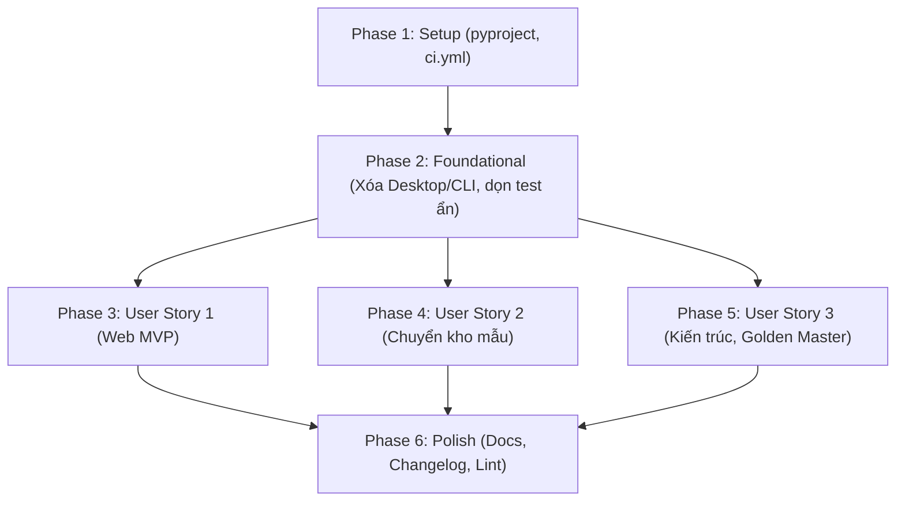

# Tasks: Chuyển sang sản phẩm chỉ có Web — Loại bỏ ứng dụng Desktop & CLI

**Feature**: `038-web-only-remove-desktop`  
**Plan**: [plan.md](./plan.md) | **Spec**: [spec.md](./spec.md)  
**Status**: Ready for Implementation  

---

## Phase 1: Setup (Cấu hình dự án & Môi trường CI)

**Purpose**: Cấu hình dự án và môi trường CI chuyển sang Web-Only, loại bỏ các phụ thuộc đóng gói desktop.

- [X] T001 Cập nhật `pyproject.toml` để loại bỏ mục `[project.scripts]` (`hw-note`, `hw-gui`) và gỡ `pyinstaller>=6` khỏi `[project.optional-dependencies] dev`
- [X] T002 [P] Cập nhật `.github/workflows/ci.yml` để loại bỏ bước cài đặt `python3-tk xvfb` trong job `test-core` và đổi lệnh chạy `pytest` bỏ wrapper `xvfb-run -a`
- [X] T003 [P] Xóa bỏ tệp `requirements-build.txt` chứa phụ thuộc đóng gói PyInstaller

---

## Phase 2: Foundational (Loại bỏ các tệp Desktop, CLI và dọn dẹp liên kết ẩn)

**Purpose**: Gỡ bỏ dứt điểm mã nguồn Desktop/CLI, cấu hình đóng gói PyInstaller và dọn sạch các liên kết import ẩn trong bộ test lõi.

**⚠️ CRITICAL**: Không được bắt đầu thực hiện User Stories cho đến khi Phase 2 hoàn tất và toàn bộ mã nguồn Desktop đã bị gỡ sạch.

- [X] T004 Xóa toàn bộ thư mục giao diện Desktop `chuviettay/view/` (toàn bộ 8 tệp: `__init__.py`, `app_window.py`, `bank_tab.py`, `dialogs.py`, `teach_tab.py`, `theme.py`, `word_canvas.py`, `write_tab.py`)
- [X] T005 [P] Xóa các điểm vào Desktop và CLI ở thư mục gốc và chuviettay: `chuviettay/gui.py`, `chuviettay/cli.py`, `chuviettay/__main__.py`, `hw_gui.py`, `hw_note.py`
- [X] T006 [P] Xóa các tệp kịch bản và cấu hình đóng gói Desktop: `hw_gui.spec`, `build_windows.bat`, `build_linux_mac.sh`
- [X] T007 [P] Dọn dẹp mã chết và `sys.frozen` trong `chuviettay/paths.py` (loại bỏ `load_user_config()`, `save_user_config()`, `user_config_path()`, và nhánh `sys.frozen`)
- [X] T008 [P] Cập nhật tài liệu docstring trong `chuviettay/__init__.py` phản ánh kiến trúc Web-Only
- [X] T009 [P] Dọn dẹp fixtures Tkinter trong `tests/conftest.py` (loại bỏ `is_tk_usable()`, `tk_root`, `_safe_gui_dialogs`, đoạn lọc marker gui)
- [X] T010 Xóa 7 tệp kiểm thử thuần Desktop và CLI: `tests/test_gui.py`, `tests/test_gui_document.py`, `tests/test_gui_resilience.py`, `tests/test_theme.py`, `tests/test_word_canvas.py`, `tests/test_cli.py`, `tests/test_cli_format.py`
- [X] T011 [P] Dọn dẹp liên kết test ẩn trong `tests/test_logging.py` (loại bỏ hàm `test_report_error_with_no_log_path`) và `tests/test_teach_geometry.py` (loại bỏ hàm `test_view_reexport_matches`)
- [X] T012 [P] Dọn dẹp liên kết test ẩn trong `tests/test_paths_logging.py` (loại bỏ hàm `test_duong_dan_mac_dinh_khi_da_dong_goi_dung_thu_muc_cua_file_exe`) và `tests/test_txt_unified_pipeline.py` (viết lại `test_cli_write_txt_file_uses_document_ir` sang dùng `AppController.write_document()`)
- [X] T013 [P] Di chuyển các bài test ghép chữ và thống kê từ `tests/test_letter_gui_cli.py` sang `tests/test_formatting.py` và `tests/test_letter_assembly.py`, sau đó xóa `tests/test_letter_gui_cli.py`
- [X] T014 [P] Đổi tên `tests/test_web_cli_parity.py` thành `tests/test_web_controller_parity.py` và cập nhật docstring / biến tham chiếu để phản ánh bản chất parity giữa BrowserBridge và AppController

**Checkpoint**: Nền tảng sạch sẽ — không còn bất kỳ tệp Desktop/CLI nào trong repository, các bài test lõi không còn import gãy.

---

## Phase 3: User Story 1 - Người dùng dùng toàn bộ sản phẩm qua Web (Priority: P1) 🎯 MVP

**Goal**: Web Client hoạt động đầy đủ 100% 3 luồng Viết chữ, Dạy chữ, Kho mẫu; build tĩnh sạch sẽ và kiểm thử E2E xanh mà không cần bất kỳ thành phần Desktop nào.

**Independent Test**: Trên bản Web đã build, chạy `npm test` và `python scripts/build_web.py` thành công; các bài test Playwright (`write.spec.ts`, `teach.spec.ts`, `bank.spec.ts`) đều PASS.

- [X] T015 [US1] Chạy đóng gói Web Client tĩnh sạch vào `webapp/dist/` bằng `python scripts/build_web.py`
- [X] T016 [P] [US1] Chạy kiểm thử tính toàn vẹn bản phân phối tĩnh trong `tests/test_build_web.py` đảm bảo không có file cấm hoặc tệp Desktop nào lọt vào dist
- [X] T017 [P] [US1] Chạy kiểm thử môi trường Pyodide Node.js trong `tests/browser/test_bridge_no_tkinter.mjs` xác nhận `BrowserBridge` không import `tkinter` hay các module đã gỡ bỏ
- [X] T018 [US1] Chạy kiểm thử Playwright E2E cho 3 luồng Web (`npx playwright test tests/e2e/write.spec.ts tests/e2e/teach.spec.ts tests/e2e/bank.spec.ts`)

**Checkpoint**: User Story 1 (MVP) hoàn tất — sản phẩm Web hoạt động độc lập và hoàn hảo không cần Desktop.

---

## Phase 4: User Story 2 - Người dùng Desktop cũ chuyển kho mẫu sang Web (Priority: P1)

**Goal**: Người dùng có sẵn tệp kho mẫu cá nhân `.json.gz` từ phiên bản Desktop nạp vào Web Client nguyên vẹn 100% mẫu chữ, chữ cái, số, dấu câu, và hồ sơ cỡ tay.

**Independent Test**: Nạp tệp `tests/data/kho_mau_tong_hop.json.gz` qua Web Client API (`bridge.load_bank()`) và UI, thống kê ký tự và mẫu khớp 100% với tệp gốc.

- [X] T019 [US2] Kiểm tra và xác nhận tính tương thích schema v1, v2, v3 trong `tests/test_bank_export_roundtrip.py` và `tests/test_schema.py` khi nạp qua `BrowserBridge.load_bank()`
- [X] T020 [P] [US2] Chạy kiểm thử Playwright E2E nhập kho mẫu trong `tests/e2e/bank.spec.ts` xác nhận luồng nạp tệp kho mẫu cá nhân hoạt động chính xác trong giao diện Web

**Checkpoint**: User Story 2 hoàn tất — bảo đảm an toàn dữ liệu 100% cho người dùng Desktop cũ chuyển sang Web.

---

## Phase 5: User Story 3 - Nhà phát triển duy trì một giao diện duy nhất (Priority: P2)

**Goal**: Kho mã sạch bóng mọi tham chiếu tới Desktop và CLI; test kiến trúc trở thành tường lửa cấm Tkinter vĩnh viễn; bộ test lõi chạy xanh và 100% Golden Master trùng khớp từng byte.

**Independent Test**: `tests/test_architecture.py` và `tests/test_golden_master_real_path.py` PASS; tìm kiếm toàn repo không còn tham chiếu tới GUI/CLI ngoài changelog và lịch sử specs.

- [X] T021 [US3] Cập nhật thông điệp người dùng trong `chuviettay/formatting.py:50` (hàm `write_report_lines`) loại bỏ câu nhắc CLI và `--seed`; đồng thời cập nhật assertion trong `tests/test_formatting.py`
- [X] T022 [US3] Khẳng định bất khả xâm phạm Golden Master: Xác nhận chuỗi chú thích trong `chuviettay/layout/engine.py:1063` và hằng số XML trong `chuviettay/model/xopp.py` giữ nguyên văn để bảo toàn mã băm SHA-256
- [X] T023 [US3] Cập nhật `tests/test_architecture.py`: Thiết lập quy tắc cấm 100% `tkinter` trên toàn bộ repository và assert các module `chuviettay.view`, `chuviettay.gui`, `chuviettay.cli` không tồn tại
- [X] T024 [P] [US3] Chạy kiểm thử Golden Master trong `tests/test_golden_master_real_path.py` và `scripts/test_golden_pyodide.mjs` xác nhận 100% mã băm SHA-256 trùng khớp từng byte
- [X] T025 [P] [US3] Chạy toàn bộ test suite lõi không cần Tkinter/xvfb: `python -m pytest tests/ -k "not web and not browser and not benchmark" -vv --timeout=30`

**Checkpoint**: User Story 3 hoàn tất — toàn bộ bài kiểm tra kiến trúc và kiểm thử lõi chạy xanh 100% trong môi trường thuần headless.

---

## Phase 6: Polish & Cross-Cutting Concerns

**Purpose**: Cập nhật tài liệu, hướng dẫn chuyển đổi, changelog và kiểm tra toàn diện trước khi bàn giao.

- [X] T026 [P] Cập nhật `README.md` loại bỏ toàn bộ hướng dẫn cài đặt/chạy Desktop Tkinter và CLI; đặt Web Client làm giao diện duy nhất; bổ sung mục "Chuyển đổi từ bản Desktop cũ sang Web Client"
- [X] T027 [P] Cập nhật `CHANGELOG.md` ghi nhận việc loại bỏ Desktop & CLI như một breaking change trong phiên bản mới
- [X] T028 Chạy kiểm tra lint toàn diện với `ruff check .`
- [X] T029 Chạy toàn bộ quy trình kiểm chứng `specs/038-web-only-remove-desktop/quickstart.md` để xác nhận lần cuối

---

## Dependencies & Execution Order

### Phase Dependencies

- **Phase 1 (Setup)**: Có thể bắt đầu ngay.
- **Phase 2 (Foundational)**: Phụ thuộc vào Phase 1 — **Khóa chặn toàn bộ User Stories** cho đến khi hoàn thành.
- **Phase 3 (User Story 1 - P1)**: Có thể bắt đầu ngay sau Phase 2.
- **Phase 4 (User Story 2 - P1)**: Có thể bắt đầu song song với US1 sau Phase 2.
- **Phase 5 (User Story 3 - P2)**: Có thể bắt đầu sau Phase 2; phụ thuộc vào việc dọn dẹp xong mã chết và test ẩn.
- **Phase 6 (Polish)**: Phụ thuộc vào cả 3 User Stories hoàn tất.

---

## Parallel Opportunities

- **Trong Phase 1**: T002 (`ci.yml`) và T003 (`requirements-build.txt`) có thể chạy song song.
- **Trong Phase 2**: T005, T006, T007, T008, T009, T011, T012, T013, T014 có thể thực thi độc lập song song sau khi xóa thư mục `view/` (T004).
- **Trong Phase 3**: T016 (`test_build_web.py`) và T017 (`test_bridge_no_tkinter.mjs`) có thể chạy song song sau khi T015 hoàn tất.
- **Trong Phase 5**: T024 (Golden Master) và T025 (Core test suite) có thể chạy song song.
- **Trong Phase 6**: T026 (`README.md`) và T027 (`CHANGELOG.md`) có thể thực thi song song.

---

## Implementation Strategy (Chiến lược triển khai)

1. **MVP First (User Story 1)**:
   - Hoàn thành Phase 1 + Phase 2 (gỡ sạch Desktop/CLI và dọn test ẩn).
   - Đóng gói bản Web tĩnh và chạy E2E tests (Phase 3).
   - Kiểm chứng Web Client chạy độc lập 100%.
2. **Bảo toàn dữ liệu (User Story 2)**:
   - Kiểm tra luồng nhập kho mẫu `.json.gz` cũ (Phase 4).
3. **Chuẩn hóa kiến trúc & Golden Master (User Story 3)**:
   - Dọn dẹp thông điệp trong `formatting.py` và bảo vệ chuỗi Golden Master trong `engine.py`.
   - Cài đặt tường lửa cấm Tkinter trong `test_architecture.py`.
4. **Hoàn thiện & Bàn giao (Phase 6)**:
   - Cập nhật tài liệu, changelog và chạy quickstart.
