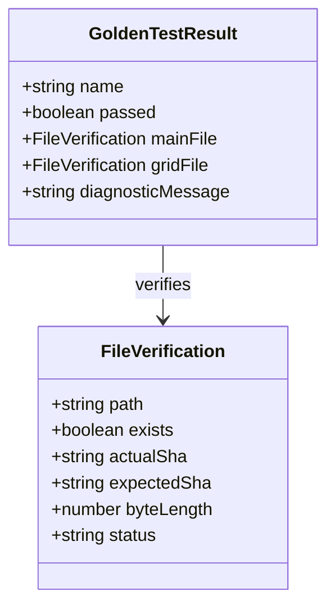
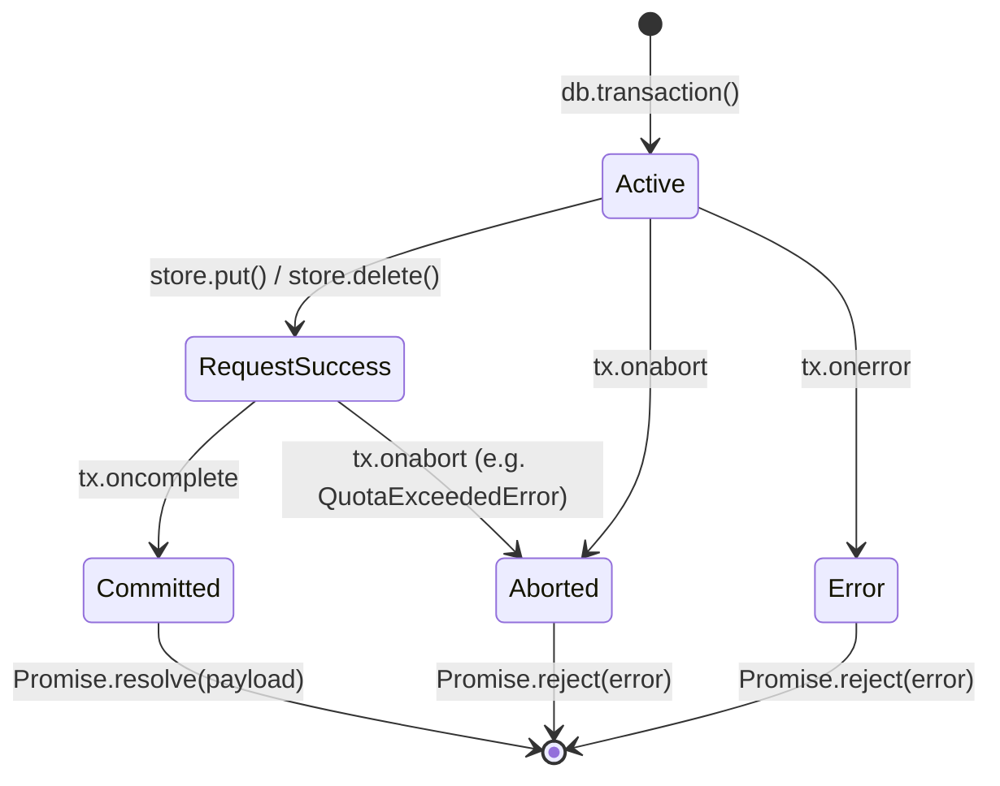

# Data Model: CI Pyodide Hardening, Storage Transactions & Worker Lifecycle

**Feature**: `041-ci-pyodide-storage-hardening`  
**Date**: 2026-10-16  
**Status**: Completed  

---

## 1. Thực thể Kết quả Kiểm thử Golden Master (`GoldenTestResult`)

Thực thể đại diện cho kết quả kiểm tra từng ca Golden Master trong môi trường Pyodide (`scripts/test_golden_pyodide.mjs`).



### Các trường thuộc tính:
- **`name`** (string): Tên ca kiểm thử (ví dụ: `markdown_list`, `co_ban`, `strict_case`, `math`, v.v.).
- **`passed`** (boolean): `true` khi và chỉ khi cả tệp chính và tệp phụ (nếu có yêu cầu) đều tồn tại và có mã băm SHA-256 khớp 100% với chuẩn kỳ vọng.
- **`mainFile`** (`FileVerification`):
  - `path`: Đường dẫn ảo trong hệ thống tệp Pyodide (ví dụ: `/tmp/golden_run/markdown_list.xopp`).
  - `exists`: Tệp có tồn tại trên đĩa hay không.
  - `actualSha`: Chuỗi hex SHA-256 của tệp được kết xuất.
  - `expectedSha`: Chuỗi hex SHA-256 trong từ điển chuẩn `GOLDEN_REAL`.
  - `byteLength`: Kích thước tệp tính bằng byte.
  - `status`: `'MATCH'` | `'MISMATCH'` | `'MISSING'`.
- **`gridFile`** (`FileVerification | null`):
  - Thông tin kiểm tra tệp lưới luyện viết `_thieu.xopp`. Nếu ca kiểm thử không yêu cầu lưới phụ, trường này có giá trị `null` hoặc status là `'SKIPPED'`.
- **`diagnosticMessage`** (string): Thông điệp chẩn đoán chi tiết được in ra console nếu ca kiểm thử thất bại.

---

## 2. Thực thể Giao dịch Lưu trữ Trình duyệt (`StorageTransaction`)

Mô hình hóa vòng đời của giao dịch IndexedDB đảm bảo tính nguyên tử (atomic) và bền vững (durable).



### Các trạng thái và thuộc tính:
- **`db`** (`IDBDatabase`): Thao tác kết nối cơ sở dữ liệu `chuviettay_web`.
- **`storeNames`** (string | string[]): Tên object store (`profiles`, `app_settings`).
- **`mode`** (`IDBTransactionMode`): `'readonly'` hoặc `'readwrite'`.
- **`status`**:
  - `Active`: Giao dịch đang nhận các thao tác.
  - `Committed`: Giao dịch đã hoàn tất và ghi bền vững xuống đĩa (`tx.oncomplete`). Chỉ tại trạng thái này, Promise ghi dữ liệu mới được phép `resolve`.
  - `Aborted`: Giao dịch bị hủy ngang (`tx.onabort`), bắt buộc kích hoạt `reject`.
  - `Error`: Giao dịch phát sinh lỗi (`tx.onerror`), bắt buộc kích hoạt `reject`.

---

## 3. Thực thể Khóa Hợp tác Dự phòng (`CooperativeLockRecord`)

Lưu trữ trong store `app_settings` với key `_lock_${profileId}` khi trình duyệt không hỗ trợ `navigator.locks`.

| Thuộc tính | Kiểu dữ liệu | Mô tả |
| :--- | :--- | :--- |
| `key` | `string` | Định danh khóa, có tiền tố `_lock_` (ví dụ: `_lock_default_profile`). |
| `ownerId` | `string` | Định danh ngẫu nhiên của tab đang giữ khóa (`tabId`). |
| `acquiredAt` | `number` | Dấu thời gian Unix millisecond thời điểm cấp khóa. |
| `expiresAt` | `number` | Dấu thời gian hết hạn hợp đồng thuê khóa (`acquiredAt + 5000ms`). Tránh trường hợp tab bị đóng đột ngột làm treo khóa mãi mãi. |

### Quy tắc chuyển đổi trạng thái khóa:
1. **Xin khóa**:
   - Đọc bản ghi `_lock_${profileId}`.
   - Nếu bản ghi chưa tồn tại HOẶC `expiresAt < Date.now()` (khóa cũ đã hết hạn): Ghi đè bản ghi mới với `ownerId = currentTabId`, `expiresAt = Date.now() + 5000`. Cấp quyền thực thi tác vụ.
   - Nếu bản ghi đang tồn tại và chưa hết hạn: Chờ theo chu kỳ (50ms) kèm exponential jitter; thử lại tối đa 3000ms. Nếu quá 3000ms, ném lỗi `LockAcquisitionTimeoutError`.
2. **Giải phóng khóa**:
   - Đọc bản ghi khóa: nếu `ownerId === currentTabId`, xóa bản ghi khỏi `app_settings`.

---

## 4. Thực thể Bản ghi Hồ sơ Kho mẫu Đồng bộ (`SyncProfileRecord`)

Bản ghi đại diện cho một hồ sơ kho mẫu chữ trong store `profiles`.

```json
{
  "id": "default_profile",
  "name": "Kho của tôi",
  "data": [31, 139, 8, ...],
  "teach_count_since_backup": 5,
  "updated_at": 1776348123456
}
```

- **`id`** (`string`, Primary Key): Định danh hồ sơ duy nhất.
- **`name`** (`string`): Tên hiển thị người dùng đặt.
- **`data`** (`Array<number>` | `Uint8Array`): Khối nhị phân nén `.json.gz` của kho mẫu.
- **`teach_count_since_backup`** (`number`): Số lượng mẫu đã dạy kể từ lần sao lưu/xuất kho gần nhất (để kích hoạt toast nhắc sao lưu khi >= 20).
- **`updated_at`** (`number`): Dấu thời gian Unix millisecond chính xác khi transaction lưu thành công. Biến `localSyncedTimestamp` của tab phải nhận đúng giá trị này sau khi `saveProfile` trả về.

---

## 5. Thực thể Quản lý Yêu cầu Worker Chờ xử lý (`WorkerPendingRequest`)

Được lưu trong bộ nhớ luồng chính (`pendingRequests: Map<number, WorkerPendingRequest>`).

| Thuộc tính | Kiểu dữ liệu | Mô tả |
| :--- | :--- | :--- |
| `id` | `number` | Định danh tự tăng của yêu cầu (ví dụ: `1, 2, 3...`). |
| `method` | `string` | Tên phương thức gọi Worker (ví dụ: `render`, `sync_save`, `import_docx`, v.v.). |
| `params` | `object` | Tham số truyền vào phương thức. |
| `timeoutTimer` | `number \| Timeout` | Mã định danh timer hủy yêu cầu khi quá hạn (timeout). |
| `createdAt` | `number` | Dấu thời gian khi yêu cầu được khởi tạo. |
| `resolve` | `Function` | Hàm giải quyết Promise khi nhận phản hồi thành công từ Worker. |
| `reject` | `Function` | Hàm từ chối Promise khi quá hạn hoặc Worker báo lỗi. |
