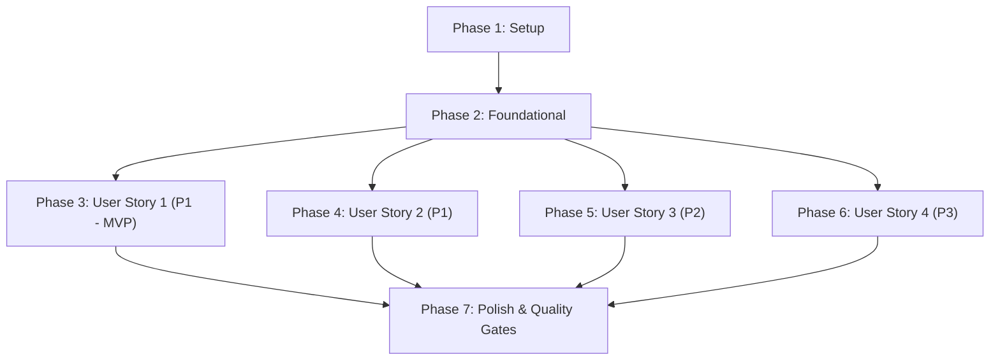

# Tasks: Khắc phục CI Pyodide Golden Master, An toàn Giao dịch Lưu trữ & Cứng hóa Worker

**Feature**: `041-ci-pyodide-storage-hardening`  
**Input**: [plan.md](plan.md), [spec.md](spec.md), [data-model.md](data-model.md), [contracts/](contracts/), [research.md](research.md), [quickstart.md](quickstart.md)  
**Status**: Ready for Implementation  

---

## Phase 1: Setup (Shared Infrastructure)

**Purpose**: Chuẩn bị môi trường kiểm thử và công cụ giả lập kiểm thử IndexedDB cho Node.js

- [x] T001 Rà soát cấu hình Node.js Pyodide và các lệnh npm test trong `scripts/test_golden_pyodide.mjs` và `package.json`
- [x] T002 [P] Xây dựng bộ giả lập IndexedDB tối giản (Mock IDB) cho môi trường `node --test` trong `tests/js/helpers/mock_idb.mjs`

---

## Phase 2: Foundational (Blocking Prerequisites)

**Purpose**: Xây dựng hạ tầng wrapper transaction bền vững trước khi chỉnh sửa các thao tác lưu trữ

- [x] T003 Xây dựng hàm tiện ích thực thi giao dịch bền vững `executeTransaction` bảo toàn lỗi `QuotaExceededError` trong `webapp/js/storage.js`

---

## Phase 3: User Story 1 - Khôi phục và Cứng hóa Kiểm tra Golden Master trên Pyodide (Priority: P1) 🎯 MVP

**Goal**: Khôi phục CI xanh 100% cho bước Verify Golden Master in Pyodide (`scripts/test_golden_pyodide.mjs`), phân định rõ ràng chẩn đoán tệp chính `.xopp` và tệp lưới phụ `_thieu.xopp`.

**Independent Test**: Chạy `node scripts/test_golden_pyodide.mjs`, xác nhận toàn bộ 8 ca kiểm thử vượt qua với mã thoát `0`.

### Implementation for User Story 1

- [x] T004 [US1] Bổ sung `missing_grid=True` vào lời gọi `ctl_l.write_document` cho ca `markdown_list` trong `scripts/test_golden_pyodide.mjs`
- [x] T005 [US1] Tái cấu trúc mô hình dữ liệu `test_results` trong Pyodide Python runtime thành cấu trúc phân định rõ tệp chính và tệp phụ trong `scripts/test_golden_pyodide.mjs`
- [x] T006 [US1] Cải tiến vòng lặp chẩn đoán JavaScript in thông tin kích thước, mã băm thực tế và kỳ vọng độc lập theo `golden-test-contract.md` trong `scripts/test_golden_pyodide.mjs`
- [x] T007 [US1] Xác thực toàn bộ 8 ca Golden Master chạy thành công qua lệnh `node scripts/test_golden_pyodide.mjs`

**Checkpoint**: User Story 1 hoàn tất — CI bước Verify Golden Master in Pyodide hoàn toàn phục hồi xanh 100% (MVP sẵn sàng).

---

## Phase 4: User Story 2 - Bảo vệ Tính toàn vẹn Giao dịch Lưu trữ Kho mẫu & Đồng bộ Đa tab (Priority: P1)

**Goal**: Đảm bảo các thao tác ghi dữ liệu kho mẫu và cài đặt chỉ xác nhận khi transaction commit thành công (`tx.oncomplete`), bắt đúng lỗi `QuotaExceededError`, triệt tiêu lệch dấu thời gian, và hỗ trợ fallback tuần tự hóa khi thiếu Web Locks.

**Independent Test**: Chạy `npm run test:unit` với các ca kiểm thử trong `tests/js/storage.test.mjs` và chạy kiểm thử đa tab `npx playwright test tests/e2e/multitab.spec.ts`.

### Tests for User Story 2

- [x] T008 [P] [US2] Xây dựng bộ kiểm thử đơn vị cho commit transaction, bắt lỗi `QuotaExceededError`, và tính toàn vẹn dấu thời gian trong `tests/js/storage.test.mjs`

### Implementation for User Story 2

- [x] T009 [US2] Chuyển đổi `saveProfile`, `setSetting`, và `deleteProfile` sang dùng `executeTransaction` chờ `tx.oncomplete` trong `webapp/js/storage.js`
- [x] T010 [US2] Đồng bộ hóa dấu thời gian: cập nhật `saveProfile` trả về bản ghi lưu trữ cuối cùng và gán `localSyncedTimestamp = savedProfile.updated_at` trong `syncAndSaveActiveProfile` tại `webapp/js/storage.js`
- [x] T011 [US2] Triển khai cơ chế khóa dự phòng kết hợp in-memory Promise queue và Optimistic Concurrency Control (OCC qua kiểm tra `expectedUpdatedAt`) trong `webapp/js/storage.js`
- [x] T012 [P] [US2] Bổ sung kịch bản kiểm thử Playwright E2E mô phỏng môi trường không có Web Locks (`navigator.locks = undefined`) trong `tests/e2e/multitab.spec.ts`
- [x] T013 [US2] Xác thực kiểm thử đơn vị lưu trữ và kiểm thử E2E đa tab bằng cách chạy `npm run test:unit` và `npx playwright test tests/e2e/multitab.spec.ts`

**Checkpoint**: User Story 2 hoàn tất — Lớp lưu trữ IndexedDB đạt độ bền vững tối đa, loại bỏ hoàn toàn nguy cơ mất dữ liệu và xung đột đa tab.

---

## Phase 5: User Story 3 - Cứng hóa Vòng đời Yêu cầu Web Worker & Chẩn đoán Nạp Thư viện DOCX (Priority: P2)

**Goal**: Bổ sung timeout cho `sendWorkerMessage`, xử lý sự kiện `worker.onerror`/`worker.onmessageerror`, và cơ chế fail-fast khi tải wheel DOCX lười trong Worker.

**Independent Test**: Chạy `npm run test:unit` với bộ kiểm thử trong `tests/js/worker_resilience.test.mjs`.

### Tests for User Story 3

- [x] T014 [P] [US3] Xây dựng bộ kiểm thử đơn vị mô phỏng Worker timeout, loại bỏ phản hồi muộn, và xử lý `worker.onerror` trong `tests/js/worker_resilience.test.mjs`

### Implementation for User Story 3

- [x] T015 [US3] Bổ sung tham số `timeoutMs` (mặc định 60000ms), bộ hẹn giờ dọn dẹp `pendingRequests`, và cơ chế loại bỏ phản hồi muộn trong `sendWorkerMessage` tại `webapp/js/app.js`
- [x] T016 [US3] Đăng ký trình lắng nghe `worker.onerror` và `worker.onmessageerror` để reject toàn bộ yêu cầu đang chờ và cập nhật trạng thái lỗi phục hồi trong `webapp/js/app.js`
- [x] T017 [US3] Bổ sung kiểm tra nghiêm ngặt `resp.ok` khi fetch wheel tải lười DOCX và ném lỗi HTTP chi tiết trong `webapp/js/worker/py-worker.js`
- [x] T018 [US3] Xác thực khả năng phục hồi của Worker và cơ chế nạp wheel bằng cách chạy `npm run test:unit`

**Checkpoint**: User Story 3 hoàn tất — Ứng dụng không bao giờ bị treo vô tận khi Worker gặp sự cố, thông báo lỗi tải wheel rõ ràng.

---

## Phase 6: User Story 4 - Chuẩn hóa Xử lý DOM Bảng Ký hiệu & Đồng bộ Tài liệu Phiên bản (Priority: P3)

**Goal**: Loại bỏ việc nội suy chuỗi thô vào `innerHTML` trong bảng ký hiệu LaTeX, và đồng bộ hóa tài liệu `README.md` với ma trận kiểm thử CI thực tế.

**Independent Test**: Chạy `npm run test:unit` cho kiểm tra DOM và kiểm tra tính nhất quán giữa `README.md` và `.github/workflows/ci.yml`.

### Tests for User Story 4

- [x] T019 [P] [US4] Xây dựng bộ kiểm thử đơn vị kiểm tra an toàn DOM (không innerHTML injection) khi hiển thị bảng ký hiệu LaTeX trong `tests/js/latex_modal.test.mjs`

### Implementation for User Story 4

- [x] T020 [US4] Tái cấu trúc hàm `loadLatexSymbols` sử dụng `document.createElement`, `textContent`, và `container.replaceChildren()` trong `webapp/js/write.js`
- [x] T021 [P] [US4] Cập nhật thông tin ma trận phiên bản Python trong `README.md` đồng bộ chuẩn xác với cấu hình CI
- [x] T022 [US4] Xác thực an toàn DOM và tính nhất quán tài liệu bằng cách chạy `npm run test:unit`

**Checkpoint**: User Story 4 hoàn tất — Tiêu chuẩn an toàn DOM được áp dụng triệt để, tài liệu phản ánh chính xác 100% cấu hình CI.

---

## Phase 7: Polish & Cross-Cutting Concerns

**Purpose**: Kiểm tra toàn diện chuỗi chất lượng của repository trước khi sẵn sàng bàn giao

- [x] T023 [P] Chạy kiểm tra quy chuẩn mã nguồn Python bằng Ruff qua lệnh `ruff check .`
- [x] T024 [P] Chạy xác thực biên dịch bytecode Python qua lệnh `python -m compileall -q .`
- [x] T025 Chạy toàn bộ 1235+ kiểm thử lõi Python qua lệnh `python -m pytest -vv -s --timeout=60 -m "not benchmark"`
- [x] T026 Xây dựng bản phân phối Web Client dist qua lệnh `python scripts/build_web.py`
- [x] T027 Chạy toàn bộ kịch bản kiểm thử trong `quickstart.md` (`node scripts/test_golden_pyodide.mjs`, `npm run test:unit`, `npm run test:browser`, `npx playwright test`)

---

## Dependencies & Execution Order

### Phase Dependencies



### User Story Dependencies
- **User Story 1 (P1 - MVP)**: Độc lập 100%, có thể triển khai và xác nhận ngay lập tức bằng `node scripts/test_golden_pyodide.mjs`.
- **User Story 2 (P1)**: Phụ thuộc `executeTransaction` ở Phase 2, độc lập với US1, US3, US4.
- **User Story 3 (P2)**: Độc lập với US1, US2, US4.
- **User Story 4 (P3)**: Độc lập với US1, US2, US3.

### Parallel Opportunities

- **Trong Setup & Foundational**: `T002` có thể làm song song với `T001`.
- **Trong User Story 2**: `T008` (viết test) và `T012` (E2E no-locks) có thể chuẩn bị song song với `T009`, `T010`, `T011`.
- **Trong User Story 3**: `T014` (viết test) có thể viết song song với `T015`, `T016`, `T017`.
- **Trong User Story 4**: `T019` (test DOM) và `T021` (README) có thể làm song song với `T020`.
- **Trong Polish**: `T023`, `T024` có thể chạy song song.

---

## Parallel Example: User Story 2

```bash
# Nhánh kiểm thử (viết trước để kiểm chứng lỗi hiện tại):
Task: "Xây dựng bộ kiểm thử đơn vị cho commit transaction trong tests/js/storage.test.mjs" (T008)
Task: "Bổ sung kịch bản kiểm thử Playwright E2E không có Web Locks trong tests/e2e/multitab.spec.ts" (T012)

# Nhánh mã nguồn triển khai:
Task: "Chuyển đổi saveProfile, setSetting, deleteProfile sang dùng executeTransaction trong webapp/js/storage.js" (T009)
Task: "Đồng bộ hóa dấu thời gian localSyncedTimestamp = savedProfile.updated_at trong webapp/js/storage.js" (T010)
Task: "Triển khai cơ chế khóa dự phòng OCC trong webapp/js/storage.js" (T011)
```

---

## Implementation Strategy

### MVP First (User Story 1 Only)
1. Hoàn thành `Phase 1` (Setup).
2. Hoàn thành `Phase 3` (User Story 1 - Khôi phục CI Pyodide Golden Master).
3. Chạy `node scripts/test_golden_pyodide.mjs` để xác nhận 8/8 tests PASS với mã thoát `0`.
4. **Xác nhận MVP**: CI job Pyodide đã xanh trở lại ngay từ bước đầu tiên!

### Incremental Delivery
1. Setup + Foundational -> Nền tảng vững chắc (`T001` - `T003`).
2. Triển khai US1 -> Khôi phục CI Golden Master (`T004` - `T007`).
3. Triển khai US2 -> Cứng hóa lưu trữ IndexedDB & Đồng bộ đa tab (`T008` - `T013`).
4. Triển khai US3 -> Cứng hóa Web Worker & Bắt lỗi tải wheel DOCX (`T014` - `T018`).
5. Triển khai US4 -> Chuẩn hóa an toàn DOM bảng ký hiệu LaTeX & Cập nhật README (`T019` - `T022`).
6. Chạy toàn bộ Quality Gates (Polish) -> Đảm bảo 100% CI xanh tuyệt đối trước khi bàn giao (`T023` - `T027`).
