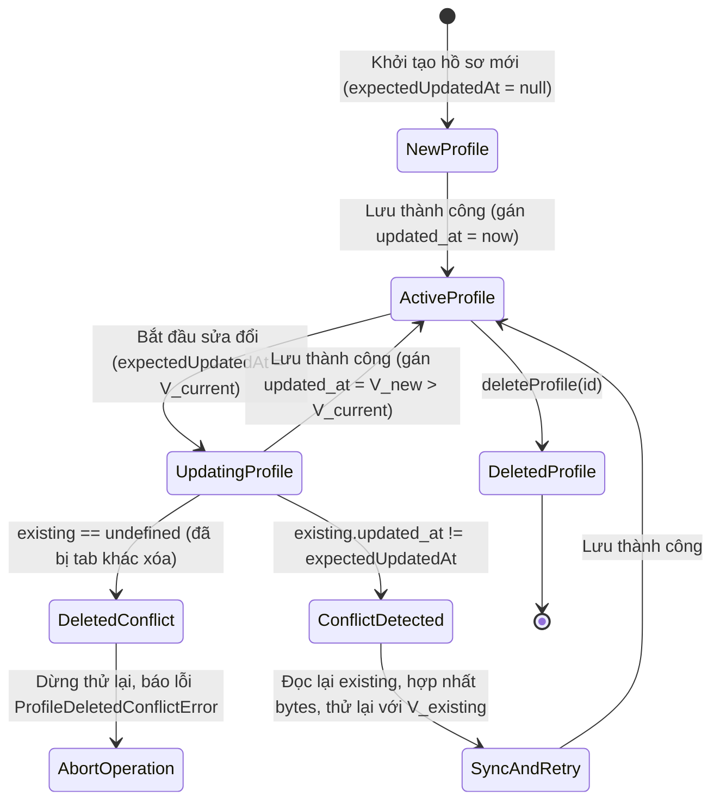
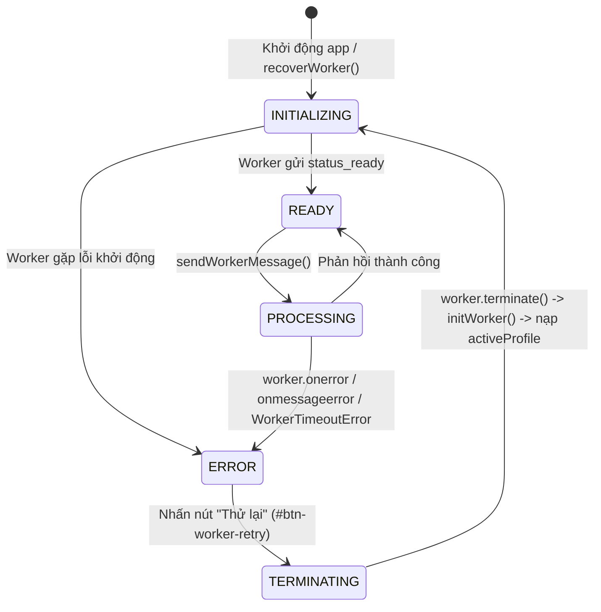
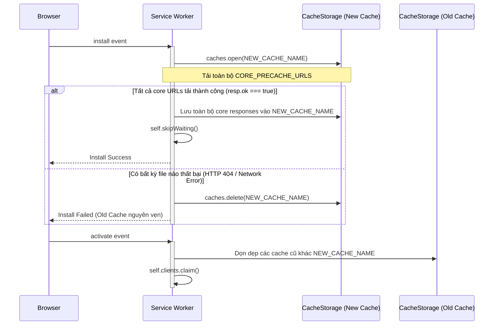

# Data Model: Feature 042 (Concurrency, Worker Session & Offline Cache)

**Feature Branch**: `042-sync-concurrency-worker-recovery`  
**Date**: 2026-10-17

---

## 1. Concurrency Control State Model

Quản lý phiên bản và tính nguyên tử khi ghi hồ sơ trong `IndexedDB` (`profiles` store).

### ConcurrencyExpectation
Đặc tả điều kiện phiên bản khi gọi `saveProfile(profile, expectedUpdatedAt)`:

| Trạng thái | Kiểu dữ liệu `expectedUpdatedAt` | Quy tắc kiểm tra đối với bản ghi hiện có (`existing`) | Hành vi khi vi phạm |
| :--- | :--- | :--- | :--- |
| **Existing Version** | `number` (epoch ms) | Bắt buộc `existing !== undefined` VÀ `existing.updated_at === expectedUpdatedAt` | Ném `DOMException("...", "ConcurrencyConflictError")` |
| **Non-existence (New)**| `null` | Bắt buộc `existing === undefined` (chưa từng tồn tại) | Ném `DOMException("...", "ConcurrencyConflictError")` |
| **Unconditional Write**| `undefined` | Bỏ qua kiểm tra phiên bản (ghi đè trực tiếp) | Không ném lỗi xung đột phiên bản |

### State Transitions (Profile Concurrency)

---

## 2. Worker Lifecycle & Session Model

Quản lý phiên làm việc của Web Worker trong `webapp/js/app.js`.

### WorkerSession
- **`generation`** (`number`): Mã thế hệ của Worker, tăng dần mỗi khi Worker được tạo hoặc phục hồi (`1, 2, ...`). Dùng để vô hiệu hóa các thông điệp muộn từ Worker cũ.
- **`status`** (`string`): Trạng thái hoạt động của Worker:
  - `"UNINITIALIZED"`: Chưa khởi tạo.
  - `"INITIALIZING"`: Đang tải Pyodide và cài đặt core packages.
  - `"READY"`: Đã sẵn sàng xử lý yêu cầu.
  - `"ERROR"`: Đang ở trạng thái lỗi nghiêm trọng (`onerror`, `onmessageerror`, hoặc timeout).
  - `"TERMINATED"`: Đã bị chấm dứt.
- **`pendingRequests`** (`Map<number, PendingRequest>`):
  - `id`: Định danh yêu cầu.
  - `method`: Tên phương thức gọi (`render`, `sync_save`, etc.).
  - `timer`: Bộ đếm thời gian timeout (mặc định 60,000ms).
  - `resolve`: Hàm resolve Promise.
  - `reject`: Hàm reject Promise.
  - `generation`: Mã thế hệ tại thời điểm gửi yêu cầu.

### State Transitions (Worker Session Recovery)

---

## 3. Offline Cache Model

Quản lý tính nguyên tử và tách biệt tài nguyên trong Service Worker (`webapp/sw.js`).

### OfflineCacheRelease
- **`cacheName`** (`string`): Tên cache có định danh băm nội dung duy nhất cho mỗi bản phát hành (ví dụ: `chuviettay-cache-<12hex>`).
- **`coreUrls`** (`string[]`): Danh sách tài nguyên cốt lõi bắt buộc nạp trước trong sự kiện `install`. Bao gồm:
  - Shell: `./`, `./index.html`, `./manifest.webmanifest`, `./version.json`
  - Style: `./css/style.css`, `./css/print.css`
  - JS: `./js/app.js`, `./js/bank.js`, `./js/canvas.js`, `./js/export.js`, `./js/i18n.js`, `./js/paper.js`, `./js/storage.js`, `./js/teach.js`, `./js/write.js`, `./js/worker/py-worker.js`
  - Pyodide Core & stdlib: `./pyodide/pyodide.js`, `./pyodide/pyodide.mjs`, `./pyodide/pyodide.asm.js`, `./pyodide/pyodide.asm.mjs`, `./pyodide/pyodide.asm.wasm`, `./pyodide/python_stdlib.zip`, `./pyodide/pyodide-lock.json`, `./pyodide/chuviettay.zip`
  - Core Wheels (Markdown): `mdurl`, `mdit_py_plugins`, `markdown_it_py`
- **`optionalLazyUrls`** (`Set<string>`): Danh sách các tài nguyên nạp theo nhu cầu (On-Demand / Lazy-Cached):
  - DOCX Wheels: `python_docx`, `lxml`, `typing_extensions`.
  - Chiến lược: Cache-First khi runtime fetch, lưu vào cache sau khi tải thành công; không chặn hoặc làm hỏng quá trình `install` ban đầu.

### Atomic Cache Install Workflow

