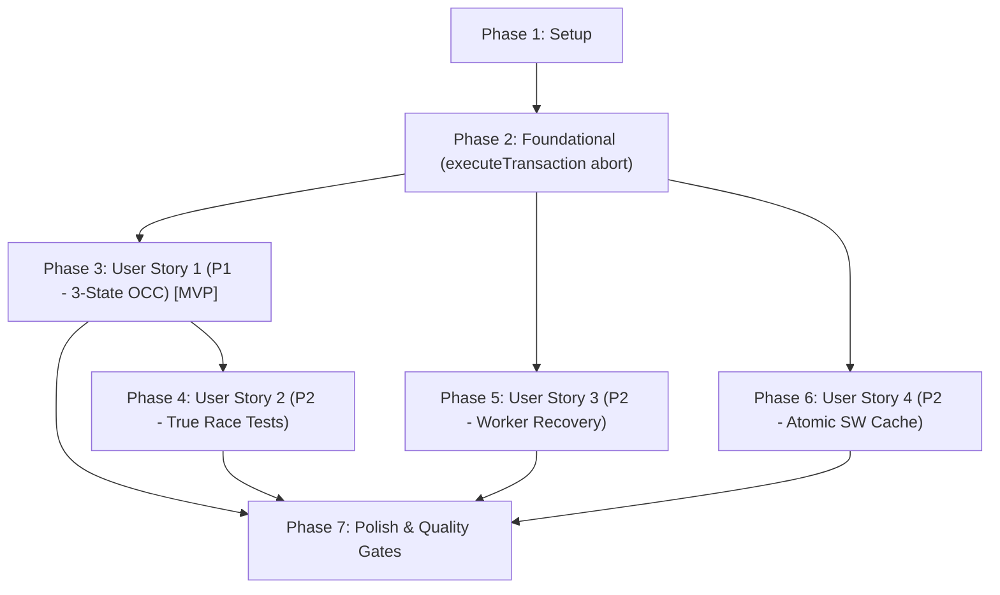

# Tasks: Feature 042 — Kiểm soát Cạnh tranh Đa tab, Khôi phục Worker & Nguyên tử hóa Cache Ngoại tuyến

**Branch**: `042-sync-concurrency-worker-recovery` | **Date**: 2026-10-17 | **Spec**: [spec.md](file:///d:/viet/app/specs/042-sync-concurrency-worker-recovery/spec.md)

---

## Phase 1: Setup (Shared Infrastructure)

**Purpose**: Chuẩn bị bộ khung kiểm thử và helper giả lập cho các kịch bản cạnh tranh và phục hồi Worker

- [x] T001 Cập nhật `tests/js/helpers/mock_idb.mjs` hỗ trợ mô phỏng kiểm tra phiên bản 3 trạng thái, hủy request khi abort đồng bộ, và tăng timestamp đơn điệu
- [x] T002 [P] Mở rộng `MockWorker` trong `tests/js/worker_resilience.test.mjs` hỗ trợ mô phỏng sự kiện `onmessageerror`, `terminate()`, và khởi động lại với generation mới

---

## Phase 2: Foundational (Blocking Prerequisites)

**Purpose**: Cơ sở hạ tầng cốt lõi về giao dịch IndexedDB an toàn ngoại lệ và bộ khung nhận diện lỗi xung đột

**⚠️ CRITICAL**: Các User Story phía sau phụ thuộc vào cơ chế bắt lỗi đồng bộ và định nghĩa lỗi chuẩn hóa tại phase này

- [x] T003 Cập nhật `executeTransaction()` trong `webapp/js/storage.js` gọi `try { tx.abort(); } catch (_) {}` trong khối `catch (err)` trước khi `safeReject(err)` để đảm bảo an toàn ngoại lệ đồng bộ
- [x] T004 Thêm kiểm thử đơn vị xác thực `executeTransaction` tự động hủy giao dịch khi `operationFn` ném ngoại lệ đồng bộ trong `tests/js/storage.test.mjs`

**Checkpoint**: Nền tảng giao dịch IndexedDB an toàn tuyệt đối với ngoại lệ đồng bộ.

---

## Phase 3: User Story 1 - Kiểm soát Cạnh tranh Ba Trạng thái & Ngăn Hồi sinh Hồ sơ Đã Xóa (Priority: P1) 🎯 MVP

**Goal**: Triển khai cơ chế kiểm soát cạnh tranh 3 trạng thái (Explicit 3-State OCC) và dấu thời gian đơn điệu trong IndexedDB, ngăn chặn tuyệt đối lỗi làm sống lại hồ sơ đã xóa và bảo vệ khi tạo mới đồng thời.

**Independent Test**: Chạy `npm run test:unit` cho `tests/js/storage.test.mjs`; xác nhận các ca kiểm thử từ chối lưu hồ sơ đã xóa, bắt xung đột tạo mới đồng thời và dấu thời gian đơn điệu đều PASS.

### Tests for User Story 1
- [x] T005 [P] [US1] Viết unit tests cho `saveProfile` kiểm tra 3 trạng thái (`number`, `null`, `undefined`) và chặn hồi sinh hồ sơ đã xóa trong `tests/js/storage.test.mjs`
- [x] T006 [P] [US1] Viết unit test cho `syncAndSaveActiveProfile` ném `ConcurrencyConflictError` (`codeName = "ProfileDeletedConflictError"`) khi hồ sơ bị xóa trước đó (`localSyncedTimestamp > 0`) trong `tests/js/storage.test.mjs`

### Implementation for User Story 1
- [x] T007 [US1] Nâng cấp `saveProfile` trong `webapp/js/storage.js` hỗ trợ 3 trạng thái `expectedUpdatedAt`: `number` (bắt buộc tồn tại & khớp phiên bản), `null` (bắt buộc chưa tồn tại), `undefined` (ghi không điều kiện), cùng monotonic `updated_at`
- [x] T008 [US1] Cập nhật `syncAndSaveActiveProfile` trong `webapp/js/storage.js` kiểm tra `localSyncedTimestamp > 0` và dừng ngay khi hồ sơ bị xóa, truyền `baseUpdatedAt = currentProfile ? currentProfile.updated_at : null`
- [x] T009 [US1] Xác thực User Story 1 bằng cách chạy `npm run test:unit`

**Checkpoint**: User Story 1 hoàn tất — Dữ liệu hồ sơ được bảo vệ 3 trạng thái, không bao giờ bị hồi sinh khi đã xóa.

---

## Phase 4: User Story 2 - Giải quyết Cuộc đua Ghi Đồng thời Thực sự Giữa Đa Tab (Priority: P2)

**Goal**: Đảm bảo và kiểm thử cuộc đua ghi chồng lấn thực sự giữa 2 tab (kể cả khi không có Web Locks): bắt xung đột, tự động thử lại, hợp nhất mẫu chữ và bảo toàn lệnh xóa ký tự.

**Independent Test**: Chạy `npx playwright test tests/e2e/multitab.spec.ts`; xác nhận 2 tab cùng lưu đồng thời qua `Promise.all` hội tụ đầy đủ mẫu chữ mà không bị mất hoặc nhân đôi.

### Tests for User Story 2
- [x] T010 [P] [US2] Viết test đơn vị đa tab mô phỏng cuộc đua ghi đồng thời thực sự giữa 2 phiên gọi `syncAndSaveActiveProfile` trong `tests/js/storage.test.mjs`
- [x] T011 [P] [US2] Bổ sung kịch bản E2E Playwright trong `tests/e2e/multitab.spec.ts` kích hoạt `Promise.all([page1.click("#btn-teach-save"), page2.click("#btn-teach-save")])` đồng thời và kiểm tra hội tụ

### Implementation for User Story 2
- [x] T012 [US2] Cập nhật logic retry trong `syncAndSaveActiveProfile` của `webapp/js/storage.js`: khi `attempt > 0` và phát hiện xung đột, luôn nạp `diskGzBytes` mới nhất từ IndexedDB để Worker hợp nhất
- [x] T013 [US2] Kiểm tra và xác nhận hành vi tombstone trong `chuviettay/model/bank.py` và `webapp/js/storage.js` bảo toàn trạng thái đã xóa khi hợp nhất đa tab
- [x] T014 [US2] Xác thực User Story 2 bằng cách chạy `npx playwright test tests/e2e/multitab.spec.ts`

**Checkpoint**: User Story 2 hoàn tất — Cuộc đua ghi đồng thời đa tab hội tụ 100% trong thực tế.

---

## Phase 5: User Story 3 - Khôi phục Bộ xử lý Nền Tương tác & Chống Trùng lặp Khi Quá hạn Chờ (Priority: P2)

**Goal**: Thêm nút "Thử lại" trên giao diện khi Worker gặp lỗi hoặc quá hạn chờ; tái tạo Worker sạch, nạp lại kho mẫu mà không làm mất văn bản; chấm dứt vật lý Worker bị timeout để ngăn duplicate execution.

**Independent Test**: Chạy `node --test tests/js/worker_resilience.test.mjs`; xác nhận quy trình `recoverWorker()`, xử lý `onmessageerror`, và chấm dứt Worker khi timeout đều PASS.

### Tests for User Story 3
- [x] T015 [P] [US3] Viết unit tests cho `recoverWorker()` (khởi tạo lại Worker, gọi `load_bank` với `{ gzBytes, createIfMissing: false }`, làm mới view) trong `tests/js/worker_resilience.test.mjs`
- [x] T016 [P] [US3] Viết unit tests cho xử lý lỗi giải mã thông điệp `worker.onmessageerror` và chấm dứt Worker vật lý khi timeout trong `tests/js/worker_resilience.test.mjs`

### Implementation for User Story 3
- [x] T017 [P] [US3] Thêm phần tử nút `#btn-worker-retry` vào thanh trạng thái `.status-bar` trong `webapp/index.html`
- [x] T018 [US3] Triển khai hàm `recoverWorker()` với cờ `isRecovering` và `workerGeneration` trong `webapp/js/app.js`
- [x] T019 [US3] Cập nhật `onWorkerReady()` trong `webapp/js/app.js` sử dụng cờ `isUiInitialized` để không đăng ký trùng lặp DOM event listeners khi phục hồi
- [x] T020 [US3] Cập nhật `sendWorkerMessage()` trong `webapp/js/app.js`: khi gặp `WorkerTimeoutError`, lập tức gọi `worker.terminate()` và chuyển sang `handleWorkerFatalError()`
- [x] T021 [US3] Xác thực User Story 3 bằng cách chạy `node --test tests/js/worker_resilience.test.mjs`

**Checkpoint**: User Story 3 hoàn tất — Người dùng có thể khôi phục Worker lỗi ngay trên giao diện chỉ với 1 click mà không mất văn bản.

---

## Phase 6: User Story 4 - Nguyên tử hóa Cập nhật Bộ nhớ Đệm Ngoại tuyến & Tách Tài nguyên Tùy chọn (Priority: P2)

**Goal**: Nguyên tử hóa quá trình nạp cache Service Worker lúc install (Fetch-All-First, rollback xóa cache dở dang nếu đứt mạng); tách các wheel DOCX lười khỏi `PRECACHE_URLS` bắt buộc.

**Independent Test**: Chạy `python -m pytest tests/test_build_web.py` và `npx playwright test tests/e2e/sw-update.spec.ts`; xác nhận phân tách `PRECACHE_URLS` vs `OPTIONAL_LAZY_URLS` và cập nhật cache thành công.

### Tests for User Story 4
- [x] T022 [P] [US4] Bổ sung kiểm thử trong `tests/test_build_web.py` xác thực `webapp/dist/sw.js` phân tách đúng `PRECACHE_URLS` (core) và `OPTIONAL_LAZY_URLS` (lazy wheels)

### Implementation for User Story 4
- [x] T023 [US4] Tái cấu trúc sự kiện `install` trong `webapp/sw.js` theo mẫu Fetch-All-First: kiểm tra toàn bộ `resp.ok` trước khi `cache.put`, xóa `CACHE_NAME` nếu lỗi, và chỉ `skipWaiting()` khi thành công
- [x] T024 [US4] Cập nhật `generate_sw_js()` trong `scripts/build_web.py` đọc `scripts/vendor_lock.json` để tách các wheel `"stage": "lazy"` vào `OPTIONAL_LAZY_URLS`, trong khi vẫn băm toàn bộ dist để tính `CACHE_NAME`
- [x] T025 [US4] Xác thực User Story 4 bằng cách chạy `python scripts/build_web.py`, `pytest tests/test_build_web.py`, và `npx playwright test tests/e2e/sw-update.spec.ts`

**Checkpoint**: User Story 4 hoàn tất — Service Worker cài đặt nguyên tử 100%, không bao giờ để lại cache chắp vá.

---

## Phase 7: Polish & Quality Gates

**Purpose**: Chạy toàn diện chuỗi kiểm thử chất lượng trước khi bàn giao

- [x] T026 [P] Chạy kiểm tra quy chuẩn mã nguồn Python bằng Ruff qua lệnh `ruff check .`
- [x] T027 [P] Chạy xác thực biên dịch bytecode Python qua lệnh `python -m compileall -q .`
- [x] T028 Chạy toàn bộ 1235+ kiểm thử lõi Python qua lệnh `python -m pytest -q -m "not benchmark"`
- [x] T029 Xây dựng bản phân phối Web Client dist qua lệnh `python scripts/build_web.py`
- [x] T030 Chạy toàn bộ kịch bản kiểm thử JavaScript trong `quickstart.md` (`npm run test:unit`, `npm run test:browser`, `node scripts/test_golden_pyodide.mjs`, `npx playwright test tests/e2e/multitab.spec.ts`)

---

## Dependencies & Execution Order

### Phase Dependencies

### Parallel Opportunities
- **US1 & US3 & US4**: Sau Phase 2, các User Story US1, US3, US4 hoàn toàn độc lập và có thể triển khai song song.
- **US2**: Phụ thuộc vào US1 (vì kiểm thử cuộc đua đồng thời thực sự sử dụng logic 3-state OCC của US1).
- Trong từng User Story, các task kiểm thử [P] và thêm element UI [P] có thể viết trước song song.
