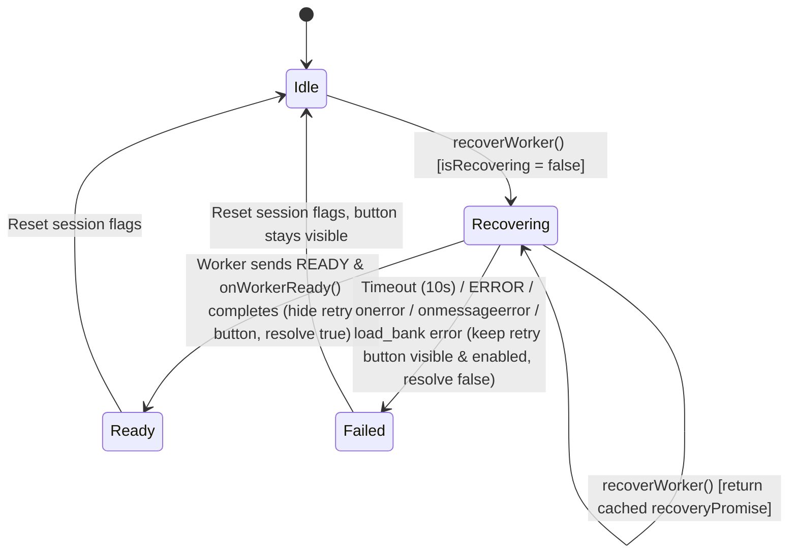

# Data Model: Feature 043 — Worker Recovery & Render Seed Pipeline Hardening

**Branch**: `043-worker-recovery-seed-stability` | **Date**: 2026-10-18 | **Spec**: [spec.md](file:///d:/viet/app/specs/043-worker-recovery-seed-stability/spec.md)

---

## 1. Entities

### `SeedContext` (Python: `chuviettay/model/rng.py`)
Represents the immutable contextual identity of an entity requiring deterministic random perturbation.

```python
@dataclass(frozen=True, slots=True)
class SeedContext:
    content_type: str        # Category: "text", "cell", "sym", "math_inline", "math_block", "wgap", "tbl_border"
    element_id: str          # Token string, symbol, latex formula, or structural table ID
    occurrence: int = 0      # Occurrence index of (content_type, element_id)
    purpose: str = "variant" # Purpose of randomness: "variant", "geom", "jitter", "dgap"
    sub_index: int = 0       # Internal character, digit, or stroke segment index

    @property
    def token_id(self) -> str:
        return f"{self.content_type}:{self.element_id}#{self.occurrence}"

    def with_purpose(self, purpose: str, sub_index: int = 0) -> SeedContext:
        return SeedContext(
            content_type=self.content_type,
            element_id=self.element_id,
            occurrence=self.occurrence,
            purpose=purpose,
            sub_index=sub_index,
        )

    def to_keys(self) -> tuple[Any, ...]:
        return (self.content_type, self.element_id, self.occurrence, self.purpose, self.sub_index)
```

**Validation & Invariants**:
- `content_type` must be a non-empty string (`"text"`, `"cell"`, `"sym"`, `"math_inline"`, `"math_block"`, `"wgap"`, `"tbl_border"`).
- `occurrence >= 0` and `sub_index >= 0`.
- `token_id` preserves `"text:alpha#0"`, `"sym:beta#0"`, `"cell:alpha#0"` format required by `RenderItem`.

---

### `CanonicalKey` (Python: `chuviettay/model/rng.py`)
Specification for serializing keys in `derive_seed(..., version="v2")` to guarantee zero collisions and zero integer overflow.

| Python Type | Type Tag (1B) | Length Prefix (4B uint32 BE) | Payload Bytes |
| :--- | :--- | :--- | :--- |
| `None` | `b'n'` | `0` (`\x00\x00\x00\x00`) | `b""` |
| `bool` | `b'?'` | `1` (`\x00\x00\x00\x01`) | `b"\x01"` (`True`) or `b"\x00"` (`False`) |
| `int` (not `bool`) | `b'i'` | `len(ascii_bytes)` | `str(int(val)).encode("ascii")` (handles negative & `>= 2**63` safely) |
| `str` | `b's'` | `len(utf8_bytes)` | `unicodedata.normalize("NFC", val).encode("utf-8")` |
| `bytes` / `bytearray` | `b'b'` | `len(val)` | `bytes(val)` |
| `SeedContext` | `b'c'` | `5` (field count) | Concatenated `_encode_canonical_key` of its 5 fields |
| `tuple` / `list` | `b't'` | `len(val)` (item count) | Concatenated `_encode_canonical_key` of elements |

**Serialization Rule**:
`payload = b"rng-v2\x00" + _encode_canonical_key(master_seed) + b"".join(_encode_canonical_key(k) for k in keys)`

---

### `WorkerRecoverySession` (JavaScript: `webapp/js/app.js`)
Manages the single-flight lifecycle of an interactive worker restoration attempt.

```typescript
interface WorkerRecoverySession {
  generation: number;            // Monotonically increasing worker generation ID
  isRecovering: boolean;         // Single-flight lock preventing concurrent recovery triggers
  recoveryPromise: Promise<boolean> | null; // Cached active recovery promise
  timeoutTimer: ReturnType<typeof setTimeout> | null; // Default 10,000ms safety timeout timer
  workerReadyResolve: ((value: boolean) => void) | null;
}
```

**State Transitions**:


---

### `TeachCountUpdate` (JavaScript: `webapp/js/storage.js`)
Structure for atomic, concurrency-safe profile teaching updates within a single IndexedDB `readwrite` transaction.

| Field | Type | Description |
| :--- | :--- | :--- |
| `profile_id` | `string` | ID of the active profile being incremented/reset |
| `teach_count_since_backup` | `number` | New teach count (incremented by 1 or set to 0) |
| `updated_at` | `number` | Monotonic timestamp `Math.max(Date.now(), (existing.updated_at || 0) + 1)` |
| `was_in_sync` | `boolean` | `localSyncedTimestamp > 0 && localSyncedTimestamp === existing.updated_at` (if true, updates `localSyncedTimestamp = updated_at` on `tx.oncomplete`) |
