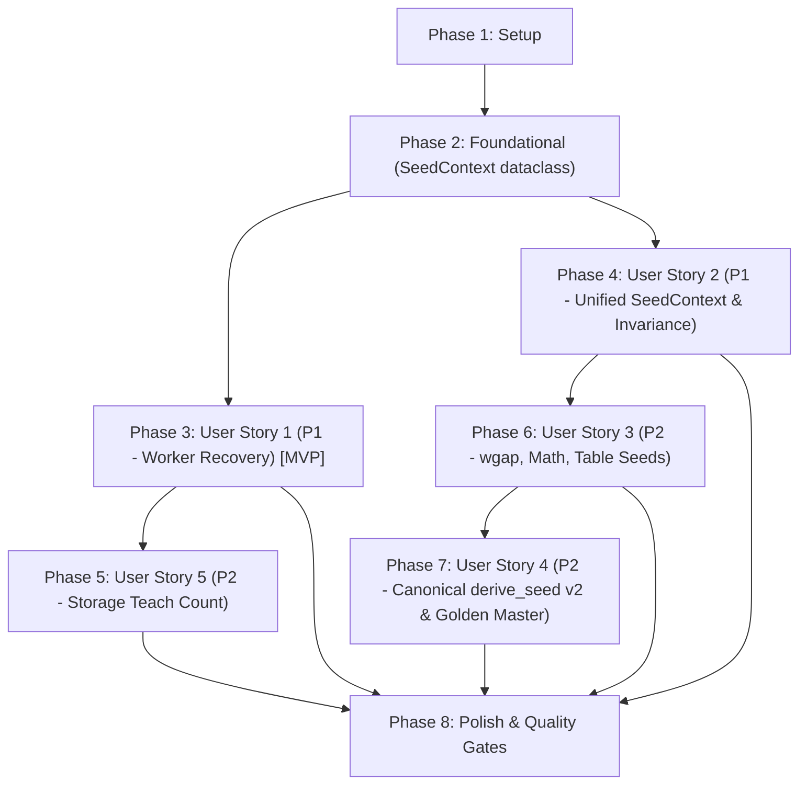

# Tasks: Feature 043 — Khôi phục Worker Tin cậy và Ổn định Ngữ cảnh Seed Kết xuất

**Branch**: `043-worker-recovery-seed-stability` | **Date**: 2026-10-18 | **Spec**: [spec.md](file:///d:/viet/app/specs/043-worker-recovery-seed-stability/spec.md) | **Plan**: [plan.md](file:///d:/viet/app/specs/043-worker-recovery-seed-stability/plan.md)

---

## Phase 1: Setup (Shared Infrastructure)

**Purpose**: Chuẩn bị khung test helper cho phục hồi Web Worker và bộ tạo kho mẫu đa biến thể kiểm thử

- [x] T001 [P] Mở rộng `MockWorker` trong `tests/js/worker_resilience.test.mjs` hỗ trợ mô phỏng Worker treo không phản hồi (timeout), thông điệp `ERROR`, lỗi giải mã `messageerror`, và từ chối tải script
- [x] T002 [P] Bổ sung các helper kiểm thử so sánh hình thái nét vẽ tương đối (normalized stroke shape delta <= 0.02 pt) trong `tests/test_stable_variants.py`

---

## Phase 2: Foundational (Blocking Prerequisites)

**Purpose**: Cơ sở hạ tầng định danh `SeedContext` dùng chung bắt buộc cho toàn bộ pipeline sinh số ngẫu nhiên

**⚠️ CRITICAL**: Các User Story về bố cục và tạo nét viết phụ thuộc trực tiếp vào cấu trúc này

- [x] T003 Định nghĩa dataclass `SeedContext` (`content_type`, `element_id`, `occurrence`, `purpose`, `sub_index`, `token_id`, `to_keys()`, `with_purpose()`) trong `chuviettay/model/rng.py`
- [x] T004 [P] Viết unit tests kiểm tra tính bất biến (frozen), thuộc tính `token_id` và phương thức `to_keys()` của `SeedContext` trong `tests/test_rng.py`

**Checkpoint**: Thực thể `SeedContext` sẵn sàng — các User Story có thể triển khai song song.

---

## Phase 3: User Story 1 - Khôi phục Bộ xử lý Nền (Worker) Tương tác & Đáng tin cậy (Priority: P1) 🎯 MVP

**Goal**: Loại bỏ hoàn toàn lỗi báo thành công giả trong `recoverWorker()`; áp dụng timeout 10s cho bước chờ `READY`; chỉ ẩn nút "Thử lại" sau khi `onWorkerReady()` hoàn tất nạp kho mẫu; giữ nguyên nút và thông báo lỗi khi thất bại.

**Independent Test**: Chạy `node --test tests/js/worker_resilience.test.mjs`; xác nhận các ca kiểm thử timeout, ERROR, onerror, onmessageerror, và lỗi `load_bank` đều khiến `recoverWorker()` trả về `false` và giữ nguyên nút "Thử lại".

### Tests for User Story 1
- [x] T005 [P] [US1] Viết unit tests cho `recoverWorker()` kiểm tra timeout (10s), nhận thông điệp `ERROR`, sự kiện `onerror`, và sự kiện `onmessageerror` trong `tests/js/worker_resilience.test.mjs`
- [x] T006 [P] [US1] Viết unit tests cho `recoverWorker()` kiểm tra trường hợp `onWorkerReady()` ném lỗi khi nạp lại kho mẫu thì giữ nguyên nút "Thử lại" và trả về `false` trong `tests/js/worker_resilience.test.mjs`

### Implementation for User Story 1
- [x] T007 [US1] Nâng cấp `recoverWorker(WorkerClass, timeoutMs)` trong `webapp/js/app.js`: kiểm tra kết quả boolean của `readyPromise`, áp dụng bộ đếm thời gian `timeoutMs = 10000`, chấm dứt Worker khi quá hạn, và bọc khối `try / catch` toàn diện trả về `false` khi có lỗi
- [x] T008 [US1] Cập nhật `attachWorkerHandlers()` trong `webapp/js/app.js`: gọi `handleWorkerFatalError()` và giải quyết `workerReadyResolve(false)` cho cả nhánh `data.type === "ERROR"`, `targetWorker.onerror`, `targetWorker.onmessageerror`, và `onWorkerReady().catch()`
- [x] T009 [US1] Tái cấu trúc `onWorkerReady()` trong `webapp/js/app.js`: chỉ ẩn `#splash-screen`, ẩn `#btn-worker-retry`, gán `isUiInitialized = true` và đặt `setStatus("status_ready")` ở cuối hàm sau khi nạp kho mẫu thành công
- [x] T010 [US1] Xác thực User Story 1 bằng cách chạy `node --test tests/js/worker_resilience.test.mjs`

**Checkpoint**: User Story 1 hoàn tất — Quá trình khôi phục Worker an toàn 100%, không bao giờ báo thành công giả.

---

## Phase 4: User Story 2 - Thống nhất Định danh và Ngữ cảnh Seed Toàn Diện (Priority: P1)

**Goal**: Thống nhất `SeedContext` giữa `DocumentLayoutEngine`, `Writer` và `FidelityLayoutEngine`; khắc phục các lỗi rò rỉ ngữ cảnh trong `Writer`; hỗ trợ `align_document_seeds` để bảo toàn hình thái nét chữ khi chèn nội dung.

**Independent Test**: Chạy `pytest tests/test_stable_variants.py`; xác nhận các bài kiểm thử chèn từ không trùng lặp và chèn từ trùng lặp có đối chiếu định danh đều giữ nguyên hình thái nét chữ cũ 100%.

### Tests for User Story 2
- [x] T011 [P] [US2] Viết unit tests kiểm tra `Writer.token()`, `Writer.symbol()`, `Writer.number()` nhận `context: SeedContext` và không đếm trùng lặp trong `tests/test_stable_variants.py`
- [x] T012 [P] [US2] Viết unit tests kiểm tra tính bất biến hình thái nét vẽ khi chèn từ trùng lặp sử dụng `align_document_seeds` trong `tests/test_stable_variants.py`
- [x] T013 [P] [US2] Viết unit tests kiểm tra cô lập biến thể giữa các không gian tên `text`, `cell`, `sym` trong `tests/test_stable_variants.py`

### Implementation for User Story 2
- [x] T014 [US2] Cập nhật `Writer` trong `chuviettay/model/writer.py`: nhận `context: SeedContext | None` trong `token()`, `symbol()`, `number()`; sử dụng `context` khi có; cô lập `_token_last` theo `(content_type, element_id, tag)`
- [x] T015 [US2] Khắc phục rò rỉ ngữ cảnh trong `Writer`: bảo toàn ngữ cảnh token cha khi `Writer.token()` gọi `Writer.number()`, và dùng chỉ số lặp ký tự `idx` cho `"jitter"` trong `Writer.assemble_word()` để không lệch biến thể dấu thanh
- [x] T016 [US2] Nâng cấp `_layout_inlines()` và `_render_text_line()` trong `chuviettay/layout/engine.py`: tính toán `SeedContext` trước khi gọi `Writer` và truyền cùng `SeedContext` vào `RenderItem` cũng như bước biến đổi hình học
- [x] T017 [US2] Nâng cấp `FidelityLayoutEngine` trong `chuviettay/fidelity/engine.py`: xây dựng `SeedContext` cho từng token và truyền đồng bộ vào `Writer.token()` và `ScopedRNG` biến đổi hình học
- [x] T018 [US2] Triển khai hàm `align_document_seeds(base_doc, edited_doc)` trong `chuviettay/document/ir.py` sử dụng `difflib.SequenceMatcher` (LCS) để bảo toàn `occurrence` của các phần tử cũ khi chèn nội dung trùng lặp
- [x] T019 [US2] Xác thực User Story 2 bằng cách chạy `pytest tests/test_stable_variants.py`

**Checkpoint**: User Story 2 hoàn tất — Ngữ cảnh seed đồng nhất xuyên suốt pipeline; nét chữ bất biến khi chỉnh sửa.

---

## Phase 5: User Story 5 - Bảo vệ Cạnh tranh Số lần Dạy chữ (Teach Count) trong Lưu trữ (Priority: P2)

**Goal**: Đưa `incrementTeachCount` và `resetTeachCount` vào giao dịch IndexedDB nguyên tử; chống ghi đè dữ liệu kho mẫu và chống hồi sinh hồ sơ đã xóa; đồng bộ `localSyncedTimestamp` để không kích hoạt hợp nhất giả.

**Independent Test**: Chạy `npm run test:unit`; xác nhận các ca kiểm thử tăng/đặt lại số lần dạy chữ đơn tab và đa tab chạy đúng và an toàn phiên bản.

### Tests for User Story 5
- [x] T020 [P] [US5] Viết unit tests cho `incrementTeachCount` và `resetTeachCount` trong `tests/js/storage.test.mjs` kiểm tra thao tác nguyên tử, không làm thay đổi `data`, và không hồi sinh hồ sơ đã xóa

### Implementation for User Story 5
- [x] T021 [US5] Nâng cấp `incrementTeachCount(profileId)` và `resetTeachCount(profileId)` trong `webapp/js/storage.js` sử dụng `executeTransaction("readwrite")` đọc-sửa-ghi nguyên tử trên `profiles` store
- [x] T022 [US5] Cập nhật đồng bộ `localSyncedTimestamp` trong `webapp/js/storage.js` khi tab hiện tại đang giữ phiên bản mới nhất, ngăn ngừa hợp nhất giả khi `scheduleAutoSave()` kích hoạt
- [x] T023 [US5] Xác thực User Story 5 bằng cách chạy `npm run test:unit`

**Checkpoint**: User Story 5 hoàn tất — Tầng lưu trữ IndexedDB kiểm soát cạnh tranh hoàn chỉnh cho toàn bộ các trường metadata.

---

## Phase 6: User Story 3 - Ổn định Biến thể cho Khoảng cách Từ, Công thức và Bảng (Priority: P2)

**Goal**: Dẫn xuất `wgap` từ cặp `(prev_token_id, curr_token_id)`; sao chép đầy đủ trạng thái `Writer` trong `MathLayoutEngine._scratch()`; dẫn xuất đường viền bảng từ `table_id` cấu trúc ổn định.

**Independent Test**: Chạy `pytest tests/test_stable_variants.py`; xác nhận khoảng cách từ biến thiên tự nhiên theo vị trí nhưng tái lập 100%, và nét vẽ công thức/bảng không bị đổi khi chèn thêm phần tử khác vào trước.

### Tests for User Story 3
- [x] T024 [P] [US3] Viết unit tests kiểm tra khoảng cách từ `wgap` tái lập theo vị trí nhưng biến thiên giữa các lần xuất hiện khác nhau trong `tests/test_stable_variants.py`
- [x] T025 [P] [US3] Viết unit tests kiểm tra `MathLayoutEngine._scratch()` và bước kết xuất chính thức sinh nét vẽ trùng khớp 100% trong `tests/test_stable_variants.py`
- [x] T026 [P] [US3] Viết unit tests kiểm tra chèn bảng mới phía trước không làm đổi nét viền và nét chữ của bảng phía sau trong `tests/test_stable_variants.py`

### Implementation for User Story 3
- [x] T027 [US3] Cập nhật tính toán `wgap` trong `chuviettay/layout/engine.py` và `chuviettay/fidelity/engine.py`: dẫn xuất hạt giống từ `(prev_item.token_id, curr_item.token_id)`
- [x] T028 [US3] Nâng cấp `_scratch()` và `layout_lines()` trong `chuviettay/layout/math_layout.py`: sao chép đầy đủ `_token_counts`, `_token_last`, và `_current_ctx_type` trên mỗi bản sao đo thử
- [x] T029 [US3] Cập nhật dẫn xuất hạt giống đường viền bảng `tbl_border` trong `chuviettay/layout/engine.py` sử dụng `(table_id, curr_row_idx)` với `table_id` dựa trên chữ ký cấu trúc bảng hoặc `stable_id`
- [x] T030 [US3] Xác thực User Story 3 bằng cách chạy `pytest tests/test_stable_variants.py`

**Checkpoint**: User Story 3 hoàn tất — Khoảng cách từ, công thức toán và bảng biểu đạt độ ổn định hạt giống toàn diện.

---

## Phase 7: User Story 4 - Chuẩn tắc hóa Mã hóa Khóa Dẫn xuất Seed & Bảo toàn Golden Master (Priority: P2)

**Goal**: Triển khai mã hóa chuẩn tắc `rng-v2` trong `derive_seed` loại bỏ va chạm khóa và lỗi tràn số nguyên 64-bit; cập nhật mã băm của `test_real_path_stable_variants`; bảo toàn 100% kết quả 8 ca `GOLDEN_REAL`.

**Independent Test**: Chạy `pytest tests/test_rng.py tests/test_golden_master_real_path.py` và `node scripts/test_golden_pyodide.mjs`; xác nhận các test vectors và 8/8 ca Golden Master đều PASS.

### Tests for User Story 4
- [x] T031 [P] [US4] Bổ sung bộ test vectors cố định cho `derive_seed` v2 trong `tests/test_rng.py` (kiểm tra phân biệt `1` vs `"1"`, `True` vs `1`, chuỗi chứa `\x00`, số âm `-1`, số 64-bit `>= 2**63`, chuỗi Unicode NFC/NFD)

### Implementation for User Story 4
- [x] T032 [US4] Triển khai `encode_canonical_key(val)` và nâng cấp `derive_seed(..., version="v2")` trong `chuviettay/model/rng.py` với tiền tố domain `rng-v2\x00`
- [x] T033 [US4] Cập nhật mã băm SHA-256 của tệp `.xopp` cho ca `test_real_path_stable_variants` trong `tests/test_golden_master_real_path.py` tương ứng với thuật toán v2 mới
- [x] T034 [US4] Xác thực User Story 4 bằng cách chạy `pytest tests/test_rng.py tests/test_golden_master_real_path.py` và `node scripts/test_golden_pyodide.mjs`

**Checkpoint**: User Story 4 hoàn tất — Thuật toán dẫn xuất seed chuẩn tắc v2 an toàn toán học; 8/8 ca Golden Master được bảo toàn tuyệt đối.

---

## Phase 8: Polish & Quality Gates

**Purpose**: Chạy toàn diện chuỗi kiểm định chất lượng trước khi bàn giao

- [x] T035 [P] Bổ sung bài kiểm tra hiệu năng benchmark tài liệu lớn (10+ trang) trong `tests/test_stable_variants.py` đo lường chi phí khởi tạo `SeedContext` và `derive_seed` v2 (chênh lệch trung vị <= 10%)
- [x] T036 [P] Chạy kiểm tra quy chuẩn mã nguồn Python qua `ruff check .`
- [x] T037 [P] Chạy kiểm tra biên dịch bytecode Python qua `python -m compileall -q .`
- [x] T038 Chạy toàn bộ bộ kiểm thử Python qua `pytest -q -m "not benchmark"`
- [x] T039 Xây dựng gói web tĩnh phân phối qua `python scripts/build_web.py`
- [x] T040 Chạy toàn bộ bộ kiểm thử JavaScript và trình duyệt (`npm run test:unit`, `npm run test:browser`, `node scripts/test_golden_pyodide.mjs`)
- [x] T041 Chạy toàn bộ 19 bài kiểm thử Playwright E2E qua `npx playwright test`

---

## Dependencies & Execution Order

### Phase Dependencies

### Parallel Opportunities

- **US1 & US2**: Sau Phase 2, User Story 1 (Web Worker client) và User Story 2 (Python render engine) hoàn toàn độc lập và có thể triển khai song song.
- **US5**: User Story 5 (`webapp/js/storage.js`) có thể làm song song với US2/US3.
- **US3 & US4**: US3 hoàn thiện ngữ cảnh cho khoảng cách, công thức và bảng trước khi US4 chốt mã hóa khóa `derive_seed` v2 và cập nhật mã băm `test_real_path_stable_variants`.
- Trong từng User Story, các task kiểm thử `[P]` viết trước độc lập với mã triển khai.

---

## Implementation Strategy

### MVP First (User Story 1 Only)
1. Hoàn thành Phase 1 & Phase 2.
2. Hoàn thành Phase 3 (User Story 1 - Worker Recovery).
3. **STOP & VALIDATE**: Chạy `node --test tests/js/worker_resilience.test.mjs` xác nhận không còn tình trạng báo thành công giả hoặc treo vô hạn.

### Incremental Delivery
1. Triển khai US1: Khôi phục Worker tin cậy & nút Thử lại.
2. Triển khai US2: `SeedContext` thống nhất & cô lập `Writer`.
3. Triển khai US5: Giao dịch nguyên tử cho `teach_count_since_backup`.
4. Triển khai US3: Ổn định `wgap`, `_scratch` và viền bảng.
5. Triển khai US4: `derive_seed` v2 chuẩn tắc & bảo toàn 8 ca Golden Master.
6. Chạy Quality Gates toàn trình.
