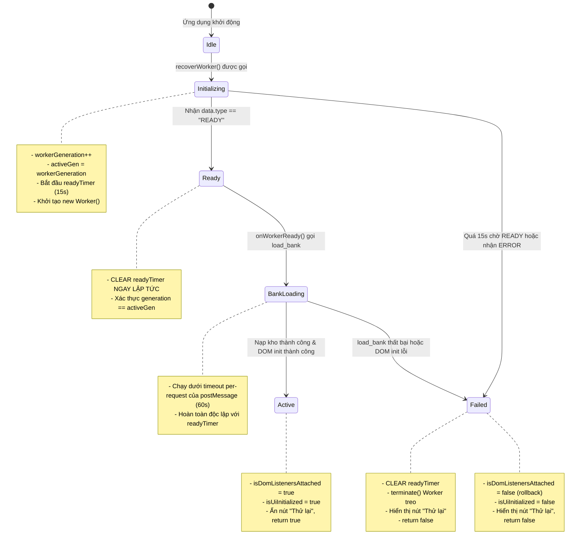

# Data Model: Worker and Seed Integrity Hardening

**Feature**: `specs/044-worker-and-seed-integrity`
**Date**: 2026-10-18
**Status**: Completed

## 1. Core Data Entities

### 1.1 `SeedContext` (Canonical Render Entity)
Đại diện cho tọa độ ngữ cảnh tất định của một phần tử trong cây tài liệu.

| Thuộc tính | Kiểu dữ liệu | Mô tả | Quy tắc kiểm tra (Validation Rules) |
| :--- | :--- | :--- | :--- |
| `content_type` | `str` | Không gian tên nội dung | Bắt buộc thuộc: `"text"`, `"cell"`, `"sym"`, `"heading"`, `"math_inline"`, `"math_block"`, `"wgap"`, `"tbl_border"` |
| `element_id` | `str` | Định danh chuỗi cốt lõi | Chuỗi Unicode NFC chuẩn hóa, không rỗng (trừ wgap có thể rỗng ở đầu dòng) |
| `occurrence` | `int` | Số thứ tự xuất hiện | Số nguyên không âm (`>= 0`) trong phạm vi tài liệu |
| `purpose` | `str` | Mục đích lấy mẫu ngẫu nhiên | Thuộc: `"variant"`, `"jitter"`, `"wgap"`, `"dgap"`, `"geom"`, `"baseline"` |
| `sub_index` | `int` | Chỉ số phụ phân đoạn | Số nguyên không âm (`>= 0`), dùng cho chỉ số ký tự trong từ hoặc chỉ số chunk khi token bị cắt |

**Derived Property**:
- `token_id`: `f"{content_type}:{element_id}#{occurrence}"`

---

### 1.2 `WorkerLifecycleSession` (Client State Entity)
Đại diện cho phiên làm việc và trạng thái tiến trình nền Web Worker trong Web Client.

| Thuộc tính | Kiểu dữ liệu | Mô tả | Quy tắc chuyển đổi trạng thái |
| :--- | :--- | :--- | :--- |
| `generation` | `int` | Số thế hệ tiến trình | Tăng đơn điệu nguyên tử (`workerGeneration++`) mỗi khi terminate hoặc restart |
| `ready_state` | `str` | Trạng thái handshake | `INITIALIZING` -> `READY` hoặc `FAILED` |
| `ready_timer` | `Timer \| null` | Bộ đếm chờ READY | Tối đa 15,000ms; **Dừng ngay lập tức** khi nhận `READY` hoặc `ERROR` |
| `bank_state` | `str` | Trạng thái nạp kho mẫu | `IDLE` -> `LOADING` -> `LOADED` hoặc `ERROR` |
| `is_dom_attached` | `bool` | Cờ gắn kết DOM | Chỉ đặt `true` khi toàn bộ listeners đăng ký thành công; rollback về `false` nếu lỗi |

---

### 1.3 `DocumentIR` & `ListBlock` (Recursive AST Entity)
Mở rộng mô hình cây tài liệu hỗ trợ duyệt đệ quy đầy đủ cho danh sách lồng nhau.

```text
Document
 └── blocks: list[Block]
      ├── Paragraph (inlines: list[Inline])
      ├── Heading (inlines: list[Inline], level: int)
      ├── MathBlock (latex: str, occurrence: int)
      ├── Table (rows: list[TableRow], occurrence: int)
      │    └── TableRow (cells: list[TableCell])
      │         └── TableCell (blocks: list[Block])  <-- recursive
      └── ListBlock (items: list[list[Block]], ordered: bool, start: int)
           └── item: list[Block]
                ├── Paragraph (inlines: list[Inline])
                ├── MathBlock (latex: str)
                └── ListBlock (nested sub-list)  <-- recursive
```

---

### 1.4 `CanonicalKeyEncoding` (Serialization Schema)
Chuẩn hóa byte payload cho hàm `encode_canonical_key(val)`:

| Tag | Kiểu dữ liệu tương ứng | Cấu trúc Payload (Bytes) | Hành vi ngoại lệ |
| :--- | :--- | :--- | :--- |
| `b'n'` | `NoneType` | `b"\x00\x00\x00\x00"` (length 0) | Hợp lệ |
| `b'?'` | `bool` | `b"\x00\x00\x00\x01"` + `(b"\x01" if val else b"\x00")` | Hợp lệ |
| `b'i'` | `int` | `b"<4-byte len>" + ASCII_DECIMAL(val)` (chống tràn 64-bit) | Hợp lệ |
| `b'f'` | `float` | `b"\x00\x00\x00\x08" + struct.pack(">d", val)` | Hợp lệ |
| `b's'` | `str` | `b"<4-byte len>" + UTF8(NFC(val))` | Hợp lệ |
| `b'b'` | `bytes`, `bytearray` | `b"<4-byte len>" + val` | Hợp lệ |
| `b'c'` | `SeedContext` | `b"\x00\x00\x00\x05" + encode(fields...)` | Hợp lệ |
| `b't'` | `tuple`, `list` | `b"<4-byte item_count>" + encode(items...)` | Hợp lệ |
| **Khác**| `dict`, `set`, `object`... | **Không hỗ trợ** | **Ném `TypeError` ngay lập tức** |

---

## 2. State Transition Diagrams

### 2.1 Chu trình sống và Timeout khôi phục Worker



---

## 3. Validation Invariants
1. **RNG Orthogonality Invariant**:
   `ScopedRNG(seed, "text", tok, occ, "variant", tag, 0).seed != ScopedRNG(seed, "cell", tok, occ, "variant", tag, 0).seed` với mọi `tok`, `occ`, `tag`.
2. **Chunked Occurrences Non-Drift Invariant**:
   Cho từ `tok_A` và `tok_B` xuất hiện liên tiếp trong cùng một dòng. Nếu `tok_A` bị ngắt thành 2 chunks `chunk_A1` và `chunk_A2`, `tok_B` vẫn nhận chính xác `occurrence = inline.token_occurrences[1]` (không bị dịch chuyển sang chỉ số 2).
3. **List Recursion Preservation Invariant**:
   Một danh sách `base_doc` gồm 3 mục `Item 1`, `Item 2`, `Item 3`. Khi chèn `Item 0` vào đầu danh sách, thuật toán `align_document_seeds` giữ nguyên `occurrence` của 3 mục cũ, nét chữ cũ lệch không quá `0.02 pt`.
4. **Strict Typing Invariant**:
   `encode_canonical_key({"unsupported": 1})` ném `TypeError` và không trả về chuỗi byte.
