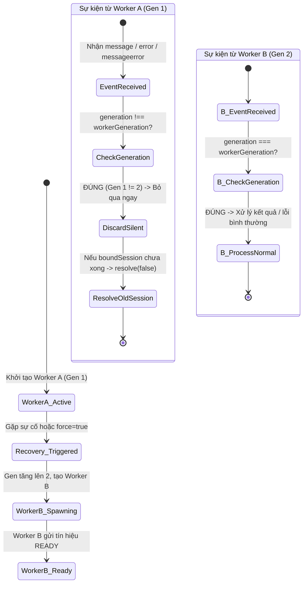
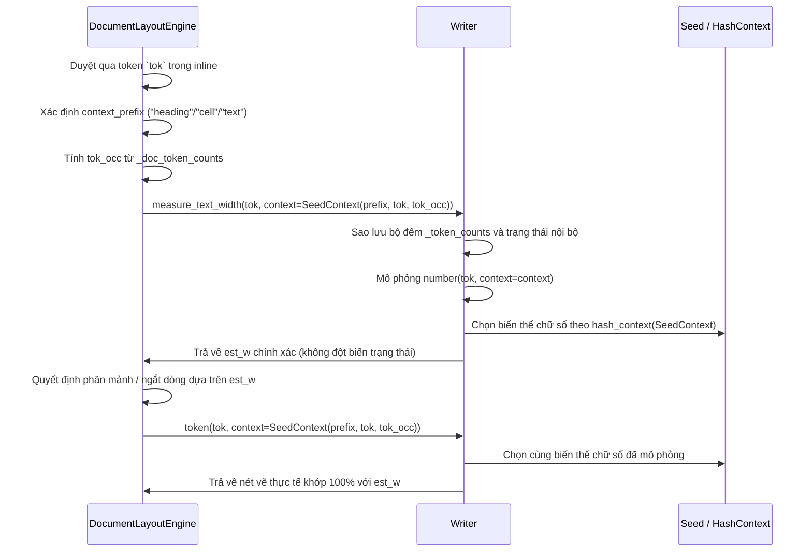

# Data Model: 049-worker-error-guard-punct-spacing

## 1. Entities & Data Structures

### 1.1. Worker Lifecycle Entities (JavaScript Frontend)

#### `WorkerSession`
Đối tượng quản lý một phiên phục hồi hoặc khởi tạo Web Worker.
```typescript
interface WorkerSession {
  generation: number;             // Chỉ số thế hệ Worker gắn với phiên này
  isResolved: boolean;            // Cờ đánh dấu Promise đã được giải quyết chưa
  timer: NodeJS.Timeout | null;   // Bộ đếm thời gian timeout bảo vệ phiên
  resolve: (success: boolean) => void; // Hàm hoàn tất phiên (chỉ gọi 1 lần duy nhất)
}
```

#### `WorkerGenerationState`
Trạng thái vòng đời toàn cục của Web Worker trong `webapp/js/app.js`.
```typescript
interface WorkerGenerationState {
  worker: Worker | null;                    // Tham chiếu tới đối tượng Web Worker hiện hành
  workerGeneration: number;                // Chỉ số thế hệ hiện tại (tăng dần mỗi chu kỳ)
  activeRecoverySession: WorkerSession | null; // Phiên phục hồi hiện hành
  isRecovering: boolean;                   // Cờ báo hiệu đang trong chu kỳ phục hồi
  recoveryPromise: Promise<boolean> | null; // Promise kết quả của phiên phục hồi
  pendingRequests: Map<number, PendingRequest>; // Hàng đợi yêu cầu đang chờ phản hồi
}
```

### 1.2. Seed & Layout Entities (Python Core)

#### `SeedContext` (từ `chuviettay.model.rng`)
Ngữ cảnh hạt giống truyền xuyên suốt từ bộ bố cục tài liệu đến bộ chọn biến thể nét viết tay.
```python
@dataclass(frozen=True)
class SeedContext:
    content_type: str    # "heading" | "cell" | "text" | "sym"
    element_id: str      # Token text, identifier chuỗi hoặc nhãn phần tử
    occurrence: int      # Số thứ tự xuất hiện của token trong content_type
    sub_index: int = 0   # Chỉ số mảnh cắt (chunk_idx) khi token dài bị chia nhỏ
```

#### `GlyphBoundingBox` & `StrokeClearance`
Biên hình học quang học tính từ các nét vẽ thực tế:
```python
@dataclass
class GlyphBoundingBox:
    min_x: float
    max_x: float
    min_y: float
    max_y: float
    width: float   # max_x - min_x
    height: float  # max_y - min_y
```

---

## 2. State Machine & Event Flow

### 2.1. Worker Generation Isolation State Transition



### 2.2. Context-Aware Measurement & Layout Sequence



---

## 3. Optical Spacing Formulas

### 3.1. Decimal Punctuation Spacing in `Writer.number()`
Giữa chữ số trước $D_1$, dấu phẩy/chấm $P$, và chữ số sau $D_2$:

$$\text{Clearance}_{\text{before}} = \max(0.10 \cdot xh,\, 0.80 \cdot \text{pen\_w})$$

$$\text{Place}_P = \max\left(x + p_{\text{gap}},\, \text{max\_x}(D_1) + \text{Clearance}_{\text{before}} - \text{min\_x}(P)\right)$$

$$\text{Clearance}_{\text{after}} = \max(0.10 \cdot xh,\, 0.75 \cdot \text{pen\_w})$$

$$\text{Place}_{D_2} = \max\left(\text{Place}_P + p_w + 0.10 \cdot xh,\, \text{max\_x}(P) + \text{Clearance}_{\text{after}} - \text{min\_x}(D_2)\right)$$

### 3.2. Math Delimiter Spacing in `MathLayoutEngine`
Trong `_row_gaps`:
- Khi $a \in \{\text{"open"}\}$ và $b \in \{\text{"ord"}, \text{"num"}, \text{"var"}\}$: $\text{gap} = em \cdot \_HUG$ với $\_HUG = 0.08$.
- Khi $a \in \{\text{"ord"}, \text{"num"}, \text{"var"}\}$ và $b \in \{\text{"close"}\}$: $\text{gap} = em \cdot \_HUG$ với $\_HUG = 0.08$.

Trong `_m_MathRow`:
- Sàn khoảng hở quang học hình học thực tế giữa biên phải nét vẽ cực đại của phần tử trước $\text{max\_x}(\text{ink}_{i-1})$ và vị trí đặt phần tử sau $\text{place}_{i}$:
  $$\text{Clearance}_{\text{delim}} \ge \max(0.12 \cdot xh \cdot \text{eff},\, 0.85 \cdot \text{pen\_w})$$
  $$\text{place}_{i} = \max\left(x + \text{gaps}_{i-1},\, \text{max\_x}(\text{ink}_{i-1}) + \text{Clearance}_{\text{delim}} - \min(0.0,\, \text{min\_x}(\text{ink}_i))\right)$$

### 3.3. Trailing Punctuation in `Writer.token()`
Giữa phần thân từ $W$ và dấu câu kết thúc $P$:
$$\text{Clearance}_{\text{trail}} = \max(0.85 \cdot \text{pen\_w},\, 0.20 \cdot xh)$$
$$\text{Place}_P = \max(x,\, \text{max\_x}(W)) + \text{Clearance}_{\text{trail}} - \min(0.0,\, \text{min\_x}(P))$$

Giữa hai dấu kết thúc liên tiếp $P_1$ và $P_2$:
$$\text{Clearance}_{\text{consec}} = \max(0.60 \cdot \text{pen\_w},\, 0.14 \cdot xh)$$
$$\text{Place}_{P_2} = \text{max\_x}(P_1) + \text{Clearance}_{\text{consec}}$$
