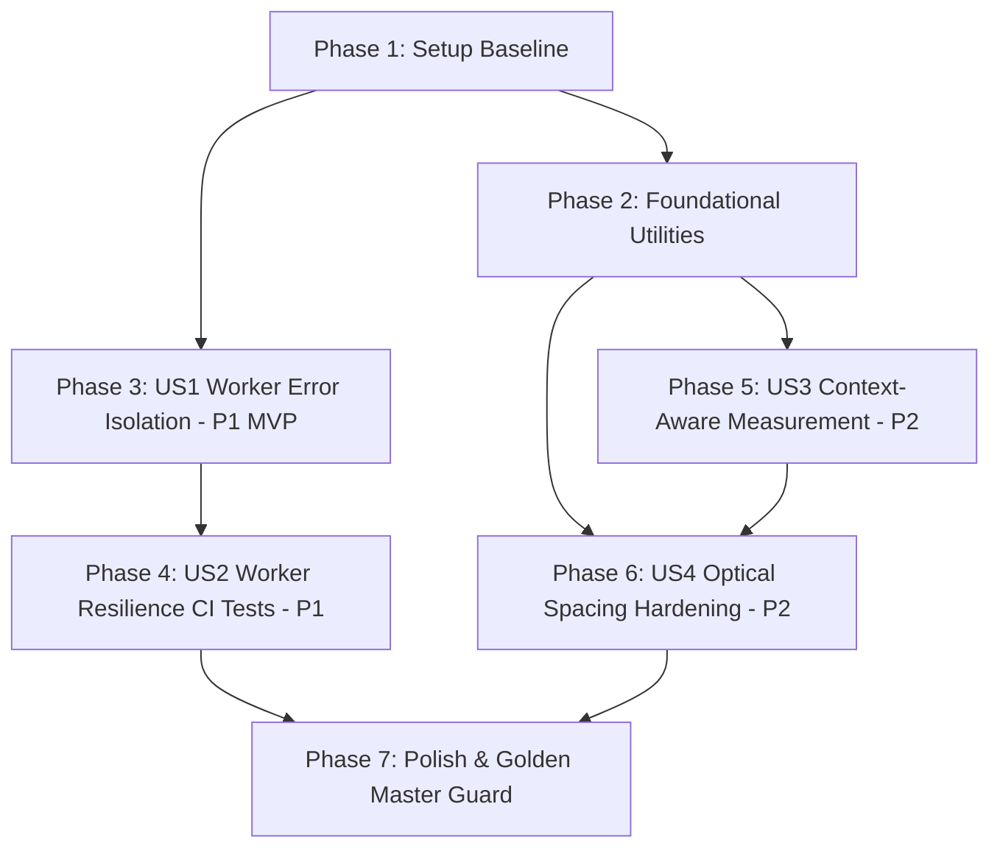

# Tasks: Cách ly Lỗi Muộn Worker, Đồng bộ Ngữ cảnh Đo Độ rộng Số và Chống Dính Nét Dấu câu

**Input**: Design documents from `/specs/049-worker-error-guard-punct-spacing/` (`spec.md`, `plan.md`, `research.md`, `data-model.md`, `contracts/`, `quickstart.md`)

**Prerequisites**: plan.md (required), spec.md (required for user stories), research.md, data-model.md, contracts/

## Format: `[ID] [P?] [Story] Description with file path`

- **[P]**: Can run in parallel (different files, no dependencies)
- **[Story]**: Which user story this task belongs to (e.g., US1, US2, US3, US4)
- Include exact file paths in descriptions

---

## Phase 1: Setup (Shared Infrastructure)

**Purpose**: Xác minh môi trường cơ sở và bộ kiểm thử hồi quy trước khi chỉnh sửa mã nguồn.

- [X] T001 Kiểm tra trạng thái làm việc và chạy thử kiểm thử đơn vị cơ sở qua `npm run test:unit` và `pytest tests/test_golden_master_real_path.py`

---

## Phase 2: Foundational (Blocking Prerequisites)

**Purpose**: Cơ sở hạ tầng hình học và glyph dự phòng dùng chung cho các User Stories.

- [X] T002 [P] Bổ sung nét vector fallback dự phòng cho dấu hai chấm `:` và chấm phẩy `;` trong `chuviettay/model/text_utils.py`
- [X] T003 [P] Bổ sung hàm tiện ích `_get_item_ink_bounds_x` đo biên ngang hình học thực tế của nét vẽ trong `chuviettay/layout/math_layout.py`

---

## Phase 3: User Story 1 - Cách ly sự kiện lỗi đến muộn từ tiến trình Worker thế hệ cũ (Priority: P1) 🎯 MVP

**Goal**: Đảm bảo mọi sự kiện lỗi (`onerror`, `onmessageerror`) đến muộn từ Worker cũ đã bị thay thế bị loại bỏ ngay tại đầu hàm mà không kích hoạt quy trình lỗi nghiêm trọng toàn cục hoặc hủy yêu cầu của Worker mới.

**Independent Test**: Gửi một yêu cầu công việc trên Worker B (thế hệ mới), kích hoạt lỗi `onerror` hoặc `onmessageerror` trên đối tượng Worker A (thế hệ cũ); xác nhận Worker B hoàn thành yêu cầu thành công và giao diện vẫn ở trạng thái sẵn sàng.

### Implementation for User Story 1

- [X] T004 [US1] Thêm guard kiểm tra `if (generation !== workerGeneration)` tại dòng đầu của `targetWorker.onerror` trong `webapp/js/app.js`
- [X] T005 [US1] Thêm guard kiểm tra `if (generation !== workerGeneration)` tại dòng đầu của `targetWorker.onmessageerror` trong `webapp/js/app.js`
- [X] T006 [US1] Bổ sung giải phóng `boundSession.resolve(false)` khi phát hiện thế hệ cũ trong cả hai handler lỗi để dọn dẹp timer và tránh rò rỉ phiên trong `webapp/js/app.js`

**Checkpoint**: User Story 1 hoàn tất - Worker cũ hoàn toàn bị cô lập khỏi luồng xử lý lỗi của hệ thống.

---

## Phase 4: User Story 2 - Bộ kiểm thử hồi quy toàn diện bảo vệ vòng đời đa phiên Worker trong CI (Priority: P1)

**Goal**: Bổ sung bộ kiểm thử tự động toàn diện trong `tests/js/worker_resilience.test.mjs` bảo vệ các kịch bản cạnh tranh đa phiên Worker, lỗi muộn từ Worker cũ, và thu hồi tài nguyên trong CI.

**Independent Test**: Chạy `npm run test:unit`; xác nhận trình chạy kiểm thử Node.js phát hiện và vượt qua 100% các bài test hồi quy mới.

### Implementation for User Story 2

- [X] T007 [P] [US2] Thêm ca kiểm thử tự động xác minh sự kiện `onerror` đến muộn từ Worker thế hệ cũ bị bỏ qua không làm hủy yêu cầu của Worker thế hệ mới trong `tests/js/worker_resilience.test.mjs`
- [X] T008 [P] [US2] Thêm ca kiểm thử tự động xác minh sự kiện `onmessageerror` đến muộn từ Worker thế hệ cũ bị bỏ qua không ảnh hưởng Worker mới trong `tests/js/worker_resilience.test.mjs`
- [X] T009 [US2] Thêm ca kiểm thử tự động xác minh sự kiện `onerror` và `onmessageerror` từ Worker thế hệ hiện hành vẫn kích hoạt `handleWorkerFatalError()` và reject pending requests trong `tests/js/worker_resilience.test.mjs`
- [X] T010 [US2] Chạy lệnh kiểm thử đơn vị `npm run test:unit` để xác nhận toàn bộ test cases Worker trong CI vượt qua 100%

**Checkpoint**: User Story 1 & 2 hoàn tất - Hệ thống kiểm thử tự động bảo vệ vòng đời Worker đã hoạt động đầy đủ trên CI.

---

## Phase 5: User Story 3 - Đồng bộ ngữ cảnh hạt giống (Seed Context) khi đo độ rộng và kết xuất chuỗi số (Priority: P2)

**Goal**: Đồng bộ hóa 100% ngữ cảnh hạt giống (`SeedContext`) giữa bước đo độ rộng (`measure_text_width`) và bước kết xuất nét chữ số thực tế, ngăn ngừa sai lệch biến thể chữ số trong tiêu đề và bảng biểu.

**Independent Test**: Đo độ rộng và kết xuất chuỗi số trên kho mẫu đa biến thể trong ngữ cảnh `heading` và `cell`; xác nhận độ rộng ước lượng và độ rộng vẽ thực tế khớp nhau (sai lệch `<= 0.05 * xh`).

### Implementation for User Story 3

- [X] T011 [US3] Mở rộng chữ ký hàm `measure_text_width(self, text: str, scale: float = 1.0, context: SeedContext | None = None)` trong `chuviettay/model/writer.py`
- [X] T012 [US3] Chuyển tiếp tham số `context` vào `self.number(nfc_text, k=k_idx, context=context)` và bảo đảm khôi phục trạng thái `_current_context` trong khối `finally` của `measure_text_width` trong `chuviettay/model/writer.py`
- [X] T013 [US3] Di chuyển bước tính `tok_occ` lên trước lời gọi `measure_text_width` và khởi tạo `SeedContext(content_type=context_prefix, element_id=tok, occurrence=tok_occ, sub_index=0)` trong `chuviettay/layout/engine.py` (`_layout_inlines`)
- [X] T014 [US3] Khởi tạo và truyền `SeedContext` phù hợp khi đo độ rộng từ ngữ trong `measure_word_bounds` của bảng biểu trong `chuviettay/layout/engine.py`
- [X] T015 [US3] Tạo kiểm thử tự động kiểm chứng tính đồng bộ độ rộng và bảo toàn trạng thái thuần túy (pure function) của `measure_text_width` trong `tests/test_punctuation_optical_spacing.py`

**Checkpoint**: User Story 3 hoàn tất - Đo độ rộng nhận biết ngữ cảnh hạt giống hoàn hảo, không còn sai lệch biến thể chữ số.

---

## Phase 6: User Story 4 - Tách rời quang học và chống dính nét cho dấu câu, dấu phẩy thập phân và dấu ngoặc toán học (Priority: P2)

**Goal**: Áp dụng sàn khoảng hở quang học hình học thực tế cho dấu phẩy/chấm thập phân, dấu ngoặc toán học và dấu câu kết thúc, ngăn ngừa triệt để hiện tượng chạm nét mực trong khi bảo toàn 100% Golden Master SHA-256.

**Independent Test**: Kết xuất các biểu thức số thập phân (`0,39`, `0,19`, `0,20`), công thức toán (`F_X(1)`, `F_X(4)`, `P(2 <= X <= 5)`) và từ có dấu (`ta có:`); đo khoảng cách hình học giữa các bounding box xác nhận luôn tồn tại khoảng hở quang học dương `>= 0.10 * xh`, đồng thời 9/9 test Golden Master vượt qua.

### Implementation for User Story 4

- [X] T016 [US4] Cập nhật `Writer.number()` trong `chuviettay/model/writer.py` áp dụng sàn khoảng hở quang học hình học thực tế trước dấu phẩy/chấm (`>= max(0.10 * xh, 0.80 * pen_w)`) và sau dấu phẩy/chấm (`>= max(0.10 * xh, 0.75 * pen_w)`) dựa trên biên nét vẽ thực tế
- [X] T017 [US4] Cập nhật `Writer.token()` trong `chuviettay/model/writer.py` căn chỉnh vị trí dấu kết thúc theo biên trái thực tế `p_min_x` và bảo đảm sàn khoảng hở đuôi (`max(0.85 * pen_w, 0.20 * xh)`) và giữa các dấu liên tiếp (`max(0.60 * pen_w, 0.14 * xh)`)
- [X] T018 [US4] Nâng cấp `_HUG` trong `_row_gaps` từ `0.02` lên `0.08` trong `chuviettay/layout/math_layout.py`
- [X] T019 [US4] Bổ sung cơ chế sàn khoảng hở quang học hình học thực tế trong `_m_MathRow` (`chuviettay/layout/math_layout.py`) bảo đảm vị trí đặt phần tử sau không bao giờ đè lên biên nét vẽ cực đại của phần tử trước
- [X] T020 [US4] Điều chỉnh `pad` trong `_m_Delimited` (`chuviettay/layout/math_layout.py`) lên `max(1.2 * eff, 0.14 * self.xh * eff)`
- [X] T021 [US4] Bổ sung các bài kiểm thử hình học tự động kiểm chứng khoảng hở quang học dương cho số thập phân, biểu thức toán học và dấu câu trong `tests/test_punctuation_optical_spacing.py`

**Checkpoint**: User Story 4 hoàn tất - Khoảng hở quang học tự nhiên, không còn hiện tượng dính nét ngoặc toán hay số thập phân.

---

## Phase 7: Polish & Cross-Cutting Concerns

**Purpose**: Xác minh toàn diện độ ổn định, kiểm thử hồi quy Golden Master và kiểm tra mã nguồn.

- [X] T022 Chạy toàn bộ 9 ca kiểm thử Golden Master đường thật `pytest tests/test_golden_master_real_path.py` xác nhận 100% SHA-256 khớp tuyệt đối
- [X] T023 Chạy toàn bộ bộ kiểm thử Python `pytest tests/` xác nhận không có bất kỳ ca kiểm thử nào bị gãy
- [X] T024 Chạy bộ kiểm thử đơn vị JavaScript `npm run test:unit` và kiểm tra cú pháp `npm run lint:js`
- [X] T025 Thực hiện toàn bộ các kịch bản kiểm chứng trong `specs/049-worker-error-guard-punct-spacing/quickstart.md`

---

## Dependencies & Execution Order

### Phase Dependencies

- **Setup (Phase 1)**: Không phụ thuộc - chạy trước tiên để chốt baseline.
- **Foundational (Phase 2)**: Phụ thuộc Phase 1 - cung cấp tiện ích fallback và đo biên nét.
- **User Story 1 (Phase 3 - P1)**: Có thể bắt đầu ngay sau Phase 1.
- **User Story 2 (Phase 4 - P1)**: Phụ thuộc vào User Story 1 (kiểm thử bảo vệ các thay đổi của US1).
- **User Story 3 (Phase 5 - P2)**: Có thể tiến hành song song với US1/US2 (thay đổi trên Python Core).
- **User Story 4 (Phase 6 - P2)**: Phụ thuộc vào Phase 2 và Phase 5 (sử dụng tiện ích hình học và context measurement).
- **Polish (Phase 7)**: Phụ thuộc vào việc hoàn tất toàn bộ các User Stories.

### User Story Dependencies



---

## Parallel Execution Opportunities

```bash
# Parallel 1: Foundational tasks
Task: T002 "Nét vector fallback dự phòng cho : và ; trong chuviettay/model/text_utils.py"
Task: T003 "Hàm tiện ích _get_item_ink_bounds_x trong chuviettay/layout/math_layout.py"

# Parallel 2: Tests in US2
Task: T007 "Test late onerror từ Worker cũ trong tests/js/worker_resilience.test.mjs"
Task: T008 "Test late onmessageerror từ Worker cũ trong tests/js/worker_resilience.test.mjs"

# Parallel 3: Frontend vs Backend track
Track Frontend: US1 (T004-T006) + US2 (T007-T010) trên webapp/js/app.js & tests/js/worker_resilience.test.mjs
Track Backend: US3 (T011-T015) + US4 (T016-T021) trên chuviettay/ & tests/test_punctuation_optical_spacing.py
```

---

## Implementation Strategy

### MVP First (User Story 1 & 2)
1. Hoàn thành Phase 1 & Phase 2.
2. Hoàn thành Phase 3 (US1 - Cách ly lỗi muộn Worker trong `app.js`).
3. Hoàn thành Phase 4 (US2 - Unit test bảo vệ đa phiên Worker trong CI).
4. **Xác nhận MVP**: Chạy `npm run test:unit` đạt 100% PASS.

### Incremental Delivery (User Story 3 & 4)
1. Triển khai Phase 5 (US3 - Đồng bộ SeedContext trong `measure_text_width` và `_layout_inlines`).
2. Triển khai Phase 6 (US4 - Sàn quang học chống dính nét dấu phẩy, dấu ngoặc và dấu câu).
3. Triển khai Phase 7 (Nghiệm thu toàn diện: Golden Master, Pytest, Lint).
