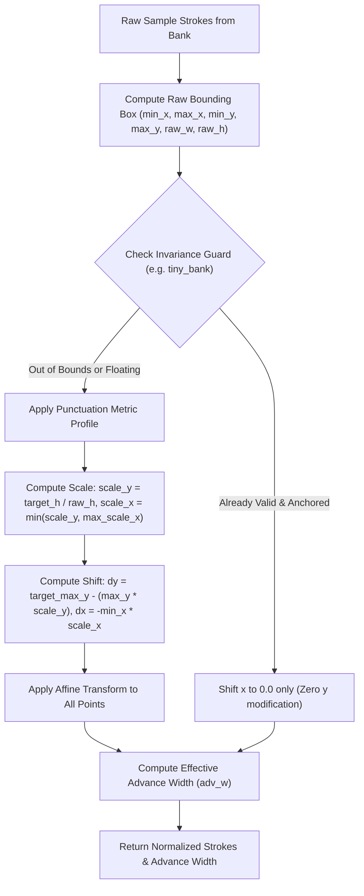

# Data Model: Chuẩn hóa Hình học và Vị trí Quang học Dấu câu

**Feature Branch**: `050-punctuation-geometry-normalization`  
**Date**: 2026-10-20  
**Spec Reference**: [specs/050-punctuation-geometry-normalization/spec.md](spec.md)

---

## 1. Mô hình Thực thể (Entities)

### 1.1 Nhóm Hình học Dấu câu (Punctuation Category)
Phân loại các ký tự dấu câu theo đặc tính sinh học hình học:

```text
enum PunctuationCategory {
    PARENS,       // Ngoặc bao quanh: (, ), [, ], {, }
    COMMA,        // Dấu phẩy: ,
    DOT,          // Dấu chấm: .
    COLON,        // Dấu hai chấm: :
    SEMICOLON,    // Dấu chấm phẩy: ;
    EXCL_QUEST,   // Dấu chấm than & hỏi: !, ?
    QUOTES,       // Dấu nháy đơn/kép: ', ", “, ”, ‘, ’
    HYPHEN_DASH,  // Dấu gạch ngang: -, –, —
    OTHER         // Các dấu khác: /, %, &, @, #, *, §
}
```

### 1.2 Hồ sơ Hình học Tham chiếu (PunctuationMetricProfile)
Định nghĩa quy chuẩn kích thước, vị trí và tỷ lệ cho từng nhóm dấu câu:

```text
class PunctuationMetricProfile:
    category: PunctuationCategory
    target_height_ratio: float      # Chiều cao mục tiêu so với xh
    min_height_ratio: float         # Chiều cao tối thiểu chấp nhận được
    max_height_ratio: float         # Chiều cao tối đa chấp nhận được
    target_min_y_ratio: float       # Vị trí đỉnh mục tiêu (y âm là hướng lên trên)
    target_max_y_ratio: float       # Vị trí đáy mục tiêu (y dương là hướng xuống dưới)
    max_width_ratio: float | None   # Bề rộng tối đa cho phép so với xh
    preserve_baseline: bool         # Mẫu đã bám đúng baseline thì không dịch chuyển
```

Bảng tham số tham chiếu:

| Nhóm | Ký tự | Dải chiều cao (`* xh`) | Đỉnh mục tiêu (`min_y`) | Đáy mục tiêu (`max_y`) | Tỷ lệ co giãn bề rộng x (`scale_x`) |
|------|-------|------------------------|-------------------------|------------------------|------------------------------------|
| `PARENS` | `(`, `)`, `[`, `]`, `{`, `}` | `[1.35, 1.55]` (mục tiêu `1.45`) | `-1.25 * xh` | `+0.20 * xh` | `min(scale_y, (0.50 * xh) / max(raw_w, 1e-3))` |
| `COMMA` | `,` | `[0.20, 0.50]` (mục tiêu `0.38`) | `-0.14 * xh` | `+0.24 * xh` | `1.0` (giữ nguyên tỷ lệ tự nhiên) |
| `DOT` | `.` | `<= 0.22` (mục tiêu `0.14`) | `-0.14 * xh` | `0.00 * xh` | `min(scale_y, 1.0)` |
| `COLON` | `:` | `[0.60, 0.85]` (mục tiêu `0.70`) | `-0.75 * xh` | `-0.05 * xh` | `1.0` |
| `SEMICOLON` | `;` | `[0.85, 1.15]` (mục tiêu `1.00`) | `-0.75 * xh` | `+0.24 * xh` | `<= 0.32 * xh` |
| `EXCL_QUEST`| `!`, `?` | `[1.10, 1.25]` (mục tiêu `1.18`) | `-1.18 * xh` | `0.00 * xh` | `min(scale_y, (0.45 * xh) / max(raw_w, 1e-3))` |
| `QUOTES` | `'`, `"`, `“`, `”`, `‘`, `’` | `[0.25, 0.45]` (mục tiêu `0.35`) | `-1.20 * xh` | `-0.85 * xh` | `1.0` |
| `HYPHEN_DASH`| `-`, `–`, `—` | theo mẫu | tâm `-0.45 * xh` | tâm `-0.45 * xh` | `1.0` |

---

## 2. Quy trình Biến đổi Hình học (Geometry Transformation Pipeline)



---

## 3. Quy tắc Khoảng hở Quang học (Optical Clearance Model)

### 3.1 Định nghĩa Khoảng hở Cặp Ký tự
Khoảng hở quang học thực tế giữa hai nét vẽ liền kề được tính dựa trên tọa độ cực phải của nét vẽ đi trước (`prev_ink_max_x`) và tọa độ cực trái của nét vẽ tiếp theo (`curr_ink_min_x`):

$$\text{actual\_gap} = (x_{\text{curr}} + \text{curr\_ink\_min\_x}) - \text{prev\_ink\_max\_x}$$

Yêu cầu bất biến:

$$\text{actual\_gap} \ge \text{min\_clearance}$$

### 3.2 Bảng Quy tắc Sàn Khoảng hở Tối thiểu (`min_clearance`)

| Ký tự trước (`prev`) | Ký tự sau (`curr`) | Ngữ cảnh | Sàn khoảng hở tối thiểu (`min_clearance`) |
|----------------------|--------------------|----------|------------------------------------------|
| Chữ số `1` (hoặc nét sổ đứng) | Dấu đóng ngoặc `)` | Toán học (`MathRow`) | $\max(0.18 \times x_h \times \text{eff},\; 1.0 \times \text{pen\_w})$ |
| Bất kỳ | Dấu đóng ngoặc `)` | Toán học (`Delimited`) | $\max(0.18 \times x_h \times \text{eff},\; 1.0 \times \text{pen\_w})$ (nếu đuôi là số 1) |
| Chữ số bất kỳ | Dấu phẩy `,` | Văn bản / Số / Toán | $\max(0.18 \times x_h \times \text{eff},\; 1.0 \times \text{pen\_w})$ |
| Từ văn bản | Dấu hai chấm `:` | Văn bản thường (`token`) | $\max(0.18 \times x_h,\; 0.85 \times \text{pen\_w})$ |
| Dấu chấm `.` | Dấu chấm `.` | Chuỗi ba chấm `...` | $0.15 \times x_h$ |
