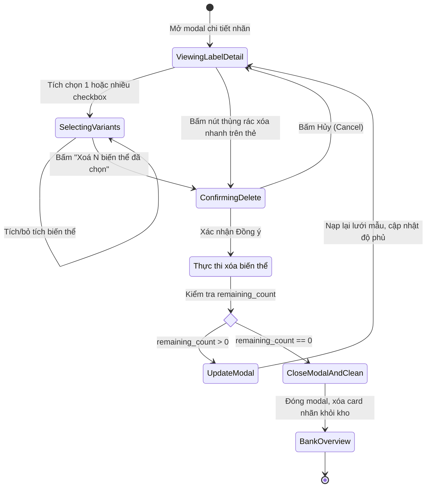

# Data Model: Chọn và Xóa Biến Thể Mẫu Nét Tùy Chọn

**Feature Branch**: `051-selective-variant-deletion`  
**Date**: 2026-10-20  
**Spec**: [spec.md](spec.md)

---

## 1. Mô hình Thực thể (Entities)

### 1.1. `Biến thể mẫu nét` (Sample Variant)
Đại diện cho một mẫu nét vẽ đơn lẻ của một nhãn ký tự trong kho mẫu nét.

| Thuộc tính | Kiểu dữ liệu | Bắt buộc | Mô tả |
|------------|--------------|----------|-------|
| `index` | `int` | Có (runtime) | Chỉ số 0-based của mẫu trong danh sách mẫu của nhãn (`0 <= index < count`). |
| `w` | `float` | Có | Chiều rộng tham chiếu của nét vẽ (đơn vị pt). |
| `s` | `list[list[list[float]]]` | Có | Mảng các nét vẽ (strokes), mỗi nét là danh sách các điểm tọa độ `[x, y]`. |
| `_sig` | `str` | Tùy chọn | Chữ ký hash hình học dùng cho chống trùng lặp mẫu (deduplication). |
| `T` | `str` | Tùy chọn | Mã dấu thanh (chỉ có trong phân loại `words`). |
| `ti` | `int` | Tùy chọn | Chỉ số của nét dấu thanh trong danh sách nét (chỉ có trong `words`). |

---

### 1.2. `Nhãn ký tự` (Character Label)
Đại diện cho một ký tự, từ hoặc ký hiệu hoàn chỉnh trong kho mẫu nét.

| Thuộc tính | Kiểu dữ liệu | Bắt buộc | Mô tả |
|------------|--------------|----------|-------|
| `label` | `str` | Có | Chuỗi định danh nhãn (ví dụ: `"Ơ"`, `"hoa"`, `","`, `"\pi"`). |
| `category` | `str` | Có | Phân loại kho: `"letters"`, `"words"`, `"digits"`, `"punct"`, `"symbols"`, `"marks"`. |
| `samples` | `list[SampleVariant]` | Có | Danh sách tuần tự các biến thể mẫu nét đã được dạy cho nhãn này. |
| `count` | `int` | Có | Số lượng biến thể hiện có (`len(samples)`). |

**Ràng buộc bất biến (Invariants)**:
- **Tính hợp lệ**: Nếu `count > 0`, nhãn bắt buộc phải tồn tại trong từ điển `bank.<category>` với danh sách `samples` không rỗng.
- **Dọn dẹp rỗng**: Nếu `count == 0` (sau khi xóa hết biến thể), nhãn bắt buộc phải bị xóa khỏi từ điển `bank.<category>`, đồng thời ghi nhận tombstone `{category}:{label}` để đồng bộ. Tuyệt đối không để lại nhãn có `samples = []`.
- **Thứ tự ổn định**: Sau khi xóa một tập hợp con các biến thể, thứ tự tương đối của các biến thể còn lại phải được bảo toàn nguyên vẹn.

---

## 2. Mô hình Thông điệp Giao tiếp (IPC Message Payloads)

### 2.1. Yêu cầu xóa biến thể (`drop_label_samples` Request)
Dữ liệu từ Frontend/Web Worker gửi tới Python Engine:

```json
{
  "method": "drop_label_samples",
  "params": {
    "label": "Ơ",
    "indices": [1, 3],
    "category": "letters"
  }
}
```

- `label` (`str`): Nhãn mục tiêu cần xóa biến thể.
- `indices` (`list[int]`): Danh sách các chỉ số 0-based của biến thể muốn xóa (ví dụ `[1, 3]` tương ứng Mẫu #2 và Mẫu #4).
- `category` (`str`, mặc định `"words"`): Phân loại kho chứa nhãn.

### 2.2. Kết quả xóa biến thể (`drop_label_samples` Response)
Dữ liệu Python Engine phản hồi cho Frontend:

```json
{
  "ok": true,
  "data": {
    "label": "Ơ",
    "category": "letters",
    "removed_count": 2,
    "remaining_count": 2,
    "label_deleted": false
  }
}
```

Trường hợp xóa sạch toàn bộ biến thể dẫn đến xóa nhãn:
```json
{
  "ok": true,
  "data": {
    "label": "Ơ",
    "category": "letters",
    "removed_count": 4,
    "remaining_count": 0,
    "label_deleted": true
  }
}
```

---

## 3. Chuyển trạng thái Vòng đời Dữ liệu (State Transitions)


