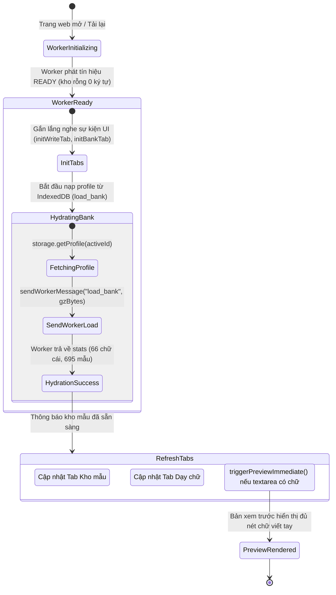
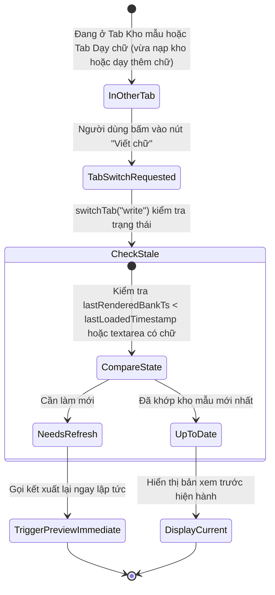
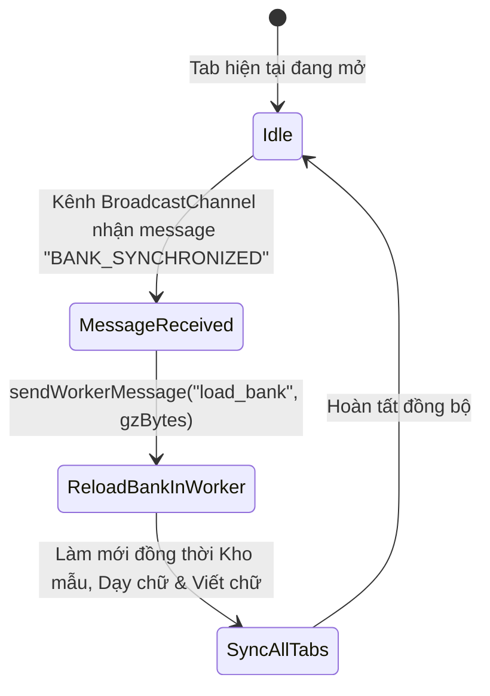

# Data Model & State Transitions: 052-write-preview-bank-sync

## 1. Thực Thể Dữ Liệu (Entities)

### 1.1. BankHydrationState (Trạng thái nạp kho mẫu)
Quản lý trạng thái nạp và độ sẵn sàng của kho mẫu trong phiên làm việc Web Client.

```typescript
interface BankHydrationState {
  isHydrated: boolean;          // true khi kho mẫu từ IndexedDB đã được nạp thành công vào Worker
  profileId: string;            // ID của hồ sơ kho mẫu đang hoạt động (ví dụ: 'default_profile')
  lastLoadedTimestamp: number;  // Thời điểm (epoch ms) kho mẫu được nạp gần nhất vào Worker
  lettersCount: number;         // Số lượng chữ cái trong kho mẫu vừa nạp
  totalSamples: number;         // Tổng số mẫu nét trong kho mẫu vừa nạp
}
```

### 1.2. WritePreviewSyncState (Trạng thái đồng bộ của Tab Viết chữ)
Theo dõi phiên bản kho mẫu đã được dùng để kết xuất bản xem trước hiện tại trong Tab Viết chữ.

```typescript
interface WritePreviewSyncState {
  isRendering: boolean;               // Cờ báo hiệu đang thực hiện yêu cầu kết xuất
  hasPendingRequest: boolean;         // Có yêu cầu kết xuất đang chờ thực hiện nối tiếp
  lastRenderedBankTs: number;         // Timestamp của kho mẫu được sử dụng trong lượt kết xuất gần nhất
  missingTokenCount: number;          // Số lượng token bị thiếu mẫu trong lần kết xuất gần nhất
  missingSorted: [string, number][];  // Danh sách từ/ký tự thiếu đã sắp xếp [ký_tự, số_lần]
  missingBoxes: TokenBox[];           // Danh sách bounding box của các từ thiếu mẫu trên trang giấy
}
```

---

## 2. Máy Trạng Thái & Chuyển Dịch (State Transitions)

### 2.1. Chu trình khởi động & Tải trang (Startup & Page Reload Lifecycle)



### 2.2. Chuyển đổi Tab (Tab Switch Transition)



### 2.3. Nhận Tín Hiệu Đồng Bộ Đa Tab (BroadcastChannel Sync Transition)


