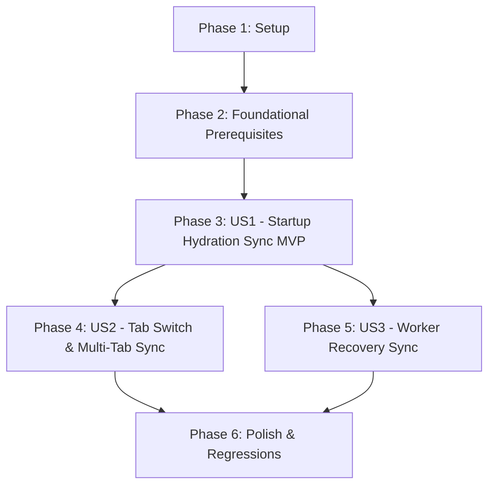

# Tasks: Đồng Bộ Kho Mẫu Và Kết Xuất Xem Trước Tab Viết Chữ (052-write-preview-bank-sync)

**Input**: Design documents from `specs/052-write-preview-bank-sync/` (`spec.md`, `plan.md`, `research.md`, `data-model.md`, `contracts/preview-sync-contract.md`, `quickstart.md`)

**Prerequisites**: `plan.md` (required), `spec.md` (required for user stories), `research.md`, `data-model.md`, `contracts/preview-sync-contract.md`

**Tests**: Test tasks included using Node.js built-in test runner (`tests/js/write_preview_sync.test.mjs`).

**Organization**: Tasks are grouped by user story to enable independent implementation and testing of each story.

## Format: `- [ ] [TaskID] [P?] [Story?] Description with file path`

- **[P]**: Can run in parallel (different files, no dependencies)
- **[Story]**: Which user story this task belongs to (e.g., [US1], [US2], [US3])
- Include exact file paths in descriptions

---

## Phase 1: Setup (Shared Infrastructure)

**Purpose**: Thiết lập cấu trúc giao diện module và định nghĩa trạng thái đồng bộ ban đầu giữa `app.js` và `write.js`.

- [X] T001 Inspect and verify module export/import bindings between webapp/js/write.js and webapp/js/app.js to prevent circular dependency deadlocks
- [X] T002 Add bank hydration state flags (isBankHydrated, isBankDirty, hasInitialRenderDone) in webapp/js/write.js
- [X] T003 [P] Initialize unit test scaffold for preview synchronization in tests/js/write_preview_sync.test.mjs

---

## Phase 2: Foundational (Blocking Prerequisites)

**Purpose**: Hạ tầng giao tiếp cốt lõi giữa điều phối vòng đời ứng dụng và bộ kết xuất Tab Viết chữ.

**⚠️ CRITICAL**: Không thực hiện các User Story khi chưa hoàn thành giai đoạn nền tảng này.

- [X] T004 Implement notifyBankUpdated({ reason }) and state synchronization accessors (getWritePreviewSyncState, markBankDirty) in webapp/js/write.js
- [X] T005 Update initWriteTab in webapp/js/write.js to avoid premature unhydrated preview during initial load while bank hydration is pending
- [X] T006 [P] Implement mock DOM and Pyodide worker harness with MockIDBDatabase in tests/js/write_preview_sync.test.mjs

**Checkpoint**: Nền tảng đồng bộ sẵn sàng - các User Story có thể tiến hành độc lập.

---

## Phase 3: User Story 1 - Tự động đồng bộ và hiển thị đúng nét chữ khi mở trang hoặc tải lại (Priority: P1) 🎯 MVP

**Goal**: Khi người dùng mở hoặc tải lại trang web với văn bản có sẵn trong editor, sau khi `load_bank` hoàn thành trong `onWorkerReady()`, hệ thống tự động gọi `triggerPreviewImmediate()` để kết xuất nét chữ từ kho mẫu đã nạp, xóa bỏ 100% tình trạng thiếu mẫu giả tạo (false positive missing chips).

**Independent Test**: Nạp profile có sẵn trong mock IndexedDB, đặt text trong textarea, kích hoạt `onWorkerReady()`, xác nhận `write_text` được gọi sau `load_bank` và không có render kho rỗng trước đó.

### Tests for User Story 1 🧪

- [X] T007 [P] [US1] Unit test: verify load_bank completion in onWorkerReady() triggers hydrated preview without duplicate startup render in tests/js/write_preview_sync.test.mjs
- [X] T008 [P] [US1] Unit test: verify first-time user with empty profiles triggers initial preview on default empty bank in tests/js/write_preview_sync.test.mjs

### Implementation for User Story 1

- [X] T009 [US1] Hook load_bank completion in onWorkerReady() in webapp/js/app.js to call triggerPreviewImmediate() and mark bank hydrated
- [X] T010 [US1] Handle startup flow when profiles.length is 0 in webapp/js/app.js to allow initial write preview with default empty bank
- [X] T011 [US1] Ensure rendering indicator and missing tokens count are correctly updated upon hydrated preview in webapp/js/write.js

**Checkpoint**: User Story 1 hoàn thành - giải quyết dứt điểm vấn đề kẹt gạch đỏ và chip thiếu mẫu giả tạo khi mở trang (MVP Ready).

---

## Phase 4: User Story 2 - Tự động cập nhật kết xuất khi chuyển đổi hoặc nạp kho mẫu mới (Priority: P2)

**Goal**: Khi người dùng chuyển tab sang Tab Viết (`switchTab("write")`), nạp file kho mới (`loadBankFromBytes` trong `bank.js`), nạp lưới chữ (`import_grid` / `notifySampleTaught`), hoặc nhận tín hiệu đồng bộ đa tab (`BANK_SYNCHRONIZED`), Tab Viết chữ tự động phát hiện trạng thái bẩn (`isBankDirty`) và kết xuất lại bản xem trước chính xác nhất.

**Independent Test**: Thay đổi kho mẫu hoặc dạy mẫu mới ở tab khác, chuyển sang Tab Viết chữ, xác nhận `triggerPreviewImmediate` chỉ kích hoạt khi `isBankDirty` và không re-render dư thừa nếu dữ liệu không đổi.

### Tests for User Story 2 🧪

- [X] T012 [P] [US2] Unit test: verify switchTab("write") refreshes preview only when isBankDirty is true in tests/js/write_preview_sync.test.mjs
- [X] T013 [P] [US2] Unit test: verify loadBankFromBytes() in webapp/js/bank.js marks bank dirty and notifies Tab Viết in tests/js/write_preview_sync.test.mjs
- [X] T014 [P] [US2] Unit test: verify BANK_SYNCHRONIZED broadcast event triggers preview refresh in tests/js/write_preview_sync.test.mjs

### Implementation for User Story 2

- [X] T015 [US2] Update switchTab(targetTab) in webapp/js/app.js to check isBankDirty and trigger triggerPreviewImmediate() when switching to "write"
- [X] T016 [US2] Update loadBankFromBytes() in webapp/js/bank.js to notify Tab Viết of bank update via notifyBankUpdated()
- [X] T017 [US2] Update notifySampleTaught() in webapp/js/app.js to mark bank dirty and notify write preview of new taught samples
- [X] T018 [US2] Update BANK_SYNCHRONIZED handler in webapp/js/app.js to refresh Tab Viết preview after multi-tab bank reload

**Checkpoint**: User Story 2 hoàn thành - bản xem trước Tab Viết luôn nhất quán khi thao tác nạp kho, học mẫu hoặc đồng bộ giữa nhiều cửa sổ.

---

## Phase 5: User Story 3 - Xử lý mượt mà khi phục hồi Web Worker (Priority: P3)

**Goal**: Khi Worker bị phục hồi sau lỗi hoặc treo (`recoverWorker`), sau khi Worker mới hoàn tất khởi động và nạp lại kho từ IndexedDB, Tab Viết chữ tự động khôi phục bản xem trước trang giấy với kho mẫu đầy đủ.

**Independent Test**: Mô phỏng worker crash và gọi `recoverWorker()`, xác minh sau khi worker mới khởi tạo và nạp bank, preview Tab Viết tự động kết xuất lại đúng nội dung và không treo trạng thái lỗi.

### Tests for User Story 3 🧪

- [X] T019 [P] [US3] Unit test: verify Worker recovery re-hydrates bank and re-renders Tab Viết preview without stale missing chips in tests/js/write_preview_sync.test.mjs

### Implementation for User Story 3

- [X] T020 [US3] Ensure recoverWorker() lifecycle and generation guard in webapp/js/app.js cleanly trigger write preview upon recovery completion

**Checkpoint**: Cả 3 User Story đã sẵn sàng và hoạt động độc lập, chống chịu sự cố sập Worker nền.

---

## Phase 6: Polish & Cross-Cutting Concerns

**Purpose**: Hoàn thiện xử lý lỗi biên, kiểm thử hồi quy toàn diện và đối chiếu tài liệu kiểm thử.

- [X] T021 [P] Ensure error boundary handling and toast feedback in webapp/js/write.js when render worker call fails
- [X] T022 Run complete JavaScript test suite with npm run test:unit to ensure zero regressions across tests/js/
- [X] T023 Validate manual verification scenarios according to specs/052-write-preview-bank-sync/quickstart.md

---

## Dependencies & Execution Order

### Phase Dependencies

- **Setup (Phase 1)**: Không phụ thuộc - có thể bắt đầu ngay lập tức.
- **Foundational (Phase 2)**: Phụ thuộc vào Setup - KHÓA TẤT CẢ các User Story cho đến khi hoàn thành.
- **User Story 1 (Phase 3 - P1)**: Phụ thuộc vào Foundational hoàn thành. Không phụ thuộc vào US2 hay US3.
- **User Story 2 (Phase 4 - P2)**: Phụ thuộc vào Foundational và US1 hoàn thành.
- **User Story 3 (Phase 5 - P3)**: Phụ thuộc vào Foundational và US1 hoàn thành.
- **Polish (Phase 6)**: Phụ thuộc vào tất cả User Stories đã hoàn thành.

### User Story Dependencies



### Within Each User Story

- Viết các bài kiểm thử unit/contract test tương ứng trước (TDD) và bảo đảm thất bại trước khi cài đặt.
- Cập nhật state flags và accessors trước khi tích hợp vào event handlers.
- Kiểm tra tính độc lập của từng User Story tại mỗi checkpoint trước khi chuyển sang story tiếp theo.

### Parallel Opportunities

- **Trong Phase 1**: T003 có thể thực hiện song song với T001, T002.
- **Trong Phase 2**: T006 có thể thực hiện song song với T004, T005.
- **Trong Phase 3 (US1)**: T007 và T008 có thể viết song song.
- **Trong Phase 4 (US2)**: T012, T013, T014 có thể viết song song. T016 (bank.js) có thể thực hiện song song với T015 (app.js).
- **Trong Phase 6**: T021 có thể thực hiện song song với việc chuẩn bị kịch bản kiểm thử T023.

---

## Parallel Execution Examples

### Parallel Execution: User Story 1 (Tests)
```bash
# Viết song song 2 test case cho User Story 1:
- Task T007: "Unit test: verify load_bank completion in onWorkerReady() triggers hydrated preview without duplicate startup render in tests/js/write_preview_sync.test.mjs"
- Task T008: "Unit test: verify first-time user with empty profiles triggers initial preview on default empty bank in tests/js/write_preview_sync.test.mjs"
```

### Parallel Execution: User Story 2 (Tests & Modules)
```bash
# Viết song song các test case cho User Story 2:
- Task T012: "Unit test: verify switchTab('write') refreshes preview only when isBankDirty is true in tests/js/write_preview_sync.test.mjs"
- Task T013: "Unit test: verify loadBankFromBytes() in webapp/js/bank.js marks bank dirty and notifies Tab Viết in tests/js/write_preview_sync.test.mjs"
- Task T014: "Unit test: verify BANK_SYNCHRONIZED broadcast event triggers preview refresh in tests/js/write_preview_sync.test.mjs"
```

---

## Implementation Strategy

### MVP First (User Story 1 Only)

1. Hoàn thành **Phase 1: Setup** (T001 - T003)
2. Hoàn thành **Phase 2: Foundational** (T004 - T006)
3. Hoàn thành **Phase 3: User Story 1** (T007 - T011)
4. **DỪNG VÀ XÁC THỰC**: Chạy `node --test tests/js/write_preview_sync.test.mjs` để xác nhận User Story 1 hoạt động hoàn hảo.
5. Giải quyết dứt điểm lỗi cốt lõi người dùng phản ánh.

### Incremental Delivery

1. Setup + Foundational -> Nền tảng đồng bộ sẵn sàng.
2. User Story 1 -> Khởi động/tải lại trang tự động nạp kho và render chuẩn (MVP).
3. User Story 2 -> Chuyển tab và nạp kho/dạy thêm mẫu tự động đồng bộ Tab Viết.
4. User Story 3 -> Tự động khôi phục bản xem trước khi Worker gặp sự cố.
5. Polish -> Chạy toàn bộ test suite (`npm run test:unit`) và kiểm tra thủ công.

---

## Notes

- Quy ước task: `- [ ] [TaskID] [P?] [Story?] Description with file path`
- Tất cả các task đều có file path cụ thể (`webapp/js/...`, `tests/js/...`).
- Không tạo biến toàn cục mới không kiểm soát; tuân thủ kiến trúc mô-đun ES6.
- Sử dụng cờ `isBankDirty` để tránh re-render lãng phí khi chuyển tab nếu kho mẫu không thay đổi.
