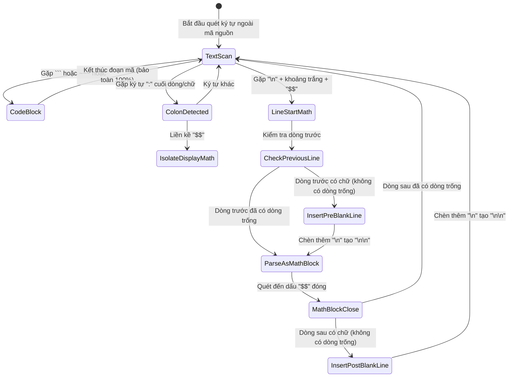

# Data Model: Nhận Diện Khối Công Thức Toán Display Khi Xuống Dòng Và Ngăn Ngừa Đè Nét Cận Toán Tử

**Feature**: `053-markdown-math-block-isolation`  
**Date**: 2026-10-22  
**Status**: Completed  

---

## 1. Mô hình thực thể tài liệu (Document IR Entities)

Mô hình cấu trúc tài liệu của `chuviettay` biểu diễn văn bản dưới dạng các phần tử cây cú pháp trung gian (Intermediate Representation - IR):

```text
Document
  ├── Block (Khối cấp 1)
  │     ├── Heading (level: 1..6, inlines: list[Inline])
  │     ├── Paragraph (inlines: list[Inline], align: str)
  │     ├── MathBlock (latex: str, ast: MathRow | None, occurrence: int | None)
  │     ├── ListBlock (ordered: bool, items: list[list[Block]], start: int)
  │     └── Table (rows: list[TableRow], borders: list[TableBorder])
  └── Inline (Phần tử nội dòng)
        ├── Text (text: str, stable_id: str | None)
        ├── LineBreak ()
        ├── Symbol (symbol: str, count: int)
        └── MathInline (latex: str, ast: MathRow | None, occurrence: int | None)
```

### Các thực thể trọng tâm trong tính năng này:

### 1. `MathBlock` (Khối công thức toán độc lập)
- **Mục đích**: Đại diện cho phương trình toán học hiển thị độc lập ở chế độ Display Math (`\displaystyle`).
- **Thuộc tính**:
  - `latex` (`str`): Chuỗi mã LaTeX gốc của công thức (ví dụ: `\sum_{j=1}^9 P(D = j) = 1`).
  - `ast` (`MathRow | None`): Cây cú pháp toán học phân tích bởi `parse_latex_math`.
  - `stable_id` (`str | None`): Định danh ổn định phục vụ gieo hạt giống biến thể chữ viết tay.
  - `occurrence` (`int | None`): Thứ tự xuất hiện trong tài liệu.
- **Quy tắc bố cục trong engine**:
  - Được kết xuất bằng `render_math_block(block, indent)`.
  - Khởi tạo `MathLayoutEngine(display=True)`.
  - Dấu $\sum$ hiển thị cận trên/dưới dạng xếp chồng (stacked limits).
  - Tự động ngắt dòng và căn giữa trên trang giấy (`layout_lines(avail_w)`).

### 2. `MathInline` (Công thức toán nội dòng)
- **Mục đích**: Đại diện cho biểu thức toán học nằm lẫn trong dòng chữ của một đoạn văn (`Paragraph`).
- **Thuộc tính**: Tương tự `MathBlock`, nhưng luôn là phần tử con của `Paragraph.inlines`.
- **Quy tắc bố cục trong engine**:
  - Được kết xuất trong luồng văn bản của đoạn văn.
  - Khởi tạo `MathLayoutEngine(display=False)`.
  - Dấu $\sum$ hiển thị cận bên (side limits).

---

## 2. Mô hình máy trạng thái phân tách khối toán (Math Block Separation State Machine)

Khi đọc chuỗi văn bản Markdown đầu vào, luồng chuẩn hóa xử lý văn bản theo máy trạng thái chuyển tiếp sau:



---

## 3. Mô hình hình học cận bên toán tử (Operator Side Limits Geometry Model)

Khi toán tử lớn ($\sum$) có cả chỉ số trên (`sup`) và chỉ số dưới (`sub`) ở chế độ cận bên:

```text
       Hoành độ: x = op.size.width + 1.0 * eff
       
                     [Superscript]       y - sup.ascent
                     |           |
                     [   sup     ]
                     |           |
                     -------------       y + sup.descent (sup_bot)
                           ▲
                           │  Khoảng hở an toàn quang học:
                           │  gap >= max(3.5 * eff, 0.40 * xh * eff)
                           ▼
                     -------------       y - sub.ascent (sub_top)
                     |           |
                     [   sub     ]
                     |           |
                     [Subscript  ]       y + sub.descent
```

### Các ràng buộc quang học (Geometric Invariants):
1. **Ràng buộc khoảng cách (Clearance Constraint)**:
   $$\text{sub\_top} - \text{sup\_bot} \ge \text{min\_gap}$$
   Với $\text{min\_gap} = \max(3.5 \times \text{eff}, 0.40 \times \text{xh} \times \text{eff})$.
2. **Ràng buộc tương thích ngược (Backward Compatibility)**:
   Nếu chỉ có một cận (`sup` hoặc `sub`), vị trí ban đầu được giữ nguyên hoàn toàn, không thay đổi so với các phiên bản trước.
3. **Ràng buộc bao bọc kích thước (Bounding Box Invariant)**:
   Chiều cao tổng thể `ascent` và `descent` của `MathLayoutItem` tự động mở rộng theo sự dịch chuyển của `sup_y` và `sub_y`, ngăn ngừa việc cắt nét hoặc tính sai kích thước dòng kẻ.
