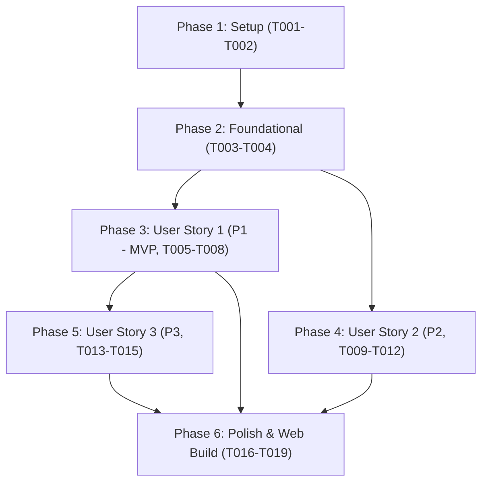

# Tasks: Nhận Diện Khối Công Thức Toán Display Khi Xuống Dòng Và Ngăn Ngừa Đè Nét Cận Toán Tử (053-markdown-math-block-isolation)

**Input**: Design documents from `specs/053-markdown-math-block-isolation/` (`spec.md`, `plan.md`, `research.md`, `data-model.md`, `contracts/`, `quickstart.md`)  
**Prerequisites**: `plan.md` (required), `spec.md` (required for user stories), `research.md`, `data-model.md`, `contracts/`  
**Tests**: Bao gồm các bài kiểm thử tự động để ngăn ngừa hồi quy và xác thực các ca lỗi từ Ảnh 1, 2, 3.  

---

## Phase 1: Setup (Shared Infrastructure)

**Purpose**: Khởi tạo tệp kiểm thử chuyên biệt và kiểm tra trạng thái xanh (green baseline) của toàn bộ test suites hiện hữu.

- [X] T001 Tạo tệp kiểm thử tự động chuyên biệt `tests/test_markdown_math_block_isolation.py` chứa khung kiểm thử ban đầu cho các ca phân tách khối toán và cận bên.
- [X] T002 [P] Chạy kiểm tra nền tảng toàn bộ test suites hiện tại qua `pytest tests/test_importer_markdown.py tests/test_markdown_math_import.py tests/test_math_layout.py` để bảo đảm baseline hoàn toàn sạch lỗi.

---

## Phase 2: Foundational (Blocking Prerequisites)

**Purpose**: Xây dựng hàm quét dòng tuyến tính an toàn và khai báo hằng số khoảng hở quang học tiên quyết.

- [X] T003 Xây dựng hàm quét dòng tuyến tính `_isolate_display_math_blocks(text: str) -> str` trong `chuviettay/importer/markdown_importer.py` có cơ chế bỏ qua hàng bảng GFM (`^\s*\|.*\|\s*$`) và chống ReDoS.
- [X] T004 [P] Khai báo hằng số khoảng hở quang học an toàn `MIN_SUBSUP_GAP_EFF = 3.5` và `MIN_SUBSUP_GAP_XH = 0.40` trong `chuviettay/layout/math_layout.py`.

---

## Phase 3: User Story 1 - Tự động nhận diện khối công thức độc lập trên dòng mới mà không cần dòng trống (Priority: P1) 🎯 MVP

**Goal**: Khắc phục trực tiếp lỗi ở Ảnh 2: Khi người dùng gõ `a\n$$\sum...$$` không có dòng trống, công thức vẫn được nhận diện là `MathBlock` độc lập với cận trên/dưới xếp chồng dọc và tự ngắt dòng.

**Independent Test**: Nhập `a\n$$\sum_{j=1}^9 P(D = j) = 1$$\nb` vào `MarkdownImporter.import_text` và xác nhận IR tạo ra đúng 3 khối riêng biệt: `Paragraph("a")`, `MathBlock(...)`, `Paragraph("b")`.

### Tests for User Story 1
- [X] T005 [P] [US1] Bổ sung các unit tests cho ca xuống dòng đơn (`\n$$...$$`), nhiều khối display liên tiếp, và khối nhiều dòng trong `tests/test_markdown_math_block_isolation.py`.

### Implementation for User Story 1
- [X] T006 [US1] Tích hợp `_isolate_display_math_blocks` vào `MarkdownImporter._normalize_math_delimiters` trong `chuviettay/importer/markdown_importer.py` để tự động chèn ranh giới dòng trống chuẩn CommonMark trước và sau `$$...$$` ở dòng mới ngoài các đoạn mã `_CODE_SEGMENT`.
- [X] T007 [US1] Xử lý bảo toàn khoảng cách thụt lề đầu dòng (indentation) khi `$$...$$` nằm trong danh sách (bullet list / ordered list) trong `chuviettay/importer/markdown_importer.py`.
- [X] T008 [US1] Chạy kiểm thử xác nhận User Story 1 hoàn thành độc lập qua `pytest tests/test_markdown_math_block_isolation.py -k "test_newline_math_block"`.

---

## Phase 4: User Story 2 - Ngăn ngừa đè nét giữa chỉ số trên và chỉ số dưới khi toán tử lớn hiển thị cận bên (Priority: P2)

**Goal**: Đảm bảo khi $\sum, \prod$ hiển thị ở chế độ cận bên (`stacked = False`), nét mực của chỉ số trên `9` và chỉ số dưới `j=1` luôn có khoảng cách thẳng đứng an toàn ($\ge 3.5\text{ pt}$), xóa bỏ hoàn toàn hiện tượng đè nét nát vụn ở Ảnh 2.

**Independent Test**: Đo đạc biểu thức `\sum_{j=1}^9 P(D = j)` bằng `MathLayoutEngine(display=False)` và kiểm tra `sub_top - sup_bot >= 3.5`.

### Tests for User Story 2
- [X] T009 [P] [US2] Bổ sung unit test kiểm tra khoảng cách quang học giữa chỉ số trên và dưới của toán tử lớn có `sup_dx == 0` trong `tests/test_math_layout.py`.

### Implementation for User Story 2
- [X] T010 [US2] Cài đặt thuật toán kiểm tra biên quang học và bù trừ độ cao (`sub_y += deficit * 0.65`, `sup_y -= deficit * 0.35`) trong `MathLayoutEngine._m_NAry` tại `chuviettay/layout/math_layout.py` cho các toán tử có `sup_dx == 0.0`.
- [X] T011 [US2] Bảo đảm toán tử tích phân (`node.op in SIDE_LIMIT_OPERATORS`, `sup_dx > 0`) giữ nguyên độ lệch dọc chuẩn tự nhiên mà không bị kéo giãn thừa thãi trong `chuviettay/layout/math_layout.py`.
- [X] T012 [US2] Chạy kiểm thử xác nhận User Story 2 hoàn thành độc lập qua `pytest tests/test_math_layout.py tests/test_math_layout_extended.py`.

---

## Phase 5: User Story 3 - Tự động tách biệt công thức display khi người dùng viết liền sau dấu hai chấm (Priority: P3)

**Goal**: Xử lý văn phong toán học tự nhiên như `ta có:$$formula$$`, tự động phân tách phần chữ dẫn nhập thành `Paragraph` và phần công thức thành `MathBlock`.

**Independent Test**: Nhập `ta có:$$\sum_{j=1}^9 P(D = j) = 1$$` và xác nhận IR chứa `Paragraph("ta có:")` và `MathBlock(...)`.

### Tests for User Story 3
- [X] T013 [P] [US3] Bổ sung unit test cho trường hợp dính liền dấu hai chấm `[text]:$$...$$`, dấu câu bám sau `$$...$$,` và chuỗi ba dấu đô la liên tiếp `$$$` trong `tests/test_markdown_math_block_isolation.py`.

### Implementation for User Story 3
- [X] T014 [US3] Triển khai quy tắc nhận diện nhãn mở đầu `:` và dấu câu liền sau `$$` trong hàm `_isolate_display_math_blocks` tại `chuviettay/importer/markdown_importer.py`.
- [X] T015 [US3] Tinh chỉnh phân tích token để xử lý chuẩn xác quá trình chuyển tiếp ba dấu đô la `$$$` (đóng display `$$` + mở inline `$`) trong `chuviettay/importer/markdown_importer.py`.

---

## Phase 6: Polish & Cross-Cutting Concerns

**Purpose**: Bảo đảm tính bất biến của Golden Master, đồng bộ bản đóng gói Web Client Pyodide và hoàn tất kiểm chứng quickstart.

- [X] T016 [P] Chạy toàn bộ 9 ca kiểm thử Golden Master qua `pytest tests/test_golden_master_real_path.py` để bảo đảm 100% mã băm SHA-256 không bị sai lệch.
- [X] T017 Đóng gói lại `chuviettay.zip` và cập nhật service worker bằng lệnh `python scripts/build_web.py`.
- [X] T018 [P] Chạy kiểm thử tính toàn vẹn của bản đóng gói web qua `pytest tests/test_build_web.py`.
- [X] T019 Thực thi kịch bản kiểm chứng toàn diện từ đầu đến cuối theo tài liệu `specs/053-markdown-math-block-isolation/quickstart.md`.

---

## Dependencies & Execution Order

### Phase Dependencies
- **Phase 1 (Setup)**: Không có phụ thuộc, thực thi ngay.
- **Phase 2 (Foundational)**: Phụ thuộc vào Phase 1; là điều kiện tiên quyết chặn (blocking prerequisite) cho tất cả các User Stories.
- **Phase 3 (User Story 1 - MVP)**: Phụ thuộc vào Phase 2; triển khai độc lập.
- **Phase 4 (User Story 2)**: Phụ thuộc vào Phase 2; có thể triển khai song song hoặc sau US1.
- **Phase 5 (User Story 3)**: Phụ thuộc vào Phase 2 và mở rộng từ hàm phân tách ở US1.
- **Phase 6 (Polish)**: Phụ thuộc vào việc hoàn tất tất cả các User Stories mong muốn.

### User Story Dependencies

---

## Parallel Opportunities

- **Các nhiệm vụ song song [P] trong Setup & Foundation**:
  - `T002` (Chạy test suite hiện tại) có thể chạy song song với `T001` (Tạo file test mới).
  - `T004` (Hằng số hình học ở layout) có thể làm song song với `T003` (Hàm quét dòng ở importer).
- **Phát triển song song giữa các User Stories**:
  - `User Story 1` (Importer: phân tách khối toán) và `User Story 2` (Layout: khoảng hở cận bên) tác động vào 2 tệp hoàn toàn độc lập (`markdown_importer.py` vs `math_layout.py`), có thể triển khai song song 100% không xung đột.
- **Các nhiệm vụ song song [P] trong Polish**:
  - `T016` (Golden Master test) và `T018` (Build web test) có thể chạy song song.

---

## Implementation Strategy

### MVP First (User Story 1 Chỉ Định)
1. Hoàn thành Phase 1 (Setup) và Phase 2 (Foundational).
2. Hoàn thành Phase 3 (User Story 1).
3. **DỪNG LẠI & KIỂM THỬ ĐỘC LẬP**: Xác nhận trường hợp `a\n$$\sum...$$` ở Ảnh 2 đã hoàn toàn được nhận diện thành `MathBlock` độc lập.
4. Triển khai tiếp User Story 2 để giải quyết triệt để vấn đề nét mực đè nén cận bên.
5. Triển khai User Story 3 để hoàn thiện hỗ trợ dấu hai chấm `ta có:$$`.
6. Đóng gói bản web và chạy kiểm chứng toàn bộ.
