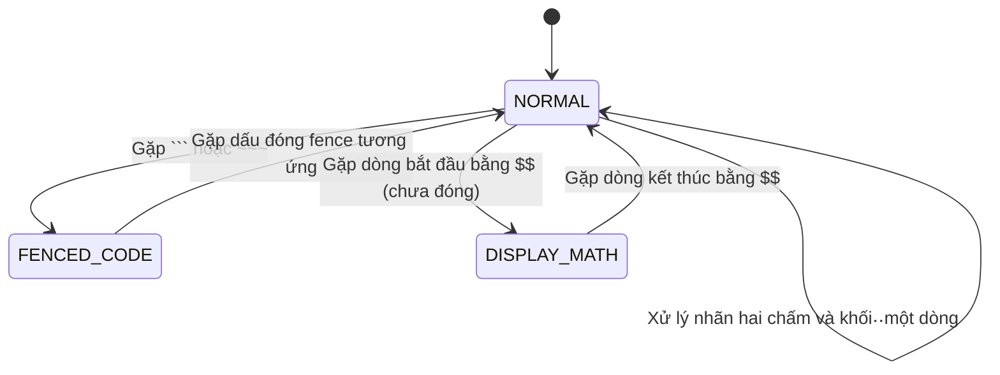
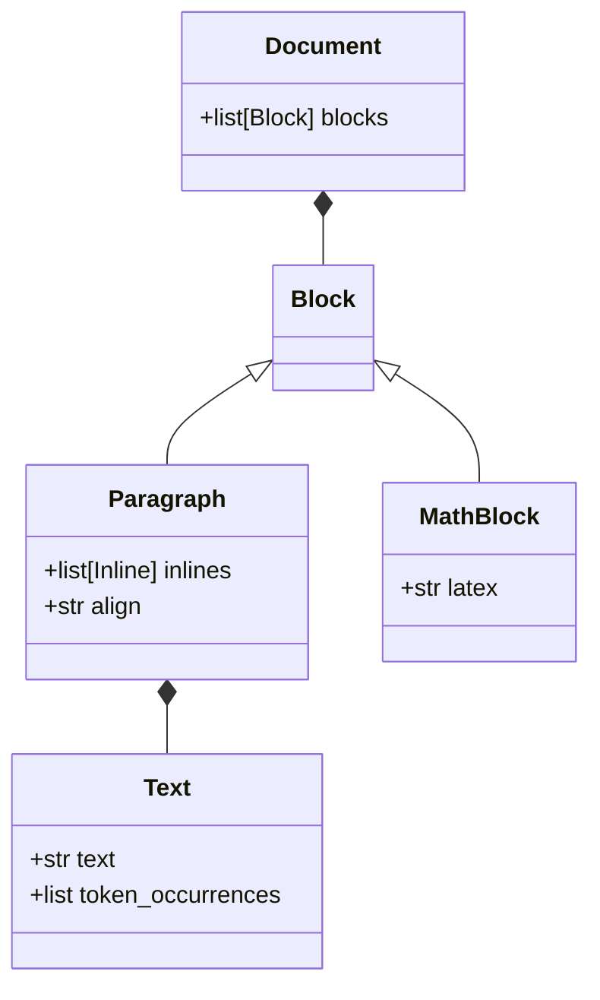
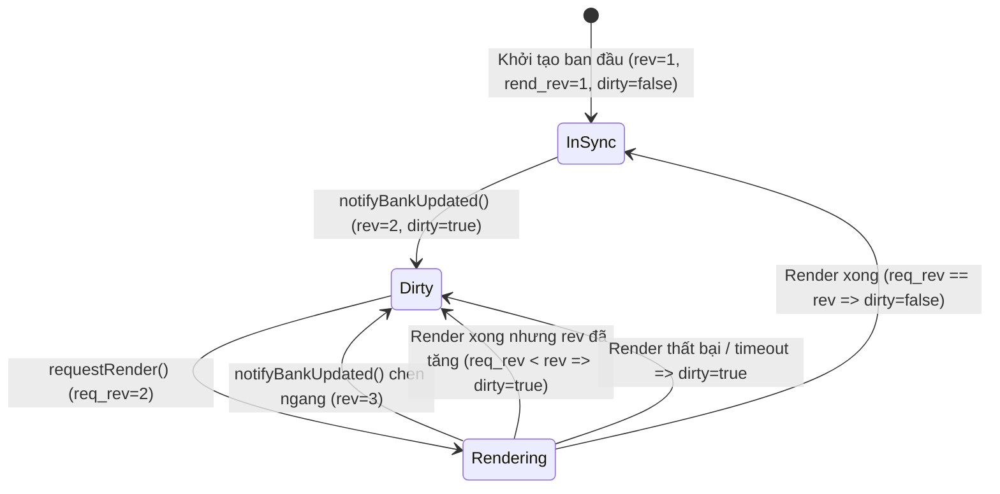
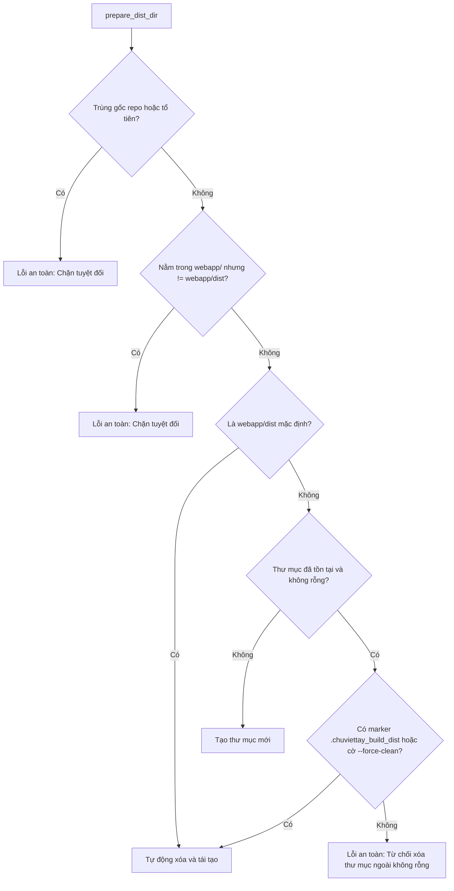

# Data Model: Gia Cố Nền Tảng Kho Mã Nguồn Hậu Rà Soát (054-repo-audit-hardening)

**Feature**: [054-repo-audit-hardening](spec.md)  
**Date**: 2026-10-23  

---

## 1. ScannerState & Phân đoạn Tiền xử lý Markdown

Mô hình trạng thái quản lý việc nhận diện ngữ cảnh và phân tách khối công thức display trong `MarkdownImporter`.



### Thuộc tính của Phân đoạn và Trạng thái

| Thực thể / Trạng thái | Kiểu dữ liệu | Ý nghĩa & Quy tắc |
| :--- | :--- | :--- |
| `NORMAL` | Trạng thái quét | Văn bản Markdown thông thường; cho phép tách nhãn hai chấm và dòng `$$...$$`. |
| `FENCED_CODE` | Trạng thái quét | Bên trong khối mã lập trình (code fence); **miễn nhiễm** với mọi phép thay đổi hay chèn dòng. |
| `DISPLAY_MATH` | Trạng thái quét | Bên trong khối công thức toán nhiều dòng đang mở; chỉ tìm dấu đóng `$$`. |
| `fence_char` | `str` (`'` hoặc `~`) | Ký tự mở khối mã hiện tại. |
| `fence_length` | `int` | Số lượng ký tự mở (tối thiểu 3); chỉ đóng khi số lượng ký tự đóng $\ge$ `fence_length`. |

---

## 2. Document IR & Tính Bất Biến (Immutability)

Cây biểu diễn trung gian của tài liệu do người dùng hoặc importer khởi tạo.



### Quy tắc Tính Bất Biến (Immutability Invariants)

1. **Caller Ownership Invariant**: Toàn bộ đối tượng thuộc cây `Document` truyền vào `DocumentLayoutEngine.layout()` hoặc `write_document()` thuộc quyền sở hữu của caller.
2. **Zero In-Place Mutation**:
   - `merged_inlines`: Khi gộp hai đối tượng `Text` kế tiếp nhau, hệ thống tạo đối tượng `Text` mới với `text` và `token_occurrences` đã gộp.
   - Các thuộc tính `text`, `inlines`, `blocks` của các nút gốc giữ nguyên địa chỉ bộ nhớ và giá trị ban đầu.
3. **Idempotence Invariant**: $N$ lần kết xuất trên cùng một `Document` với cùng cấu hình hình học và seed phải cho ra kết quả hình ảnh, tọa độ nét vẽ và cấu trúc IR giống nhau 100%.

---

## 3. Trạng thái Đồng bộ Bản xem trước & Kho mẫu (Bank Revision State)

Quản lý chu trình đồng bộ giữa trạng thái kho mẫu trong bộ xử lý nền (Worker) và giao diện xem trước (Tab Viết).



### Các trường trạng thái

| Thuộc tính | Kiểu dữ liệu | Phạm vi | Mô tả |
| :--- | :--- | :--- | :--- |
| `bankRevision` | `int` (tăng đơn điệu) | Module `write.js` | Số phiên bản của kho mẫu hiện hành. Tăng thêm 1 mỗi khi nạp, dạy mẫu hoặc đồng bộ kho. |
| `lastRenderedRevision` | `int` | Module `write.js` | Phiên bản kho mẫu của bản vẽ đang hiển thị trên màn hình xem trước. |
| `requestRevision` | `int` | Cục bộ tác vụ render | Phiên bản kho mẫu tại thời điểm gửi yêu cầu kết xuất tới Web Worker. |
| `isBankDirty` | `boolean` | Module `write.js` | Cờ báo hiệu bản xem trước đang hiển thị dữ liệu cũ (`lastRenderedRevision < bankRevision`). |

---

## 4. Danh mục Đóng gói Web & Khóa Cache Service Worker (Build Manifest)

Biểu diễn danh mục chuẩn tắc của gói phân phối web PWA phục vụ tính toán khóa cache Service Worker tái lập.

### Cấu trúc một mục tài nguyên (BuildManifestEntry)

```python
@dataclass(frozen=True)
class BuildManifestEntry:
    rel_path: str        # Đường dẫn tương đối chuẩn POSIX (vd: "js/app.js", "pyodide/chuviettay.zip")
    sha256_hash: str     # Mã băm SHA-256 nội dung tệp (64 ký tự hex)
    is_lazy: bool        # Tệp nằm trong danh mục tải trễ (optional_lazy) hay tải trước (precache)
```

### Quy tắc chuẩn tắc băm (Canonical Hashing Rules)
1. Sắp xếp danh sách `BuildManifestEntry` theo thứ tự tăng dần của `rel_path`.
2. Dòng băm chuẩn tắc cho mỗi mục: `f"{entry.rel_path}:{entry.sha256_hash}\n"`.
3. Băm SHA-256 toàn bộ chuỗi chuẩn tắc; lấy 12 ký tự đầu để tạo `CACHE_NAME = f"chuviettay-cache-{hash12}"`.

---

## 5. Chính sách An toàn Thư mục Phân phối (BuildDirSecurityPolicy)

Quy tắc thẩm định và bảo vệ thư mục đích khi chạy script đóng gói Web (`scripts/build_web.py`).


