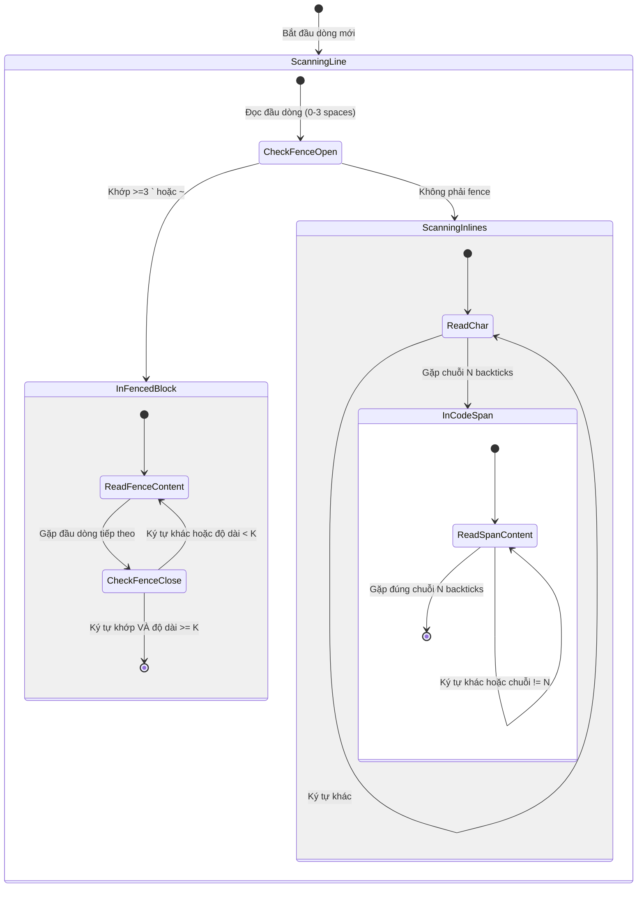
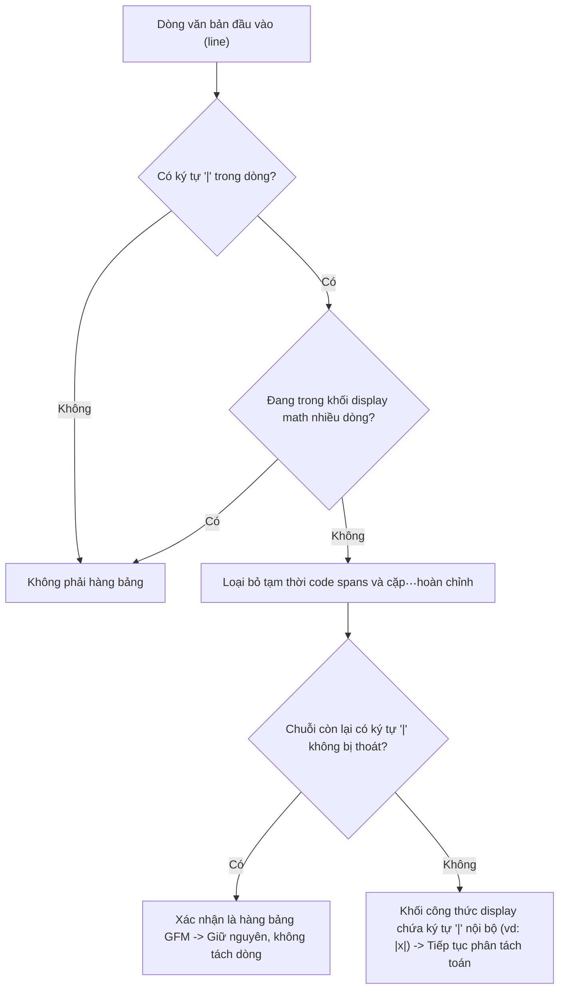

# Data Model & State Transitions: CommonMark Delimiters, Table Context & Build Safety

**Feature**: `055-parser-table-build-hardening`  
**Date**: 2026-10-23  
**Status**: Completed  

---

## 1. Entities & Types

### 1.1 CodeSegment

Đại diện cho một đoạn mã được phân tách từ văn bản Markdown (khối mã nhiều dòng hoặc đoạn mã nội tuyến).

```python
from dataclasses import dataclass
from enum import Enum

class CodeSegmentKind(Enum):
    FENCED_BLOCK = "fenced_block"  # Khối mã ``` hoặc ~~~ (độ dài >= 3)
    INLINE_SPAN = "inline_span"    # Đoạn mã nội tuyến `...`, ``...``
    TEXT = "text"                  # Văn bản Markdown thông thường

@dataclass(frozen=True)
class CodeSegment:
    kind: CodeSegmentKind
    content: str
    is_code: bool
    fence_char: str = ""           # '`' hoặc '~'
    fence_len: int = 0             # Số lượng ký tự phân cách mở
```

### 1.2 TableLineClassification

Đại diện cho kết quả phân loại một dòng văn bản trong bộ phân tách công thức display.

```python
@dataclass(frozen=True)
class TableLineClassification:
    is_table_row: bool
    has_unescaped_pipe_outside_math: bool
    stripped_text: str
```

### 1.3 BuildFileEntry

Đại diện cho một tệp được quét trong thư mục xuất bản Web Client.

```python
@dataclass(frozen=True)
class BuildFileEntry:
    rel_path: str                  # Đường dẫn tương đối chuẩn POSIX (vd: "js/app.js", "pyodide/chuviettay.zip")
    sha256_hash: str               # Mã băm SHA-256 của nội dung tệp
    is_hidden: bool                # True nếu tên tệp hoặc thư mục bắt đầu bằng dấu chấm
    is_marker: bool                # True nếu là .chuviettay_build_dist
    include_in_precache: bool      # True nếu được phép đưa vào PRECACHE_URLS của Service Worker
```

### 1.4 ScalabilityMeasurement

Đại diện cho số liệu đo lường hiệu năng của bộ nhập liệu.

```python
@dataclass(frozen=True)
class ScalabilityMeasurement:
    sample_size_1: int             # Kích thước mẫu N (vd: 2500 cặp dòng)
    sample_size_2: int             # Kích thước mẫu 2N (vd: 5000 cặp dòng)
    time_1_seconds: float          # Thời gian xử lý mẫu 1
    time_2_seconds: float          # Thời gian xử lý mẫu 2
    ratio: float                   # time_2_seconds / time_1_seconds
    is_linear: bool                # True nếu ratio <= 3.5 hoặc time_2 < 0.15s
    is_within_ceiling: bool        # True nếu time_2 < 2.0s
```

---

## 2. State Machine: CommonMark Code Segmentation



---

## 3. Table Row Detection Logic


