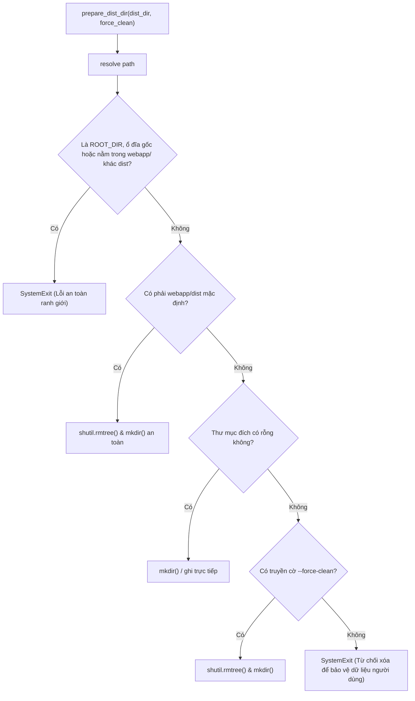
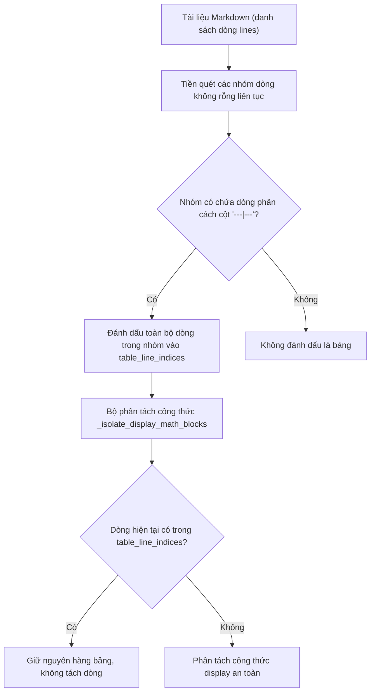

# Data Model & State Transitions: Build Safety & CommonMark Hardening

**Feature**: `056-build-safety-and-markdown-hardening`  
**Date**: 2026-10-23  
**Status**: Completed  

---

## 1. Entities & Types

### 1.1 ContextualCodeBlock

Đại diện cho khối mã trong các ngữ cảnh khác nhau của CommonMark.

```python
from dataclasses import dataclass
from enum import Enum

class CodeContext(Enum):
    ROOT_FENCE = "root_fence"        # Khối mã ở cấp gốc (``` hoặc ~~~)
    BLOCKQUOTE_FENCE = "bq_fence"    # Khối mã lồng trong blockquote (> ~~~)
    INDENTED_BLOCK = "indented"      # Khối mã thụt lề 4 dấu cách
    INLINE_SPAN = "inline_span"      # Đoạn mã nội tuyến `...`
    TEXT = "text"                    # Văn bản thông thường

@dataclass(frozen=True)
class ContextualCodeSegment:
    context: CodeContext
    content: str
    is_code: bool
    blockquote_prefix: str = ""      # Chuỗi trích dẫn (vd: "> ", ">> ")
    fence_char: str = ""             # '`' hoặc '~'
    fence_len: int = 0               # Độ dài ký tự mở
```

### 1.2 TableBlockBoundary

Đại diện cho ranh giới của một khối bảng GFM hợp lệ trong văn bản Markdown.

```python
@dataclass(frozen=True)
class TableBlockBoundary:
    start_line_index: int
    end_line_index: int
    has_delimiter_row: bool
    delimiter_line_index: int
```

### 1.3 DistDirSafetyCheck

Đại diện cho kết quả thẩm định an toàn thư mục xuất xưởng.

```python
@dataclass(frozen=True)
class DistDirSafetyCheck:
    target_path: Path
    is_default_dist: bool
    is_empty: bool
    force_clean_requested: bool
    action_allowed: bool
    rejection_reason: str = ""
```

---

## 2. Decision Flow: External Directory Safety



---

## 3. Context-Aware Table Detection Flow


