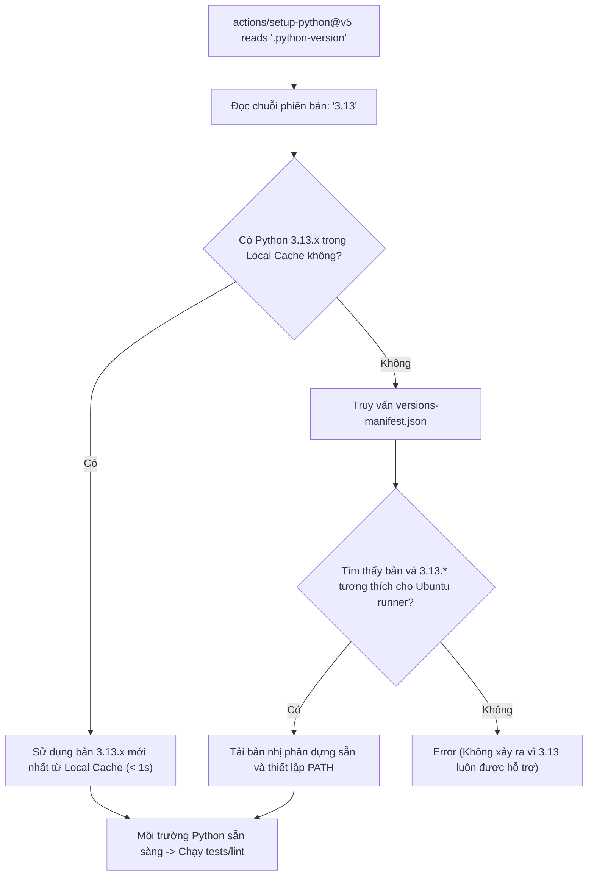

# Data Model & Configuration Schemas: Python Version Metadata

**Feature**: `057-fix-ci-python-version`  
**Date**: 2026-10-27  
**Status**: Completed  

---

## 1. Entities & Configuration Formats

### 1.1 PythonVersionFile (`.python-version`)

Tệp cấu hình môi trường chuẩn quy định phiên bản Python mặc định của repository.

```text
Format: Plain text (UTF-8, LF)
Pattern: ^\d+\.\d+$
Current Valid Value: "3.13"
```

- **Ràng buộc**:
  - Không chứa khoảng trắng thừa hoặc ký tự dòng trống ở đầu.
  - Phải là định dạng dòng phiên bản thứ cấp (Major.Minor), không ghim cứng bản vá vi mô (Patch).

---

### 1.2 RenderEnvironmentVariable (`render.yaml`)

Cấu hình khai báo biến môi trường cho dịch vụ Render Static Site.

```yaml
envVars:
  - key: PYTHON_VERSION
    value: "3.13"
```

- **Ràng buộc**:
  - Giá trị biến `PYTHON_VERSION` phải tương thích với giá trị trong `.python-version`.

---

## 2. Decision & Resolution Flow


