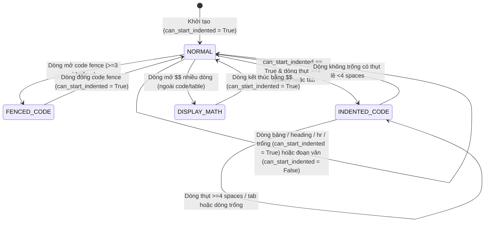

# Data Model & State Transitions: Feature 058

**Feature**: `058-ci-e2e-render-markdown-hardening`  
**Date**: 2026-10-27

---

## 1. Máy Trạng Thái Tiền Xử Lý trong `_isolate_display_math_blocks()`

Hàm `MarkdownImporter._isolate_display_math_blocks(seg: str) -> str` xử lý chuỗi văn bản qua 2 pha tuyến tính $O(n)$:

### 1.1 Pha 1: Tiền quét nhận diện cấu trúc bảng GFM (`table_line_indices`)
Xác định tập chỉ số dòng `table_line_indices: set[int]` thuộc các bảng GFM hợp lệ:

| Thuộc tính | Kiểu dữ liệu | Mô tả & Quy tắc |
| :--- | :--- | :--- |
| `d` | `int` | Chỉ số dòng phân cách (`d >= 1`), khớp mẫu hàng phân cách GFM, không nằm trong code fence / indented code block, có số cột $C_{\text{delim}} \ge 1$. |
| `h` | `int` | Chỉ số dòng tiêu đề (`h = d - 1`), không rỗng, không thụt lề $\ge 4$ dấu cách, chưa thuộc bảng trước đó, thỏa mãn `_is_table_line(lines[h])` và có số cột $C_{\text{header}} == C_{\text{delim}}$. |
| `body_range` | `range` | Các dòng dữ liệu liên tiếp `k = d + 1, d + 2, ...` thỏa mãn: không rỗng, không thụt lề $\ge 4$ dấu cách, không mở khối chắn (code fence, blockquote, heading, list, hr) và `_is_table_line(lines[k]) == True`. |

### 1.2 Pha 2: Máy trạng thái quét dòng (Single-Pass Line Scanner)



| Biến trạng thái | Kiểu dữ liệu | Ý nghĩa |
| :--- | :--- | :--- |
| `in_fence` | `bool` | Đang ở bên trong khối mã `FENCED_CODE` (` ``` ` hoặc `~~~`). |
| `fence_char` / `fence_len` | `str` / `int` | Ký tự và độ dài hàng rào mở của `FENCED_CODE`. |
| `in_indented_code` | `bool` | Đang ở bên trong khối mã thụt lề `INDENTED_CODE` (CommonMark 4.4). |
| `can_start_indented` | `bool` | Dòng hiện tại có được phép mở khối mã thụt lề hay không (`True` ở đầu tài liệu, sau dòng trống, hoặc sau khối không phải đoạn văn; `False` ngay sau dòng đoạn văn thường). |
| `in_display_math` | `bool` | Đang ở bên trong khối công thức `$$...$$` nhiều dòng. |

---

## 2. Cấu Trúc Bộ Nhớ Đệm Backtick Tuyến Tính $O(n)$

Áp dụng trong `_split_code_segments()` và `_find_code_spans()`:

| Thực thể / Biến | Kiểu dữ liệu | Bất biến (Invariant) |
| :--- | :--- | :--- |
| `backticks_scanned` | `bool` | `True` khi đã có ít nhất một lần quét tìm dấu đóng chạy tới hết chuỗi `n` mà không tìm thấy. |
| `backticks_max_pos` | `dict[int, int]` | Ánh xạ từ độ dài cụm backtick `closer_len` sang vị trí bắt đầu lớn nhất `match_start` của cụm có độ dài đó trong văn bản. Nếu `backticks_scanned == True` và `backticks_max_pos.get(span_len, 0) <= start_pos`, chắc chắn không tồn tại cụm đóng độ dài `span_len` sau `start_pos`. |

---

## 3. Cấu Hình Môi Trường & Tiện Ích Kiểm Thử Build

### 3.1 Nguồn phiên bản Python
- `.python-version`: Chứa chuỗi `"3.13\n"` — là nguồn duy nhất (Single Source of Truth) cho cả GitHub Actions (`actions/setup-python@v5`) và Render Static Site build.
- `render.yaml`: Không khai báo biến môi trường `PYTHON_VERSION` trong `envVars` (chỉ giữ `NODE_VERSION: 24.16.0`), để Render đọc trực tiếp từ `.python-version`.

### 3.2 Giao diện hàm tiện ích E2E `runBuildWeb`
- Tệp: `tests/e2e/sw-update.spec.ts`
- Chữ ký: `runBuildWeb(distDir: string, forceClean = false): void`
  - Khi `forceClean === false`: Thực thi `scripts/build_web.py --dist <distDir>`
  - Khi `forceClean === true`: Thực thi `scripts/build_web.py --dist <distDir> --force-clean`
