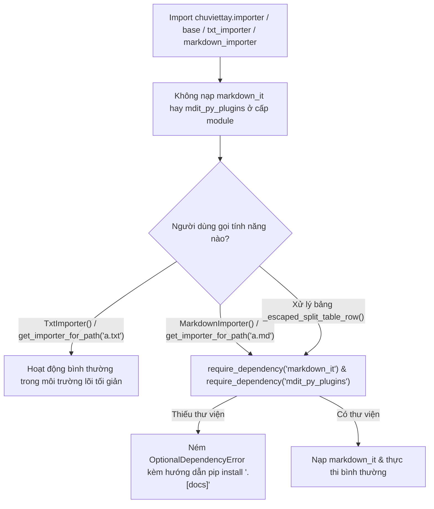

# Data Model & State Machine: Feature 059

**Feature**: `059-importer-deps-fence-hardening`
**Date**: 2026-10-28

---

## 1. Mô hình Trạng thái Khối Mã dùng chung (`FenceState` & `IndentedCodeState`)

Cả hai bộ tiền xử lý `_split_code_segments()` và `_isolate_display_math_blocks()` trong `chuviettay/importer/markdown_importer.py` cùng tuân theo mô hình trạng thái dòng theo chuẩn CommonMark:

### 1.1. Tiền tố Trích dẫn (`BlockquotePrefix`)

Trên mỗi dòng `line[line_start:line_end]`:
- Khớp biểu thức chính quy `_BQ_PREFIX_RE = re.compile(r"([ ]{0,3}>[ ]?)+")` tại `line_start`.
- **`bq_depth: int`**: Số lượng ký tự `>` trong phần tiền tố khớp được ($0$ nếu ở cấp gốc, $\ge 1$ nếu trong trích dẫn).
- **`pos_after_bq: int`**: Chỉ số ký tự ngay sau tiền tố trích dẫn.
- **`rest: str`**: Phần dòng sau tiền tố trích dẫn (`text[pos_after_bq:line_end]`).

### 1.2. Trạng thái Khối Mã Rào Chắn (`FencedCodeState`)

| Trường trạng thái | Kiểu dữ liệu | Ý nghĩa & Bất biến (Invariants) |
| :--- | :--- | :--- |
| `in_fence` | `bool` | Đang ở bên trong một khối mã rào chắn chưa đóng. |
| `fence_bq_depth` | `int` | Độ sâu trích dẫn (`bq_depth >= 0`) tại dòng mở khối mã rào chắn. |
| `fence_char` | `str` | Ký tự rào chắn: `` "`" `` hoặc `"~"`. |
| `fence_len` | `int` | Độ dài dãy ký tự rào chắn mở ($\ge 3$). |

#### Quy tắc chuyển trạng thái `FencedCodeState`:
1. **Mở khối (`in_fence == False` $\rightarrow$ `True`)**:
   - Tại đầu dòng (sau `pos_after_bq`), có $0 \le \text{indent} \le 3$ khoảng trắng, theo sau bởi dãy liên tiếp ký tự `fc` $\in \{\text{`}, \text{~}\}$ độ dài `flen >= 3`.
   - Phần còn lại của dòng sau dãy `fc` là `info_str`.
   - **Điều kiện hợp lệ**: `(fc == "~") or ("`" not in info_str)`.
   - Khi hợp lệ: đặt `in_fence = True`, `fence_bq_depth = bq_depth`, `fence_char = fc`, `fence_len = flen`.
2. **Đang trong khối (`in_fence == True`)**:
   - **Trường hợp 1 (`bq_depth < fence_bq_depth`)**: Khối trích dẫn chứa rào chắn đã kết thúc trước dòng hiện tại.
     - Đóng khối mã ngay trước dòng hiện tại (`in_fence = False`), **không tiêu thụ** dòng hiện tại trong trạng thái `in_fence` mà đánh giá lại dòng hiện tại như một dòng mới ngoài khối mã.
   - **Trường hợp 2 (`bq_depth > fence_bq_depth`)**: Dòng nằm ở cấp trích dẫn sâu hơn (ví dụ mở ở `>` nhưng dòng hiện tại bắt đầu bằng `>>`).
     - Các dấu `>` dư ra là nội dung văn bản mã bên trong rào chắn. Giữ `in_fence = True`, tiêu thụ dòng hiện tại nguyên vẹn.
   - **Trường hợp 3 (`bq_depth == fence_bq_depth`)**: Cùng ngữ cảnh trích dẫn.
     - Kiểm tra phần `rest` sau `pos_after_bq`: nếu khớp `^[ ]{0,3}(fence_char{fence_len,})[ \t]*$` thì đây là dòng đóng hợp lệ $\rightarrow$ tiêu thụ dòng hiện tại và đặt `in_fence = False`. Ngược lại, giữ `in_fence = True`.

---

### 1.3. Trạng thái Khối Mã Thụt Lề (`IndentedCodeState`)

| Trường trạng thái | Kiểu dữ liệu | Ý nghĩa & Bất biến (Invariants) |
| :--- | :--- | :--- |
| `in_indented_code` | `bool` | Đang ở bên trong khối mã thụt lề. |
| `indented_bq_depth` | `int` | Độ sâu trích dẫn (`bq_depth >= 0`) của khối mã thụt lề đang mở. |
| `can_start_indented` | `bool` | Dòng hiện tại có được phép bắt đầu một khối mã thụt lề mới hay không (đầu tài liệu, sau dòng trống, sau tiêu đề/HR/code fence/bảng, hoặc khi bước vào cấp trích dẫn mới sâu hơn). |

#### Quy tắc nhận diện dòng thụt lề:
- Xét phần `rest = text[pos_after_bq:line_end]`:
  - `is_indented_rest = (rest.startswith("    ") or rest.startswith("\t")) and (rest.strip() != "")`
- Khi `(can_start_indented or (in_indented_code and bq_depth == indented_bq_depth))` và `is_indented_rest`:
  - Dòng thuộc khối mã thụt lề ở độ sâu `indented_bq_depth = bq_depth`, bảo toàn nguyên vẹn từng ký tự.

---

## 2. Mô hình Kiểm tra Phụ thuộc Tùy chọn (`OptionalDependencyGuard`)

