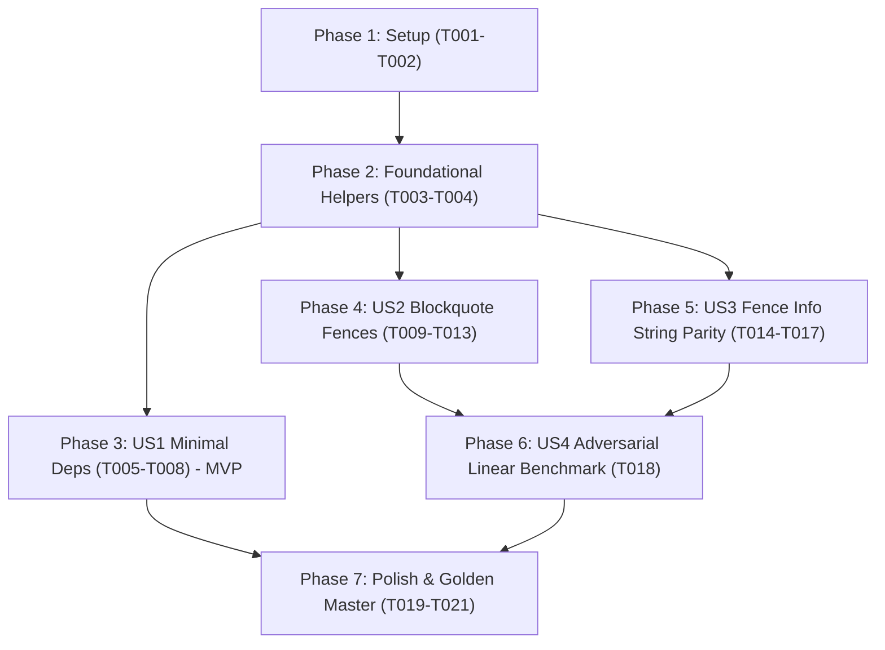

# Tasks: Bảo toàn tính tùy chọn của phụ thuộc tài liệu và đồng bộ nhận diện khối mã trong bộ nhập Markdown

**Input**: Design documents from `/specs/059-importer-deps-fence-hardening/`
**Prerequisites**: `plan.md`, `spec.md`, `research.md`, `data-model.md`, `contracts/importer-and-parser-contract.md`, `quickstart.md`

## Format: `[ID] [P?] [Story] Description with file path`

- **[P]**: Can run in parallel (different files or independent components)
- **[Story]**: User story identifier ([US1], [US2], [US3], [US4])
- File paths are exact and repository-relative

---

## Phase 1: Setup & Codebase Verification

**Purpose**: Xác minh trạng thái hiện tại của codebase và baseline trước khi triển khai

- [X] T001 Xác minh các bài test hiện tại của bộ nhập Markdown đang vượt qua trong `tests/test_markdown_math_block_isolation.py`
- [X] T002 Xác minh lỗi nạp module cấp cao khi thiếu thư viện tùy chọn trong `chuviettay/importer/markdown_importer.py`

---

## Phase 2: Foundational (Blocking Prerequisites)

**Purpose**: Xây dựng các hàm trợ giúp dùng chung làm nguồn chân lý duy nhất (Single Source of Truth) cho cả 2 bộ tiền xử lý

**CRITICAL**: Phải hoàn thành giai đoạn này trước khi đồng bộ logic mở/đóng fence trong US2 và US3

- [X] T003 Triển khai hàm trợ giúp `_parse_fence_open_line(cls, line: str) -> tuple[int, str, int] | None` xử lý CRLF `\r`, trích xuất độ sâu trích dẫn `bq_depth`, kiểm tra dãy rào chắn $\ge 3$ ký tự và xác thực quy tắc CommonMark cho info string trong `chuviettay/importer/markdown_importer.py`
- [X] T004 Triển khai hàm trợ giúp `_is_fence_close_line(cls, line: str, open_bq_depth: int, fence_char: str, fence_len: int) -> bool` xử lý CRLF `\r`, đối chiếu chính xác `line_bq_depth == open_bq_depth` và kiểm tra ký tự rào chắn đóng trong `chuviettay/importer/markdown_importer.py`

**Checkpoint**: Nền tảng hàm trợ giúp sẵn sàng — có thể triển khai các User Story độc lập

---

## Phase 3: User Story 1 - Sử dụng bản cài đặt tối giản không cần thư viện tài liệu mở rộng (Priority: P1) 🎯 MVP

**Goal**: Đảm bảo gói cài đặt tối giản (không có `markdown-it-py`) vẫn nạp được package `chuviettay.importer`, `TxtImporter`, `get_importer_for_path(..., format_name="txt")` và controller mà không bị `ModuleNotFoundError` ở cấp module.

**Independent Test**: Mô phỏng môi trường thiếu `markdown_it` và `mdit_py_plugins`: nạp `chuviettay.importer`, `TxtImporter`, kiểm tra chuyển đổi văn bản thuần túy thành công; gọi `MarkdownImporter()` ném đúng `OptionalDependencyError`.

### Tests for User Story 1

- [X] T005 [P] [US1] Viết bài kiểm thử mô phỏng môi trường thiếu `markdown_it` nạp gói `chuviettay.importer`, `TxtImporter`, `get_importer_for_path()` định dạng txt và controller thành công trong `tests/test_markdown_math_block_isolation.py`
- [X] T006 [P] [US1] Viết bài kiểm thử xác nhận khởi tạo `MarkdownImporter()`, `get_importer_for_path("a.md")` hoặc hàm xử lý bảng khi thiếu thư viện ném đúng `OptionalDependencyError` trong `tests/test_markdown_math_block_isolation.py`

### Implementation for User Story 1

- [X] T007 [US1] Xóa bỏ lệnh import cấp module `from markdown_it.rules_block.table import escapedSplit` trong `chuviettay/importer/markdown_importer.py`
- [X] T008 [US1] Triển khai hàm trợ giúp `_escaped_split_table_row(cls, line_str: str) -> list[str]` gọi `require_dependency("markdown_it", ...)` trước khi import `escapedSplit` và thay thế lệnh gọi trong `_count_header_cols` trong `chuviettay/importer/markdown_importer.py`

**Checkpoint**: User Story 1 hoàn tất — bản cài đặt tối giản hoạt động trọn vẹn, không còn rò rỉ phụ thuộc tùy chọn ở cấp module

---

## Phase 4: User Story 2 - Bảo toàn khối mã rào chắn trong các cấp trích dẫn lồng nhau (Priority: P2)

**Goal**: Ràng buộc độ sâu trích dẫn khi đóng code fence (không đóng nhầm trước `>> ``` ` khi mở ở `>`), tự động đóng khi thoát khỏi trích dẫn (`line_bq_depth < open_bq_depth`), và bảo toàn khối mã thụt lề bên trong trích dẫn.

**Independent Test**: Nhập tài liệu có code fence mở trong `>` chứa dòng `>> ``` ` và `> $$x=1$$`, xác nhận không bị đóng sớm; nhập khối mã thụt lề trong trích dẫn `>     prefix:$$x=1$$`, xác nhận giữ nguyên ký tự và không bị xé dòng.

### Tests for User Story 2

- [X] T009 [P] [US2] Viết bài kiểm thử code fence mở trong `>` không bị đóng bởi dòng đóng giả `>> ``` `, công thức `> $$x=1$$` sau dòng đóng giả được giữ nguyên vẹn trong `tests/test_markdown_math_block_isolation.py`
- [X] T010 [P] [US2] Viết bài kiểm thử code fence mở trong `>>` tự động đóng khi dòng tiếp theo rơi về `>` hoặc dòng trống không có `>` trong `tests/test_markdown_math_block_isolation.py`
- [X] T011 [P] [US2] Viết bài kiểm thử khối mã thụt lề bên trong blockquote (`>     prefix:$$x=1$$`) không bị xé dòng bởi `colon_match` và giữ nguyên ký tự trong `tests/test_markdown_math_block_isolation.py`

### Implementation for User Story 2

- [X] T012 [US2] Cập nhật logic theo dõi rào chắn trong `_split_code_segments()`: ghi nhận `fence_bq_depth`, dùng `_is_fence_close_line()`, xử lý tự đóng khi `line_bq_depth < fence_bq_depth`, và nhận diện khối mã thụt lề sau tiền tố trích dẫn trong `chuviettay/importer/markdown_importer.py`
- [X] T013 [US2] Cập nhật logic theo dõi rào chắn trong `_isolate_display_math_blocks()`: ghi nhận `fence_bq_depth`, dùng `_is_fence_close_line()`, xử lý tự đóng khi `line_bq_depth < fence_bq_depth`, và bảo vệ khối mã thụt lề sau tiền tố trích dẫn trước bước `colon_match` trong `chuviettay/importer/markdown_importer.py`

**Checkpoint**: User Story 2 hoàn tất — code fence và indented code block trong blockquote hoạt động chuẩn xác theo CommonMark

---

## Phase 5: User Story 3 - Xử lý nhất quán dòng mở rào chắn mã có chuỗi thông tin không hợp lệ (Priority: P2)

**Goal**: Đồng bộ tuyệt đối điều kiện mở code fence giữa `_split_code_segments()` và `_isolate_display_math_blocks()`, loại trừ các dòng backtick có chuỗi thông tin chứa backtick (` ```info`invalid ` `).

**Independent Test**: Nhập tài liệu có dòng ```` ```info`invalid ```` theo sau bởi `ta có:$$x=1$$`, xác nhận cả hai bước tiền xử lý đều không coi là code fence và công thức được tách thành `MathBlock`.

### Tests for User Story 3

- [X] T014 [P] [US3] Viết bài kiểm thử dòng backtick có chuỗi thông tin chứa backtick không mở code fence, các công thức ở dòng sau vẫn được tách thành `MathBlock` trong `tests/test_markdown_math_block_isolation.py`
- [X] T015 [P] [US3] Viết bài kiểm thử dòng ngã `~~~info`valid` vẫn mở code fence hợp lệ theo chuẩn CommonMark trong `tests/test_markdown_math_block_isolation.py`

### Implementation for User Story 3

- [X] T016 [US3] Đồng bộ việc phát hiện dòng mở fence trong `_split_code_segments()` sang sử dụng trực tiếp `_parse_fence_open_line()` trong `chuviettay/importer/markdown_importer.py`
- [X] T017 [US3] Đồng bộ việc phát hiện dòng mở fence trong `_isolate_display_math_blocks()` sang sử dụng trực tiếp `_parse_fence_open_line()` trong `chuviettay/importer/markdown_importer.py`

**Checkpoint**: User Story 3 hoàn tất — hai bộ tiền xử lý đạt sự đồng thuận 100% về điều kiện mở rào chắn

---

## Phase 6: User Story 4 - Đảm bảo độ ổn định và hiệu năng tuyến tính trước các mẫu dữ liệu đối kháng (Priority: P2)

**Goal**: Đảm bảo toàn bộ chuỗi tiền xử lý hoạt động tuyến tính $O(n)$ trên các mẫu dữ liệu bất lợi kết hợp (nhiều độ dài backtick chưa đóng 1–6 backticks, dòng dài, blockquote lồng nhau).

**Independent Test**: Đo thời gian thực thi $T(N), T(2N), T(4N)$ trên mẫu dữ liệu bất lợi hỗn hợp, xác nhận $T(4N)/T(N) \le 6.0$ vô điều kiện và nội dung đầu ra khớp 100%.

### Tests & Benchmarks for User Story 4

- [X] T018 [US4] Bổ sung kiểm thử hiệu năng đối kháng hỗn hợp với đa độ dài backtick không đóng (1–6 ký tự), dòng dài và trích dẫn, đo đạc với warmup và khẳng định $T(4N)/T(N) \le 6.0$ trong `tests/test_markdown_math_block_isolation.py`

**Checkpoint**: User Story 4 hoàn tất — độ phức tạp tuyến tính được bảo đảm cả về mặt lý thuyết lẫn thực nghiệm

---

## Phase 7: Polish & Cross-Cutting Verification

**Purpose**: Kiểm chứng toàn diện chống hồi quy trên toàn bộ dự án

- [X] T019 [P] Chạy toàn bộ bộ kiểm thử Python `pytest` xác nhận 100% test case vượt qua
- [X] T020 [P] Chạy kiểm thử Web Client `npm run test:unit` xác nhận không có hồi quy
- [X] T021 Chạy kiểm thử Golden Master Pyodide `node scripts/test_golden_pyodide.mjs` xác nhận khớp 8/8 mã băm SHA-256

---

## Dependencies & Execution Order



### Parallel Opportunities

- **T005 & T006**: Có thể viết các bài test môi trường tối giản song song.
- **T009, T010, T011**: Có thể viết các bài test trích dẫn lồng nhau và indented code trong blockquote song song.
- **T014 & T015**: Có thể viết các bài test info string fence song song.
- **T019 & T020**: Chạy `pytest` và `npm run test:unit` song song ở bước hoàn tất.

---

## Implementation Strategy

### MVP First (User Story 1 Only)
1. Hoàn thành Phase 1 (Setup) và Phase 2 (Foundational: T003, T004).
2. Hoàn thành Phase 3 (US1: T005, T006, T007, T008).
3. **VALIDATE MVP**: Kiểm tra import môi trường tối giản và `TxtImporter` thành công mà không cần cài đặt `markdown-it-py`.

### Incremental Delivery
1. Giao MVP (US1) để giải quyết ngay vấn đề P1 tương thích môi trường.
2. Tích hợp US2 (Blockquote context & indented code block) $\rightarrow$ chạy test US2.
3. Tích hợp US3 (Đồng bộ quy tắc mở fence) $\rightarrow$ chạy test US3.
4. Bổ sung US4 (Benchmark đối kháng đa độ dài) $\rightarrow$ xác nhận $T(4N)/T(N) \le 6.0$.
5. Chạy Golden Master 8/8 SHA-256 để hoàn tất toàn bộ chu trình.
