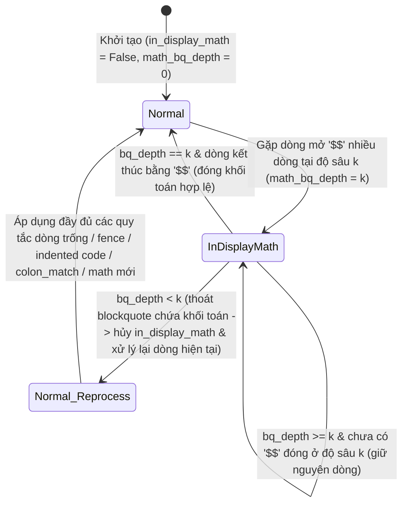

# Data Model & State Machine: Feature 060

**Feature**: `060-blockquote-math-state-hardening`
**Date**: 2026-10-28

---

## 1. Máy trạng thái Khối Toán Hiển Thị Nhiều Dòng (`DisplayMathState`)

Trong `MarkdownImporter._isolate_display_math_blocks()`, trạng thái khối toán hiển thị nhiều dòng (`$$...$$`) được quản lý bởi bộ 3 biến trạng thái:

| Trường trạng thái | Kiểu dữ liệu | Giá trị mặc định | Ý nghĩa & Bất biến (Invariants) |
| :--- | :--- | :--- | :--- |
| `in_display_math` | `bool` | `False` | Đang ở bên trong một khối toán hiển thị nhiều dòng chưa đóng. |
| `math_bq_depth` | `int` | `0` | Độ sâu trích dẫn (`bq_depth >= 0`, tức số dấu `>`) tại dòng mở khối toán. |
| `math_indent` | `str` | `""` | Tiền tố trích dẫn kết hợp khoảng trắng thụt lề hợp lệ của khối toán đang mở. |

---

## 2. Sơ đồ chuyển trạng thái `in_display_math`

### Quy tắc chi tiết khi `in_display_math == True`:

1. **Khi `bq_depth < math_bq_depth` (Thoát khỏi khối trích dẫn chứa công thức)**:
   - Đặt `in_display_math = False`, `math_bq_depth = 0`, `math_indent = ""`, `can_start_indented = True`.
   - Nếu `stripped != ""` và dòng cuối trong `out_lines` không trống (`out_lines and out_lines[-1].strip() != ""`), chèn dòng phân cách theo độ sâu mới (`bq_pref.rstrip()` nếu `bq_depth > 0`, hoặc `""` nếu `bq_depth == 0`) để ngăn CommonMark gộp dòng hiện tại làm *lazy continuation* của khối trích dẫn cũ.
   - Chuyển sang xử lý dòng hiện tại như một dòng thông thường từ bước kiểm tra dòng trống / code fence / indented code / bảng / `colon_match` / `$$`.
2. **Khi `bq_depth == math_bq_depth` và `stripped_rest` kết thúc bằng `$$` (hoặc `$$` kèm dấu câu `[,.;:!?]`)**:
   - Đưa `line` vào `out_lines`.
   - Đặt `in_display_math = False`, `math_bq_depth = 0`, `can_start_indented = True`.
   - Nếu dòng kế tiếp (`idx + 1 < n`) không trống, chèn dòng phân cách (`""` nếu dòng kế tiếp có độ sâu trích dẫn nhỏ hơn `bq_depth`, ngược lại `math_indent.rstrip()`).
3. **Các trường hợp còn lại (`bq_depth >= math_bq_depth` và chưa kết thúc khối toán)**:
   - Đưa `line` vào `out_lines` và chuyển sang dòng tiếp theo.
