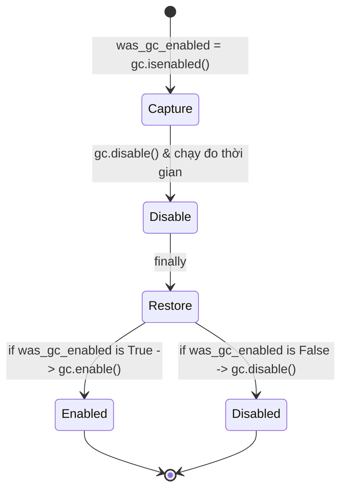

# Data Model & Verification Invariants: Feature 061

**Feature**: `061-test-depth-and-benchmark-hardening`
**Date**: 2026-10-28

---

## 1. Mô hình Bất biến Kiểm thử Khối Toán Trích Dẫn Lồng Nhau

Trong ca kiểm thử lồng nhau:
```markdown
> $$
> x = 1
>> $$
> x = 2
> $$
```

Các thuộc tính và trạng thái được kiểm chứng:

| Giai đoạn kiểm tra | Thuộc tính / Đối tượng | Giá trị kỳ vọng | Ý nghĩa kiểm chứng |
| :--- | :--- | :--- | :--- |
| **Tiền xử lý** | `isolated_nested.strip()` | `"> $$\n> x = 1\n>> $$\n> x = 2\n> $$"` | Khối toán duy nhất, không bị ngắt bởi `>> $$` ở dòng 3. |
| **Cấu trúc IR** | `len(math_blocks)` | `1` | Không sinh thêm khối `MathBlock` phụ hay phân rã thành các đoạn văn bản lỗi. |
| **Nội dung LaTeX** | `math_blocks[0].latex` | Chứa cả `x = 1` và `x = 2` | Toàn bộ biểu thức được giữ nguyên trong cùng một khối công thức hiển thị. |

---

## 2. Mô hình Bất biến Đầu Ra Benchmark ($N, 2N, 4N$)

| Mẫu dữ liệu đầu vào | Chỉ số bất biến | $N = 1000$ | $2N = 2000$ | $4N = 4000$ | Trạng thái bảo toàn |
| :--- | :--- | :---: | :---: | :---: | :--- |
| `mod == 1` (`> {bts}... và $$display_formula$$`) | `out.count("$$display_formula$$")` | 250 | 500 | 1000 | Công thức hiển thị trong blockquote được bảo toàn. |
| `mod == 3` (`Dòng cấp gốc ... kèm $$x=1$$`) | `out.count("$$x=1$$")` | 250 | 500 | 1000 | Công thức hiển thị cấp gốc được bảo toàn. |
| `mod == 0` (`chuỗi rất dài {'x'*80}`) | `out.count("x" * 80)` | 250 | 500 | 1000 | Chuỗi dài và rào chắn độ sâu 2 nguyên vẹn. |
| `mod == 3` (`chuỗi dài {'y'*60}`) | `out.count("y" * 60)` | 250 | 500 | 1000 | Chuỗi dài cấp gốc nguyên vẹn. |
| `mod == 0` | `out.count("unclosed_depth2_")` | 250 | 500 | 1000 | Ký hiệu mã độ sâu 2 nguyên vẹn. |
| `mod == 1` | `out.count("unclosed_depth1_")` | 250 | 500 | 1000 | Ký hiệu mã độ sâu 1 nguyên vẹn. |
| `mod == 2` | `out.count("no_space_bq_")` | 250 | 500 | 1000 | Ký hiệu mã không khoảng trắng nguyên vẹn. |
| `mod == 2` | `out.count("code_span")` | 250 | 500 | 1000 | Đoạn mã trong dòng nguyên vẹn. |

---

## 3. Máy Trạng Thái Garbage Collector (GC State Hygiene)


