# Data Model: Feature 062

**Date**: 2026-10-28 | **Spec**: [spec.md](./spec.md) | **Research**: [research.md](./research.md)

Feature không thêm dữ liệu lưu trữ; các "thực thể" là giá trị trung gian trong pipeline nhập Markdown.

## 1. Fake Close Marker (dấu đóng giả)

| Thuộc tính | Mô tả |
|---|---|
| Điều kiện nhận diện | Đang `in_display_math` tại độ sâu `math_bq_depth`; dòng hiện tại có `bq_depth > math_bq_depth`; phần sau tiền tố trích dẫn kết thúc bằng `$$`, có thể kèm khoảng trắng và tối đa 1 dấu câu `[,.;:!?]` rồi khoảng trắng |
| Biến đổi | `$$` cuối dòng → `placeholder`; phần đuôi (dấu câu + khoảng trắng) giữ nguyên |
| Không áp dụng | Dòng ở `bq_depth == math_bq_depth` (đó là dấu đóng thật); dòng ở `bq_depth < math_bq_depth` (thoát khối chứa); dòng ngoài khối toán; khối mã |

## 2. Internal Placeholder (dấu giữ chỗ nội bộ)

| Thuộc tính | Giá trị / Quy tắc |
|---|---|
| Kiểu | Chuỗi 1 ký tự |
| Miền | U+E000 … U+F8FF (BMP Private Use Area) |
| Chọn | Ký tự nhỏ nhất trong miền **không có** trong văn bản đầu vào sau chuẩn hóa dấu phân cách |
| Không chọn được | `None` → không thay thế dấu đóng giả (fallback bảo toàn dữ liệu) |
| Vòng đời | Sinh ở `import_text()` → chèn ở `_isolate_display_math_blocks()` → khôi phục về `$$` trên toàn bộ cây token sau `md.parse()` → **không tồn tại** trong `Document` đầu ra |

### Bất biến

- **INV-1**: `placeholder ∉ input_text` (đảm bảo bởi cách chọn) ⇒ mọi lần xuất hiện của `placeholder` sau tiền xử lý đều do bộ tiền xử lý tạo ra.
- **INV-2**: Sau khôi phục, `placeholder` xuất hiện 0 lần trong mọi `token.content`, `token.info`, `ImportResult.unsupported` và mọi node của `Document`.
- **INV-3**: Không có phép biến đổi nào khác lên nội dung công thức: `MathBlock.latex == token_content.strip()` (sau khôi phục dấu giữ chỗ).

## 3. Luồng trạng thái

```mermaid
flowchart LR
    A["Văn bản người dùng"] --> B["_normalize_math_delimiters"]
    B --> C["_choose_fake_close_placeholder"]
    C --> D["_isolate_display_math_blocks(placeholder)"]
    D --> E["_sanitize_html"]
    E --> F["md.parse"]
    F --> G["_restore_fake_close_placeholder(tokens)"]
    G --> H["_parse_blocks (không còn replace)"]
    H --> I["Document IR"]
```

