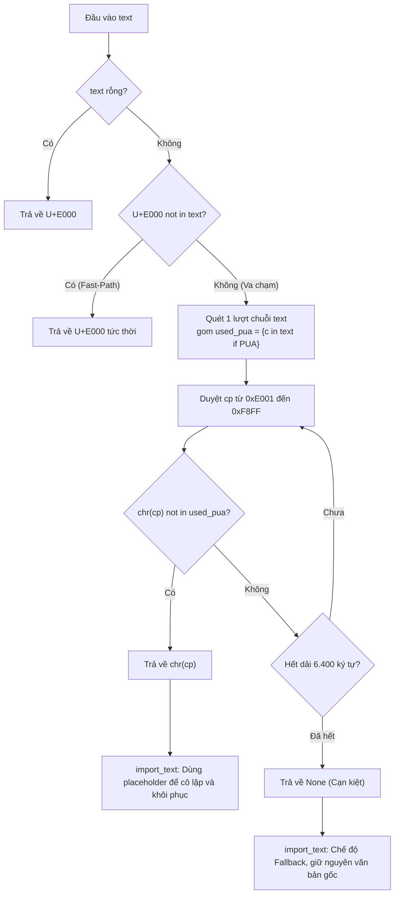

# Data Model: Cơ chế chọn và xử lý ký tự giữ chỗ PUA

**Branch**: `063-pua-placeholder-optimization` | **Date**: 2026-10-28 | **Spec**: [spec.md](./spec.md)

---

## 1. Entities & Data Structures

### 1.1. BMP PUA Range (Dải ký tự Private Use Area trên BMP)
- **Điểm mã bắt đầu (`_FAKE_CLOSE_PUA_START`)**: `0xE000` (ký tự `\ue000`)
- **Điểm mã kết thúc (`_FAKE_CLOSE_PUA_END`)**: `0xF8FF` (ký tự `\uf8ff`)
- **Tổng dung lượng (`_FAKE_CLOSE_PUA_COUNT`)**: `_FAKE_CLOSE_PUA_END - _FAKE_CLOSE_PUA_START + 1` ($6.400$ điểm mã)
- **Vai trò**: Vùng ký tự Unicode dành riêng cho ứng dụng nội bộ, đảm bảo không xung đột với các ký tự chuẩn của văn bản ngôn ngữ tự nhiên hay cú pháp Markdown/LaTeX thông thường.

### 1.2. Fast-Path Candidate (Ký tự ứng viên nhanh)
- **Giá trị**: `chr(0xE000)` (`\ue000`)
- **Vai trò**: Ký tự đầu tiên trong dải PUA, được kiểm tra ưu tiên trong thời gian $O(1)$ mà không cần cấp phát thêm bộ nhớ.
- **Hành vi**: Nếu `first_pua not in text`, trả về ngay lập tức.

### 1.3. Present PUA Set (Tập hợp PUA hiện diện trong văn bản)
- **Kiểu dữ liệu**: `set[int]` (tập hợp các điểm mã số nguyên)
- **Phạm vi tồn tại**: Biến cục bộ trong lời gọi hàm `_choose_fake_close_placeholder(text)` khi xảy ra va chạm với `first_pua`.
- **Nguồn gốc**: Xây dựng qua lọc từ `set(text)` (được CPython tối ưu hóa mức C):
  $$\text{used\_cps} = \{ \operatorname{ord}(c) \mid c \in \operatorname{set}(text) \land 0xE000 \le \operatorname{ord}(c) \le 0xF8FF \}$$
- **Kích thước**: Tối đa 6.400 phần tử ($0 \le |\text{used\_cps}| \le 6.400$).

### 1.4. Placeholder Selection Result (Kết quả chọn ký tự)
- **Kiểu dữ liệu**: `str | None`
- **Trạng thái thành công (`str`)**:
  - Chuỗi gồm đúng 1 ký tự $ch$ sao cho:
    $$ch \in [\text{U+E000}, \text{U+F8FF}] \quad \text{và} \quad ch \notin text$$
- **Trạng thái cạn kiệt (`None`)**:
  - Xảy ra khi:
    $$|\text{used\_cps}| = 6.400 \iff \forall cp \in [0xE000, 0xF8FF]: cp \in \text{used\_cps}$$

---

## 2. Invariants (Các bất biến hệ thống)

- **INV-1: Tính không va chạm (Non-Collision Guarantee)**:
  Nếu `placeholder = _choose_fake_close_placeholder(text)` trả về một chuỗi ký tự, thì đảm bảo $100\%$ rằng `placeholder not in text`. Ký tự này an toàn tuyệt đối để làm dấu giữ chỗ trung gian mà không sợ nhầm lẫn với nội dung do người dùng viết.
- **INV-2: Tính cực tiểu tất định (Deterministic Minimal Codepoint)**:
  Ký tự được chọn luôn là ký tự có giá trị `ord(ch)` nhỏ nhất trong dải $[0xE000, 0xF8FF]$ không có mặt trong `text`.
- **INV-3: Tính đầy đủ khi cạn kiệt (Exhaustion Completeness)**:
  Hàm trả về `None` khi và chỉ khi toàn bộ 6.400 ký tự trong dải PUA đều xuất hiện trong `text`.
- **INV-4: Dự phòng an toàn & bảo toàn dữ liệu (Graceful Fallback & Data Preservation)**:
  Khi `placeholder is None`:
  - `_isolate_display_math_blocks` giữ nguyên mọi dòng đầu vào không thay đổi.
  - `_restore_fake_close_placeholder` không thực hiện bất kỳ phép thay thế nào.
  - Mọi ký tự PUA thuộc về văn bản gốc của người dùng được giữ nguyên từng ký tự, không bị xóa hay thay đổi.

---

## 3. Lifecycle & Data Flow

