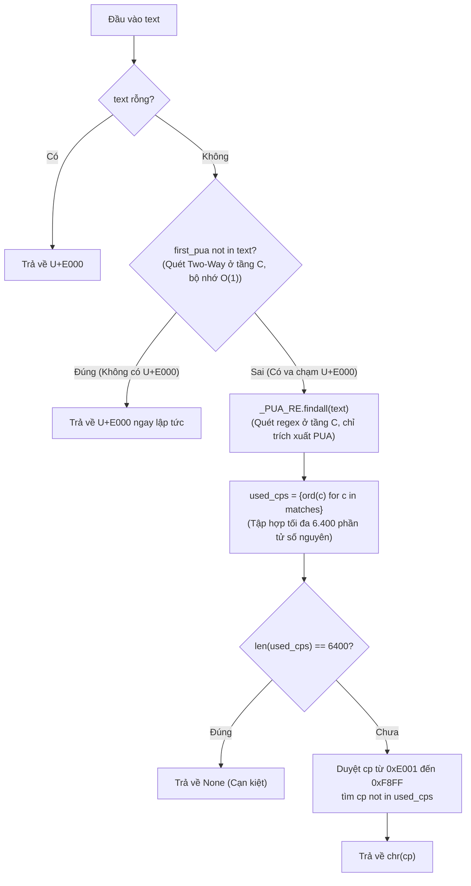

# Data Model: Cấu trúc dữ liệu khống chế bộ nhớ PUA và đo lường thống kê

**Branch**: `064-pua-memory-and-benchmark` | **Date**: 2026-10-28 | **Spec**: [spec.md](./spec.md)

---

## 1. Entities & Data Structures

### 1.1. PUA Range & Extractor Constants
- **`_FAKE_CLOSE_PUA_START`**: `0xE000` (điểm mã PUA khởi đầu)
- **`_FAKE_CLOSE_PUA_END`**: `0xF8FF` (điểm mã PUA kết thúc)
- **`_FAKE_CLOSE_PUA_COUNT`**: `_FAKE_CLOSE_PUA_END - _FAKE_CLOSE_PUA_START + 1` ($6.400$ điểm mã)
- **`_PUA_RE`**: `re.compile(r"[\uE000-\uF8FF]")` — Biểu thức chính quy được biên dịch sẵn ở cấp module, tối ưu hóa việc quét và trích xuất điểm mã PUA ở tầng C mà không nạp các ký tự thông thường vào bộ nhớ.

### 1.2. Bounded Present PUA Set (Tập hợp PUA bị chặn cứng)
- **Kiểu dữ liệu**: `set[int]`
- **Nguồn gốc**: Xây dựng qua bộ lặp phát hiện PUA `_PUA_RE.finditer(text)`, dừng sớm ngay khi đạt đủ 6.400 phần tử:
  $$\text{used\_cps} = \{ \operatorname{ord}(m\text{.group}(0)) \mid m \in \text{\_PUA\_RE.finditer}(text) \}$$
- **Ràng buộc kích thước**:
  $$0 \le |\text{used\_cps}| \le \text{\_FAKE\_CLOSE\_PUA\_COUNT} = 6.400$$
- **Đặc tính**: Tuyệt đối không chứa bất kỳ ký tự hoặc điểm mã nào ngoài dải $[0xE000, 0xF8FF]$. Bộ nhớ phụ độc lập với độ dài hoặc tính đa dạng của bảng chữ cái trong văn bản, không tạo danh sách trung gian.

### 1.3. Benchmark Run Sample (Mẫu đo lường hiệu năng)
- **Cấu trúc dữ liệu**: `list[tuple[float, float, float]]` gồm 5 phần tử:
  $$S = \{ (T(N)_k, T(4N)_k, R_k) \mid k \in [1..5], R_k = T(4N)_k / T(N)_k \}$$
- **Thống kê đại diện (Representative Metric)**:
  $$R_{\text{med}} = \operatorname{median}(\{ R_1, R_2, R_3, R_4, R_5 \})$$
- **Quy tắc nghiệm thu**: $R_{\text{med}} \le 6.0$.

---

## 2. Invariants (Các bất biến hệ thống)

- **INV-1: Khống chế bộ nhớ phụ tối đa (Strict Memory Bound)**:
  Với mọi văn bản đầu vào bất kỳ, số lượng phần tử của `used_cps` luôn thỏa mãn $|\text{used\_cps}| \le 6.400$. Mọi ký tự ngoài dải PUA bị bỏ qua hoàn toàn ở tầng C của regex engine, không chiếm giữ bộ nhớ heap của Python.
- **INV-2: Tính cực tiểu tất định (Deterministic Minimal Codepoint)**:
  Ký tự được chọn luôn là ký tự có giá trị `ord(ch)` nhỏ nhất trong dải $[0xE000, 0xF8FF]$ không có mặt trong `text`.
- **INV-3: Tính đầy đủ khi cạn kiệt (Exhaustion Completeness)**:
  Hàm trả về `None` khi và chỉ khi $|\text{used\_cps}| == 6.400$.
- **INV-4: Tính khách quan không thiên vị của Benchmark (Unbiased Metric)**:
  Bài kiểm thử hiệu năng đối kháng đánh giá dựa trên giá trị trung vị của mẫu cố định gồm 5 lượt chạy độc lập, không sử dụng cơ chế chọn lọc nhánh có giá trị thấp hơn (`min`).

---

## 3. Data Flow Diagram

